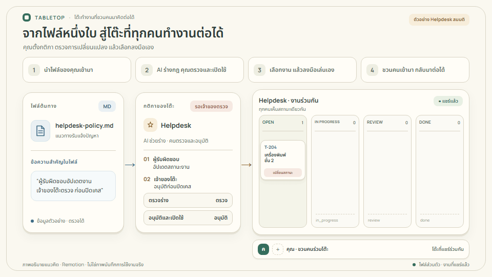
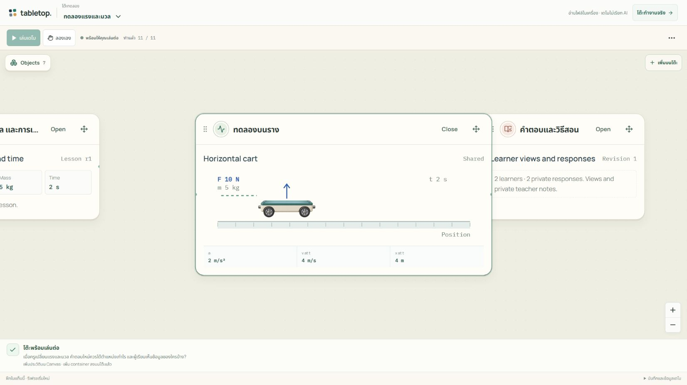

# tabletop.

## The best tool is the one you don't have to think about.

คุณมีบางอย่างอยากทำให้สำเร็จ งานที่ต้องสะสาง เรื่องที่อยากเข้าใจ หรือเกมที่อยากเล่นกับเพื่อน

Tabletop คือพื้นที่ที่เรากำลังสร้างให้เครื่องมือค่อย ๆ เข้ารูปตามสิ่งเหล่านั้น ให้คุณได้อยู่กับงาน ความคิด และคนที่อยู่ร่วมโต๊ะ

**[Bring your work to the table](https://tabletop.ptchrr.workers.dev/)** · **[See it in action — ไม่ต้องล็อกอิน](https://tabletop.ptchrr.workers.dev/demo)**

## เครื่องมือที่ค่อย ๆ พอดีมือ

ช่างพันด้ามเครื่องมือจนจับถนัด ครูเปลี่ยนวิธีอธิบายเมื่อเด็กยังไม่เข้าใจ เพื่อนกลุ่มหนึ่งปรับกติกาเกมจนกลายเป็นเกมในแบบของพวกเขา

เราปรับเครื่องมือให้เข้ากับสิ่งที่ทำมาเสมอ

แต่กับซอฟต์แวร์ งานง่าย ๆ กลับมีงานแทรก: ต้องเรียนรู้หน้าจอ หาทางอ้อมเมื่องานเปลี่ยน หรือทำเครื่องมือขึ้นมาอีกชิ้นก่อนจะเริ่มสิ่งที่ตั้งใจไว้ได้

คุณควรได้ใช้สมาธิกับเรื่องที่มาที่นี่เพื่อทำ

## Work defines what software becomes.

นี่คือวิธีคิดของ Tabletop: เริ่มจากงาน แล้วให้เครื่องมือเติบโตไปกับมัน

ไฟล์หนึ่งฉบับอาจกลายเป็นสิ่งที่เปิดอ่านและลงมือทำได้บนโต๊ะเดียวกัน เมื่ออยากลองอีกวิธี ก็ค่อยเพิ่มกฎ ตัวปรับค่า หรือภาพที่ช่วยให้เข้าใจ คนบนโต๊ะยังตรวจ ตัดสินใจ และเลือกลงมือเอง

เราอยากให้การทำงาน เรียนรู้ สร้างสรรค์ และเล่นร่วมกันมีความต่อเนื่อง แม้สิ่งที่ต้องการจะเปลี่ยนไประหว่างทาง

<picture>
  <source media="(prefers-reduced-motion: reduce)" srcset="docs/showcase/tabletop-story-poster.png">
  
</picture>

ภาพอธิบายแนวคิดจากบทเรียนแรงและมวล สร้างด้วย Remotion · [ดูภาพนิ่ง](docs/showcase/tabletop-story-poster.png) · [ที่มาและโค้ด](docs/showcase/README.md)

## Every table has a story.

สามมุมของสิ่งที่เราอยากให้ Tabletop เป็น — เป็นทิศทางของผลิตภัณฑ์ ส่วนที่ทดลองได้แล้วอยู่ถัดลงมา

### Your Table

ตัวเลขในบิลไม่ตรง คุณอยากรู้ว่าผิดตรงไหน อาจต้องเปิดหลักฐานอีกชิ้น เพิ่มเงื่อนไข หรือมองตัวเลขอีกแบบ โต๊ะควรช่วยให้คุณตามเรื่องต่อได้ โดยรักษางานที่ทำมาแล้ว

### A Table for Learning

เด็กคนหนึ่งเข้าใจจากสมการ อีกคนต้องเห็นรถเคลื่อนที่ ครูควรเปลี่ยนจากคำอธิบายเป็นการทดลอง แล้วกลับมาที่ความคิดเดิมได้ง่าย ๆ

### Our Tables

เพื่อนกลับมานั่งที่โต๊ะเดิม เรื่องราวยังอยู่ กติกาอาจค่อย ๆ เปลี่ยนตามโลกที่สร้างด้วยกัน สิ่งสำคัญคือการได้เล่นและคิดต่อร่วมกัน

**คนต่างกัน งานต่างกัน เครื่องมือก็ควรมีที่ให้เปลี่ยนตาม**

## What you can try today

**เว็บทดลองเปิดใช้บน Cloudflare แล้ว** วันนี้ลองได้สามทาง:

- **นำงานของคุณมาเริ่ม** — ล็อกอิน Google เลือก **Start with your files** แล้วนำไฟล์ข้อความหรือข้อมูลเข้ามา ให้ AI ช่วยร่างกฎ ตรวจและเปิดใช้ก่อนลงมือทำผ่านการ์ดบน Canvas
- **ลองจากเรื่องที่เตรียมไว้** — [Auto demo](https://tabletop.ptchrr.workers.dev/demo) มีตรวจบิล ทดลองแรง และเกมโล่ ดูโต๊ะค่อย ๆ เกิดขึ้น กด **พักเดโม / ลองเอง** แล้วเปลี่ยนค่าและเล่นต่อได้ เดโมใช้ข้อมูลและลำดับที่เตรียมไว้ ไม่เรียก AI
- **ชวนคนมาที่โต๊ะเดียวกัน** — ห้องจริงเชิญสมาชิกให้เห็นสถานะร่วมกันได้ บันทึกกฎ ข้อมูล และประวัติที่ส่งแล้วไว้ กลับมาด้วยบัญชีเดิมเพื่อทำต่อ

**โค้ดรุ่น 2.0** เริ่มจากโต๊ะว่าง พิมพ์สิ่งที่อยากทำหรือวางไฟล์ แล้วให้ AI ร่างการ์ด กฎ ฉาก กราฟ และตัวปรับค่าที่ใช้ร่วมกันได้ ลองร่างเป็นการส่วนตัว ตรวจและเปิดใช้ก่อนชวนคนอื่นลงมือ เมื่อโจทย์เปลี่ยนก็แก้กฎและเพิ่มการ์ดบนโต๊ะเดิม โดยรักษาข้อมูลที่เข้ากันได้ไว้

ช่องแชทอยู่ขอบล่าง คำตอบเป็นการ์ดส่วนตัว ส่วนการ์ดที่แชร์ย้ายตามกันทุกคน ตั้งชื่อโต๊ะและกลับมาเล่นต่อได้ ดู [รุ่นที่เปิดใช้อยู่และผลตรวจ deployment ล่าสุด](https://github.com/Thanyers/tabletop/blob/dev/docs/DEPLOYMENTS.md), [ขอบเขตเครื่องมือที่สร้างได้](docs/GENERATIVE_CANVAS_RUNTIME.md) และ [วิธีทดลองในเครื่อง](CONTRIBUTING.md#checkout-และ-runtime)

  
  

ภาพหน้าจอเดโมจริง ข้อมูลและผู้เล่นจำลอง · [วิธีใช้และวิธีเล่น](docs/USER_GUIDE_TH.md) · [ไฟล์ตัวอย่างของคุณเอง](docs/examples/README.md)

## สิ่งที่ได้ลองทำจริงแล้ว

รุ่นใหม่ตรวจด้วยโจทย์ที่คนต้องลงมือจริง:

- **ร้านกาแฟ** — กดเดินเวลาแล้วคำนวณงานสำเร็จ เพิ่มการ์ดเมื่อแก้โจทย์ โดยเก็บงานที่ทำแล้ว
- **แสงและเงา** — ลากวัตถุในฉาก ตรวจผลกับสูตรเรขาคณิตที่คำนวณแยก
- **แบ่งน้ำร่วมกัน** — สองบัญชีผลัดกันเล่น ยอดรวมยังถูกต้อง และรีโหลดกลับมาเล่นต่อได้

สามเรื่องข้างต้นผ่าน AI จริงในเครื่อง ส่วนรุ่นรวมสุดท้ายทดสอบซ้ำด้วยบัญชีและคำตอบ AI จำลอง รวมโจทย์คำนวณใหม่อีกหนึ่งเรื่อง [CI หลัง merge](https://github.com/Thanyers/tabletop/actions/runs/39421576811) ผ่านทั้งการเล่นร่วมกัน การทดลองร่าง แก้กฎ และการ์ดที่เพิ่มภายหลัง

รอบก่อนหน้ามีหลักฐาน Helpdesk ในเครื่องจบสามงาน และ staging เคยเล่นด้วย Google สองบัญชีจริง แยกจากรอบ Generative ใหม่นี้ · [ขอบเขตผลทดสอบ](docs/CALM_CANVAS_ACCEPTANCE.md) · [รุ่นที่เปิดใช้อยู่](docs/DEPLOYMENTS.md) · [สรุปรับช่วงและผลทดสอบรุ่นรวม](https://github.com/Thanyers/tabletop/blob/dev/docs/TEAM_HANDOFF_TH.md#หลักฐานรุ่นรวม)

ขอบเขตของรุ่นทดลอง

เครื่องมือเติบโตได้ภายในกฎและส่วนประกอบที่ระบบรองรับ รุ่น 2.0 เพิ่มสูตร ฉากและตัวควบคุมใหม่ได้ แต่ยังไม่ใช่การสร้างแอปหรือรันโค้ดอิสระทุกแบบ

- นำเข้า CSV, JSON, TXT และ Markdown ที่เป็น UTF-8: 32 KiB ต่อไฟล์ สูงสุด 4 ไฟล์ รวม 64 KiB
- ต้องตรวจร่าง AI ก่อนเปิดใช้กฎ การสร้างภาพหรือวิดีโอด้วยโมเดล การรัน JavaScript ที่ AI เขียน และ D&D เต็มระบบยังไม่เปิด
- ห้องจริงบันทึกกฎ ข้อมูล และแชทที่ส่งแล้ว รุ่น 2.0 ใช้บริบทปัจจุบันและค้นบทสนทนาส่วนตัวที่เกี่ยวข้องในขอบเขตจำกัด ยังไม่มีการสรุปความจำระยะยาวอัตโนมัติ
- เดโมอยู่ในแท็บ รีเฟรชเริ่มใหม่ ต่างจากห้องจริงที่ล็อกอินกลับมาต่อได้

อ่านรายละเอียดใน [คู่มือผู้ใช้](docs/USER_GUIDE_TH.md)

## More time doing what matters.

**[Bring your work to the table.](https://tabletop.ptchrr.workers.dev/)**

สำหรับทีมที่มารับช่วง: [แนวคิดและน้ำเสียง](product.md) · [คู่มือส่งมอบ](https://github.com/Thanyers/tabletop/blob/dev/docs/TEAM_HANDOFF_TH.md) · [รันในเครื่องและส่ง PR](CONTRIBUTING.md) · [ระบบภาพ](docs/CALM_CANVAS_DESIGN.md)
