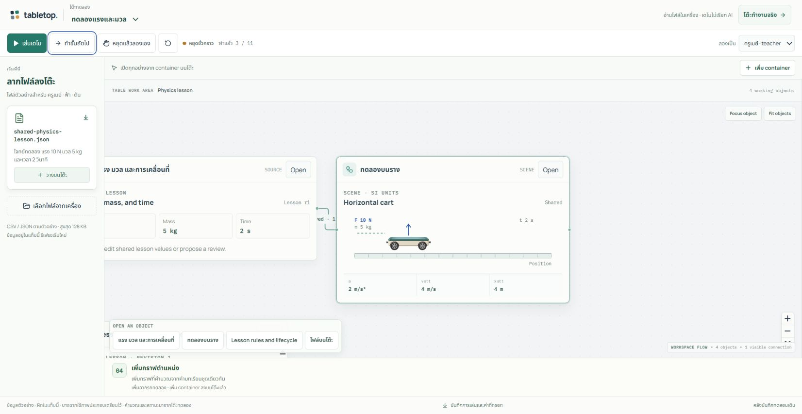

# Tabletop

โต๊ะทำงานร่วมกันบน Canvas: นำข้อมูลและกติกาจากไฟล์มาให้ AI ร่างเป็นตารางและการกระทำ ตรวจและเปิดใช้กฎ แล้วชวนคนอื่นเข้ามาเล่นหรือทำงานในสถานะเดียวกัน

**สถานะ 19 ตุลาคม 2026:** รุ่นทดสอบเปิดใช้งานบน Cloudflare แล้ว รองรับไฟล์ของผู้ใช้, Google login, multiplayer, แชท AI และกลับมาเล่นต่อ มีเดโมสาธารณะที่หยุดแล้วลองเองได้

**ทีมที่รับงานต่อให้เริ่มจาก branch [`feat/tabletop-r1`](https://github.com/Thanyers/tabletop/tree/feat/tabletop-r1)** ซึ่งมี source ของรุ่นที่ deploy อยู่และเอกสารชุดนี้ การพิจารณารวมเข้า `main` อยู่ใน [draft PR #2](https://github.com/Thanyers/tabletop/pull/2)

## เปิดใช้งานที่ไหน

| ต้องการ | ลิงก์ | การเก็บข้อมูล |
| --- | --- | --- |
| ลองเดโม ไม่ต้องล็อกอิน | [Auto demo บน Canvas](https://tabletop.ptchrr.workers.dev/demo) | อยู่ในแท็บ; รีเฟรชเริ่มใหม่; ดาวน์โหลดประวัติได้ |
| สร้างโต๊ะจากไฟล์ตัวเองและชวนเพื่อน | [แอป production](https://tabletop.ptchrr.workers.dev/) | ล็อกอิน Google; ห้องและข้อมูลที่ส่งแล้วอยู่บนเซิร์ฟเวอร์ |
| ทดสอบการเปลี่ยนแปลงก่อน release | [Staging](https://tabletop-staging.ptchrr.workers.dev/) | ห้องและฐานข้อมูลแยกจาก production |
| ดูรอบทดสอบที่บันทึกไว้ | [Replay archive](https://tabletop.ptchrr.workers.dev/demo/replay) | อ่าน checkpoint ของรอบเดิม |

รุ่นที่ deploy, บริการที่ใช้ และงบ AI ดูที่ [Deployment ปัจจุบัน](docs/DEPLOYMENTS.md)

## ตอนนี้ทำอะไรได้

- **สร้างโต๊ะแบบทั่วไป:** อัปโหลด UTF-8 CSV, JSON, TXT หรือ Markdown แล้วให้ AI ร่างข้อมูล กฎ และปุ่มการกระทำ ไม่ผูกกับชื่อสามโจทย์เดิม
- **ตรวจงานก่อนเปิดใช้:** อ่านหลักฐานและสมมติฐาน → Simulate → Validate → Approve → Activate กฎที่ยังเป็นร่างไม่เปลี่ยนโต๊ะที่กำลังเล่น
- **เล่นร่วมกัน:** เจ้าของส่งลิงก์เชิญใช้ครั้งเดียวให้แต่ละที่นั่ง สมาชิกเห็นสถานะร่วมกันแบบสด เซิร์ฟเวอร์ตรวจสิทธิ์ เทิร์น และการแก้ไขชนกัน
- **ถาม AI ระหว่างเล่น:** ใช้แชทข้าง Canvas ถามกฎหรือสถานะ และขอเตรียมหนึ่งการกระทำได้ ต้องกด Confirm action แยกก่อนเกิดผลจริง
- **กลับมาเล่นต่อ:** ล็อกอิน Google บัญชีเดิมแล้วเลือก My tables ข้อมูลห้องและแชทส่วนตัวที่บันทึกแล้วไม่หายเพราะปิดเว็บ
- **ดูแล้วรับช่วงเดโม:** เดโมหลักมีตรวจบิล ทดลองแรง/มวล และเกมโล่ กดหยุดเพื่อแก้กติกาหรือเล่นเองได้ ภาพประกอบเตรียมไว้ล่วงหน้า จึงไม่มีค่าเรียก AI ระหว่างเดโม



ภาพจากเดโมสาธารณะบน production: ฉากรถใช้ภาพที่เตรียมไว้ ส่วนตำแหน่งและตัวเลขคำนวณจากสถานะที่กำลังทดลอง

## เริ่มอ่านสำหรับทีม

| เอกสาร | ใช้เมื่อ |
| --- | --- |
| [วิธีใช้และวิธีเล่น](docs/USER_GUIDE_TH.md) | ต้องการลองเดโม สร้างห้อง นำเข้าไฟล์ เชิญคน และกลับมาเล่นต่อ |
| [ภาพรวมและงานสำหรับทีมพัฒนาต่อ](docs/TEAM_HANDOFF_TH.md) | ต้องการเข้าใจสถาปัตยกรรม จุดแก้โค้ด ผลทดสอบ และงานที่ยังเหลือ |
| [วิธีร่วมพัฒนา](CONTRIBUTING.md) | ต้องการ clone, รัน local, ทดสอบ และส่ง PR |
| [ไฟล์โจทย์ตัวอย่าง 3 แบบ](docs/examples/README.md) | ต้องการลองอุปกรณ์ยืมคืน จัดเวร หรือเกมแข่งเรือด้วย AI จริง |
| [Deployment ปัจจุบัน](docs/DEPLOYMENTS.md) | ต้องการทราบ URL, source commit, Cloudflare resources และงบที่ตั้งไว้ |
| [ดัชนีเอกสาร](docs/README.md) | ต้องการรายละเอียด runtime, AI, ข้อจำกัด และหลักฐานย้อนหลัง |

## ขอบเขตที่ต้องรู้ก่อนใช้

โต๊ะแบบทั่วไปยังรับเฉพาะไฟล์ข้อความ **32 KiB/ไฟล์, 4 ไฟล์, รวม 64 KiB** ไม่มี PDF/ภาพ/ไฟล์ไบนารีหรือการสร้างภาพขณะเล่น การตรวจบิลแบบเดิมมีข้อจำกัดการนำเข้าอีกชุดหนึ่ง ดูคู่มือก่อนเลือกประเภทโต๊ะ

AI สร้างข้อเสนอที่อาจต้องแก้ไข ผู้ใช้ต้องตรวจความถูกต้องเอง ระบบรันกฎแบบข้อมูลที่ตรวจสอบได้ ไม่รัน JavaScript ที่โมเดลเขียน โต๊ะเกมตัวอย่างยังไม่ใช่ D&D เต็มระบบ

ห้องเป็นข้อมูลถาวร แต่ความจำของ AI มีขอบเขต: ใช้สถานะปัจจุบันกับบทสนทนาล่าสุดไม่เกิน 6 คู่ ยังไม่มีการค้นความจำเก่าหรือสรุปเรื่องราวระยะยาวอัตโนมัติ เดโม `/demo` เก็บเฉพาะในแท็บและจำลองผู้เล่น ดู [การบันทึกและข้อจำกัด](docs/USER_GUIDE_TH.md#การบันทึกและความจำ)

ผ่านการทดสอบสามโจทย์ทั่วไปด้วย Google สองบัญชีจริงบน staging และตรวจ release บน production แล้ว แต่การกู้คืนทั้งระบบ การทดสอบโหลด และการทดสอบสองอุปกรณ์จริงยังไม่ครบ ดู [ขอบเขตหลักฐาน](docs/TEAM_HANDOFF_TH.md#สิ่งที่ทดสอบแล้ว)

## รันในเครื่อง

ใช้ Node.js **22.23.2** ตาม CI และ npm จากนั้นรันจาก root ของ repo:

```powershell
git clone --branch feat/tabletop-r1 https://github.com/Thanyers/tabletop.git
cd tabletop
npm ci
npm run build
npm start
```

เปิด [localhost:4310](http://127.0.0.1:4310) หรือ `/demo` สำหรับเดโม วิธีนี้เป็น Node guest runtime และปิด AI; การทดสอบ Google/AI/multiplayer แบบ Cloudflare ใช้ emulator และ fixture ตาม [CONTRIBUTING](CONTRIBUTING.md) ไม่ต้องใช้ production credentials เพื่อเริ่มพัฒนา
