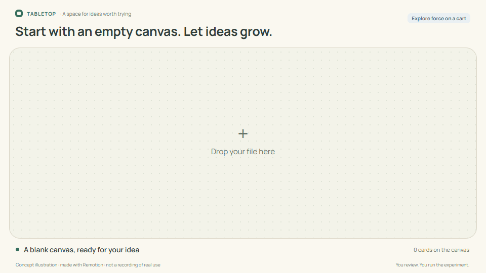

# tabletop.

## Tools that keep adapting to you.

Tabletop is a shared canvas where you and AI shape the tools you need for work, learning, and play. Describe what you want to do. Review the tables, buttons, charts, and rules AI prepares, then use them on the same table.

Start with words. Add data when you are ready. When your needs change, build on the work already there.

**[Start your table](https://tabletop.ptchrr.workers.dev/)** · **[Try the demos without signing in](https://tabletop.ptchrr.workers.dev/demo)**

<picture>
  <source media="(prefers-reduced-motion: reduce)" srcset="docs/showcase/tabletop-story-en-poster.png">
  
</picture>

Concept animation: a lesson becomes something you can experiment with. [Still image](docs/showcase/tabletop-story-en-poster.png) · [Animation sources](docs/showcase/README.md)

## A tool becomes yours through use.

Imagine a hammer that keeps slipping in your hand. You wrap its handle, build up the grip where your fingers rest, and try it again. The same hammer now fits the way you work.

Or a chair at your workbench. The seat is too low and there is nowhere to rest your feet. You add a cushion and make a footrest from an offcut. Each change answers something you noticed while using it.

We want software to leave room for that same process.

Too often, changing the way you work means another spreadsheet, another app, or another round of copying instructions out of a chat. You spend time rebuilding the tool before you can get back to the task.

Tabletop brings the conversation, data, rules, and controls together. Use something small. Notice what would help. Ask for a change. Keep going on the same table.

**The best tool is the one you don't have to think about.**

## Use it. Find what needs to change.

Picture a small coffee stall. A sales table is enough to get started. Then the morning queue arrives.

| What happens while you work | How the same table can grow |
| --- | --- |
| “I need to record coffee and cake sales.” | Start with a table of items, quantities, and totals. |
| “I can't keep typing between customers.” | Ask for one-tap sale buttons beside the table. A tap updates the quantity and total. |
| “What should I prepare more of tomorrow?” | Add a chart that uses the sales already recorded. |
| “Let's try an afternoon discount.” | Add a discount rule, then ask to change that rule when the offer changes. |

Each addition comes from using the tool. The table, its records, and the parts that still fit remain the starting point. Review a proposed change before putting it to work.

[**Watch the narrated story**](https://tabletop.ptchrr.workers.dev/narrative/tabletop-story.mp4) · [English captions](public/narrative/tabletop-story-en.vtt)

The film and coffee-stall walkthrough are authored illustrations with sample data, not recordings of live AI generation. [Media and evidence](docs/narrative/F077/evidence.md)

## What you can do today

- **Start from an idea.** Describe a task without uploading a file first. AI can prepare supported tables, forms, buttons, charts, and rules.
- **Bring in data.** Add supported files or preview rows before importing them into a table.
- **Use a calculation again.** Keep a calculation with your table and run it on new inputs. Connect its results to summaries, tables, or charts.
- **Understand and change a rule.** Ask what a rule does, or request a change to that specific rule.
- **Continue together.** Invite people to a room, work with its shared state, and return to saved work with the same account.

The canvas is where you use the software you are shaping: enter a value, press a button, inspect a result, and decide what to change next.

## Every table has a story.

**Your work.** An invoice total does not match. Put the items, calculations, and checks together so you can trace the difference.

**A lesson.** A learner needs more than an equation. Add a moving car and a chart, change the force or mass, and discuss what happens.

**A game with friends.** Keep the turn order, actions, and rules in view. Take turns and use a shield to help another player.

  
  

Screenshots of the prepared demos, using simulated data and players. [Open the demos](https://tabletop.ptchrr.workers.dev/demo), then pause to try the controls yourself.

## Bring your work to the table.

1. [Sign in and start a table](https://tabletop.ptchrr.workers.dev/).
2. Describe what you want to do. Check the tools and rules AI prepares before using them.
3. Add data, use the tools, and ask for changes as your work develops.

Before you try it

Tabletop is a beta. AI drafts may need revision. Check calculations, rules, and compatibility with existing data before applying changes.

- Tools use the views, controls, and calculation engines the current host supports. A prompt cannot produce any possible app or execute unrestricted code.
- Prepared demos do not call AI and reset when refreshed. Rooms created after signing in save work for later.
- The cooperative game is an example, not a complete D&D rules engine.
- See the [user guide (Thai)](docs/USER_GUIDE_TH.md) for supported files, limits, and controls.

**More time doing what matters.**

[Product principles](product.md) · [Documentation](docs/README.md) · [Development and build instructions](CONTRIBUTING.md)

## License

Copyright (C) 2026 Tabletop contributors.

Tabletop is free software: you can redistribute it and/or modify it under the terms of the GNU Affero General Public License as published by the Free Software Foundation, version 3 only (`AGPL-3.0-only`).

Tabletop is distributed in the hope that it will be useful, but WITHOUT ANY WARRANTY; without even the implied warranty of MERCHANTABILITY or FITNESS FOR A PARTICULAR PURPOSE. See [LICENSE](LICENSE) for the full terms.

Third-party components retain their own licenses. The [source repository](https://github.com/Thanyers/tabletop) includes the project source and build instructions.
