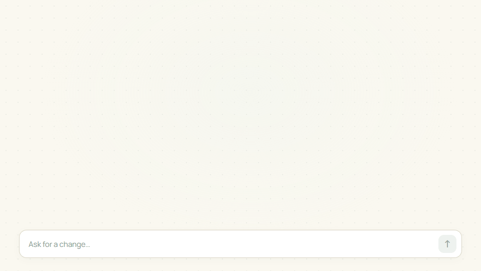
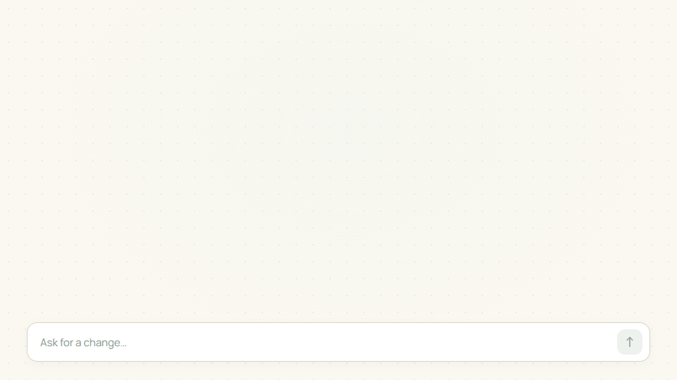
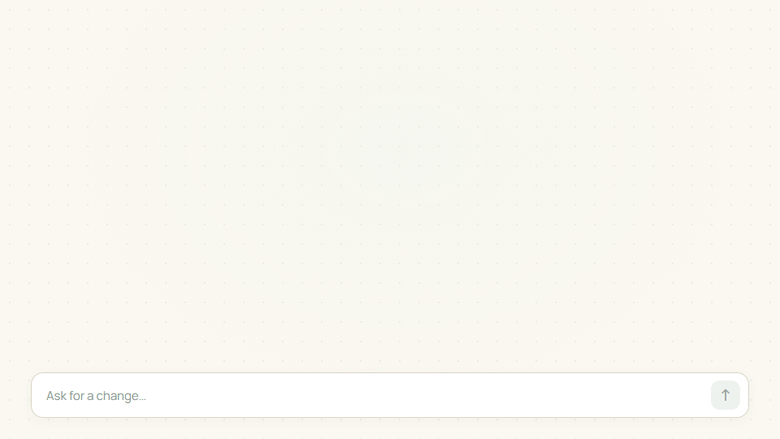

# tabletop.

**English** · [ไทย](README.th.md)

## Tools that keep adapting to you.

Tabletop is a shared canvas where you and AI shape tools for work, learning, and play. Describe what you need, use the tables, buttons, charts, and rules you create, and ask for changes as you go.

Start with words. Add data when you are ready. Keep building on the same table.

**[Start your table](https://tabletop.ptchrr.workers.dev/)** · **[Try the demos](https://tabletop.ptchrr.workers.dev/demo)**

## A tool becomes yours through use.

Imagine a hammer that keeps slipping in your hand. You build up the grip around your fingers and try it again. The same hammer now fits the way you work.

Or a chair at your workbench. You shape a cushion, add support where you need it, and make a footrest from an offcut. Each change answers something you noticed while using it.

Software should leave room for that same process. Yet changing the way you work often means another app, another spreadsheet, or copying the same data again.

Tabletop keeps the conversation, data, and controls together. Start with something small. Notice what would help. Ask for a change and keep working on the same table.

## For work, learning, and play.

### Work: café sales

A small coffee stall starts with a sales table. As the queue grows, add a quick-sale button. Then add a chart from those same sales.

<picture>
  <source media="(prefers-reduced-motion: reduce)" srcset="docs/showcase/hero-sales-en-poster.png">
  
</picture>

Keep going on the same table: add an afternoon discount, then change the offer without replacing the sales records.

### Learning: force and motion

Start with a force-and-motion experiment. Add a control to change the force, then a chart to see how far the cart travels.

<picture>
  <source media="(prefers-reduced-motion: reduce)" srcset="docs/showcase/hero-evolution-en-poster.png">
  
</picture>

Increase the force and see the cart travel farther. Keep the experiment, control, and chart together on the same canvas.

### Play: a shared adventure

Start with a turn-order table for the group. Add a roll button that updates Mira's initiative, then track health as the fight develops.

<picture>
  <source media="(prefers-reduced-motion: reduce)" srcset="docs/showcase/hero-play-en-poster.png">
  
</picture>

Each addition answers something that came up while using the table. Keep the useful parts and shape the next change around them.

**[Try the café example](https://tabletop.ptchrr.workers.dev/#board)** · **[Explore the demos](https://tabletop.ptchrr.workers.dev/demo)** · **[Watch the story](https://tabletop.ptchrr.workers.dev/#film)**

## What you can do today

- **Start from an idea.** Describe a task without uploading a file first. AI can prepare supported tables, forms, buttons, charts, and rules.
- **Bring in data.** Add supported files or preview rows before importing them into a table.
- **Reuse a calculation.** Keep it with your table, run it on new inputs, and use the results in summaries or charts.
- **Change a specific rule.** Ask what it does or request an update without starting the whole table again.
- **Continue together.** Invite people to a room, use its shared state, and return to saved work with the same account.

## Start your own table.

1. [Sign in and start a table](https://tabletop.ptchrr.workers.dev/).
2. Describe what you want to do and check the tools and rules AI prepares.
3. Add data, use the tools, and ask for changes as your work develops.

Tabletop is in beta. Review AI-generated calculations and rules before using them. See the [user guide (Thai)](docs/USER_GUIDE_TH.md) for how to get started.

[Product principles](product.md) · [Documentation](docs/README.md) · [Development and build instructions](CONTRIBUTING.md)

## License

Copyright (C) 2026 Tabletop contributors.

Tabletop is free software: you can redistribute it and/or modify it under the terms of the GNU Affero General Public License as published by the Free Software Foundation, version 3 only (`AGPL-3.0-only`).

Tabletop is distributed in the hope that it will be useful, but WITHOUT ANY WARRANTY; without even the implied warranty of MERCHANTABILITY or FITNESS FOR A PARTICULAR PURPOSE. See [LICENSE](LICENSE) for the full terms.

Third-party components retain their own licenses. The [source repository](https://github.com/Thanyers/tabletop) includes the project source and build instructions.
