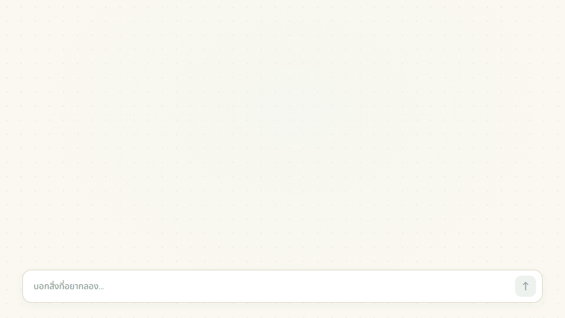
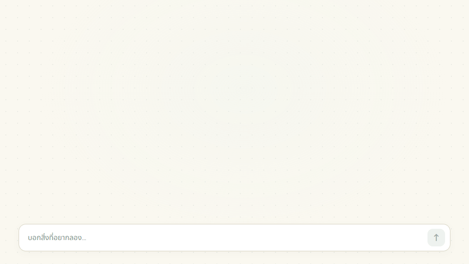
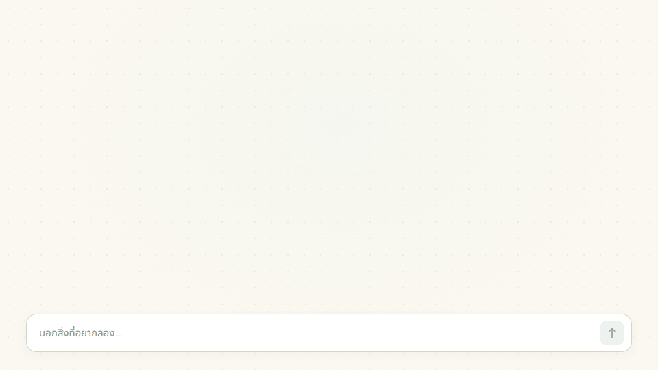

# tabletop.

[English](README.md) · **ไทย**

## เครื่องมือที่ค่อย ๆ ปรับให้เข้ากับคุณ

Tabletop คือโต๊ะดิจิทัลที่คุณกับ AI ช่วยกันสร้างเครื่องมือสำหรับทำงาน เรียนรู้ และเล่น บอกว่าต้องการอะไร แล้วใช้ตาราง ปุ่ม กราฟ และกติกาที่สร้างขึ้น ขอปรับเพิ่มได้ระหว่างใช้งาน

เริ่มจากคำพูด เพิ่มข้อมูลเมื่อพร้อม แล้วต่อยอดบนโต๊ะเดิม

**[เริ่มโต๊ะของคุณ](https://tabletop.ptchrr.workers.dev/)** · **[ลองเดโม](https://tabletop.ptchrr.workers.dev/demo)**

## เครื่องมือค่อย ๆ เป็นของคุณผ่านการใช้งาน

ลองนึกถึงค้อนที่ด้ามลื่นอยู่เรื่อย คุณค่อย ๆ เสริมกริปให้รับกับนิ้ว แล้วลองใช้อีกครั้ง ค้อนยังเป็นอันเดิม แต่จับถนัดกับมือคุณมากขึ้น

หรือเก้าอี้หน้าโต๊ะช่าง คุณปรับเบาะ เสริมส่วนที่ต้องการรองรับ แล้วเอาเศษไม้มาทำที่พักเท้า ทุกอย่างที่เพิ่มมาจากสิ่งที่สังเกตระหว่างใช้งาน

ซอฟต์แวร์ก็ควรเปิดให้ปรับแบบนั้นได้ แต่ทุกครั้งที่วิธีทำงานเปลี่ยน เรามักต้องหาแอปใหม่ ทำสเปรดชีตใหม่ หรือคัดลอกข้อมูลเดิมไปอีกที่

Tabletop เก็บบทสนทนา ข้อมูล และเครื่องมือไว้ด้วยกัน เริ่มจากสิ่งเล็ก ๆ ใช้แล้วเห็นว่าขาดอะไร ก็ขอเพิ่มและทำต่อบนโต๊ะเดิม

## ใช้ทำงาน เรียนรู้ และเล่น

### ทำงาน: ยอดขายร้านกาแฟ

ร้านกาแฟเล็ก ๆ เริ่มจากตารางจดยอดขาย พอคิวยาวขึ้นก็เพิ่มปุ่มขายเร็ว แล้วเพิ่มกราฟจากยอดขายชุดเดิม

<picture>
  <source media="(prefers-reduced-motion: reduce)" srcset="docs/showcase/hero-sales-th-poster.png">
  
</picture>

ต่อยอดบนโต๊ะเดิมได้อีก: เพิ่มส่วนลดช่วงบ่าย แล้วปรับโปรโมชันโดยไม่ต้องทิ้งรายการขายที่มีอยู่

### เรียนรู้: แรงและการเคลื่อนที่

เริ่มจากการทดลองเรื่องแรงและการเคลื่อนที่ เพิ่มตัวปรับแรง แล้วเพิ่มกราฟเพื่อดูว่ารถเคลื่อนที่ไปได้ไกลแค่ไหน

<picture>
  <source media="(prefers-reduced-motion: reduce)" srcset="docs/showcase/hero-evolution-th-poster.png">
  
</picture>

เพิ่มแรงแล้วเห็นรถเคลื่อนที่ไกลขึ้น เก็บการทดลอง ตัวปรับ และกราฟไว้ด้วยกันบนโต๊ะเดียว

### เล่น: ผจญภัยด้วยกัน

เริ่มจากตารางลำดับตาของกลุ่ม เพิ่มปุ่มทอยเต๋าที่อัปเดตค่าลำดับตาของ Mira แล้วเพิ่มตัวติดตามพลังชีวิตระหว่างต่อสู้

<picture>
  <source media="(prefers-reduced-motion: reduce)" srcset="docs/showcase/hero-play-th-poster.png">
  
</picture>

ทุกอย่างที่เพิ่มตอบโจทย์ที่เกิดขึ้นระหว่างใช้โต๊ะ เก็บส่วนที่ใช้ได้ดี แล้วค่อย ๆ ปรับสิ่งที่ต้องการต่อไป

**[ลองตัวอย่างร้านกาแฟ](https://tabletop.ptchrr.workers.dev/#board)** · **[ดูเดโม](https://tabletop.ptchrr.workers.dev/demo)** · **[ดูเรื่องราวของ Tabletop](https://tabletop.ptchrr.workers.dev/#film)**

## วันนี้ทำอะไรได้บ้าง

- **เริ่มจากไอเดีย** บอกงานที่อยากทำได้โดยไม่ต้องอัปโหลดไฟล์ก่อน AI ช่วยร่างตาราง ฟอร์ม ปุ่ม กราฟ และกติกาในรูปแบบที่ระบบรองรับ
- **นำข้อมูลเข้ามาใช้** เพิ่มไฟล์ที่รองรับ หรือดูแถวข้อมูลก่อนนำเข้าตาราง
- **ใช้วิธีคำนวณซ้ำ** เก็บวิธีคำนวณไว้กับโต๊ะ รันกับข้อมูลชุดใหม่ แล้วนำผลไปใช้ในสรุปหรือกราฟ
- **ปรับกติกาเฉพาะจุด** ถามว่ากติกาทำอะไร หรือขอแก้โดยไม่ต้องเริ่มโต๊ะใหม่ทั้งหมด
- **ทำต่อด้วยกัน** ชวนคนเข้าห้อง ใช้ข้อมูลร่วมกัน และกลับมาทำงานที่บันทึกไว้ด้วยบัญชีเดิม

## เริ่มโต๊ะของคุณ

1. [เข้าสู่ระบบแล้วเริ่มโต๊ะ](https://tabletop.ptchrr.workers.dev/)
2. บอกว่าอยากทำอะไร แล้วตรวจเครื่องมือและกติกาที่ AI เตรียมให้
3. เพิ่มข้อมูล ใช้เครื่องมือ และขอปรับเมื่อวิธีทำงานเปลี่ยนไป

Tabletop ยังอยู่ในช่วงเบตา ตรวจการคำนวณและกติกาที่ AI สร้างก่อนใช้งาน ดูวิธีเริ่มต้นใน[คู่มือผู้ใช้](docs/USER_GUIDE_TH.md)

[แนวคิดผลิตภัณฑ์](product.md) · [เอกสาร](docs/README.md) · [วิธีพัฒนาและ build](CONTRIBUTING.md)

## License

Copyright (C) 2026 Tabletop contributors.

Tabletop is free software: you can redistribute it and/or modify it under the terms of the GNU Affero General Public License as published by the Free Software Foundation, version 3 only (`AGPL-3.0-only`).

Tabletop is distributed in the hope that it will be useful, but WITHOUT ANY WARRANTY; without even the implied warranty of MERCHANTABILITY or FITNESS FOR A PARTICULAR PURPOSE. See [LICENSE](LICENSE) for the full terms.

Third-party components retain their own licenses. The [source repository](https://github.com/Thanyers/tabletop) includes the project source and build instructions.
