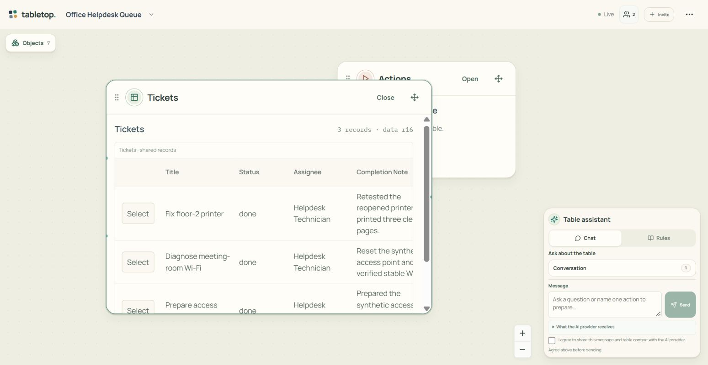

# Tabletop — พื้นที่ทำงาน เรียนรู้ และเล่นบนโต๊ะเดียวกัน

แนวทางภาพและ interaction ที่ผู้ใช้อนุมัติ 20 ตุลาคม 2026: เชื่อมผิวสัมผัสของโต๊ะและการ์ดเข้ากับเครื่องมือที่ลงมือทำงานได้จริง โดยยึด WHY / WHO / WHERE จาก [product.md](../product.md)

## บุคลิก

โต๊ะกระดาษโทนอุ่น มีชิ้นงานที่หยิบ ย้าย เปิดอ่าน และใช้ได้ ชื่อและข้อมูลของชิ้นงานเด่นกว่าเครื่องมือ สีช่วยบอกหน้าที่ การ์ดมีขอบและน้ำหนักเล็กน้อย ภาพหรือแผนภาพต้องอธิบายข้อมูลจริง

ใช้ [product.md](../product.md) เป็นหลักสำหรับลำดับเรื่องเล่า น้ำเสียง และข้อกำกับ copy; เอกสารนี้กำหนดการแสดงผลและพฤติกรรมบน Canvas

ศึกษา [การแยกชนิดและส่วนประกอบการ์ดของ Riot](https://support.riotgames.com/en-us/legends-of-runeterra/gameplay/card-types-and-how-they-work) เพื่อคิดเรื่อง identity และการอ่านเป็นชั้น ๆ เป็นแหล่งอ้างอิง ไม่ใช้ภาพ โลโก้ หรือลายกรอบของเกมเป็น asset ของ Tabletop

## กติกาของระบบภาพ

- ชุดสีและขนาดอยู่ใน `src/tabletop/ui/tabletop-tokens.css`: palette → semantic roles → component aliases ไม่สร้างชุดสีใหม่ต่อหน้า
- ผิวครีม โต๊ะสีอุ่น หมึกเข้ม; เขียวสำหรับงาน/ข้อมูล น้ำเงินสำหรับไฟล์ เหลืองอมน้ำตาลสำหรับกฎ สีดินสำหรับการกระทำ สีเป็นตัวช่วยร่วมกับชื่อ/ไอคอน
- ชื่อชิ้นงาน 17px, เนื้อหางาน 14px, ข้อความรอง 12px; ปุ่มหลักสูง 40–44px ไม่บีบด้วย fit-all ก่อนเริ่มอ่าน
- การ์ดไฟล์และคำสั่งกว้างประมาณ 340px, กฎ 360px, ผลลัพธ์ 440px; เปิดใช้งานแล้วขยายตามหน้าที่ 480–620px ไม่บังคับตารางเป็นการ์ดแนวตั้ง
- ขอบหลักชั้นเดียว มุม 18px, ปุ่ม/เมนู 12px, spacing ฐาน 4px; หลีกเลี่ยงกรอบ/ป้าย/คำอธิบายซ้อนหลายชั้น
- ความรู้สึกการ์ดมาจากขอบกระดาษ สัดส่วน สัญลักษณ์ประจำชนิด และเงาตอนลาก ไม่หมุนการ์ด ไม่ย้ายปุ่มตอน hover ไม่เพิ่มแต้ม/rarity/มานาที่ไม่มีความหมายกับงาน

## พฤติกรรมหลัก

- ไม่มี Use/Arrange: ลากหัวกล่อง ย้ายด้วยปุ่มทิศทาง/keyboard ได้ กดหรือพิมพ์ในเนื้อหาได้ตามปกติ
- เปิด/ปิดกล่องรักษามุมมอง; เลือกจาก Objects คือเจตนาพาไปหากล่องนั้น Connections แสดงเส้นเมื่อโต๊ะมีเส้นเชื่อม และจำค่าที่ผู้ใช้เลือกไว้
- ไฟล์ กฎ รายการ คำสั่ง คน ประวัติ และเครื่องมือ AI เปิดผ่าน Canvas ได้ ช่องพิมพ์อยู่ใกล้งาน ไม่บังคับอ่านคู่มือก่อน
- เลือกแถวข้อมูลแล้วทำรายการโดยใช้ record นั้นได้; ฟอร์มขอเฉพาะค่าที่ยังขาด เงื่อนไขเต็มเปิดอ่านได้
- เริ่มจากไฟล์/เจตนาแล้วค่อยมีเครื่องมือ ตัวอย่างเฉพาะทางเป็นตัวเลือก ผู้เล่นยังตัดสินใจเอง
- ลดภาษาภายในระบบ; consent, ขอบเขต context, ผลตรวจ และการอนุมัติยังชัดเจน ไม่เปิดเผยไฟล์ส่วนตัวผ่านการจัดหน้า
- Demo ใช้ภาพ/ผลที่เตรียมไว้ได้แต่บอกตรง ๆ ว่าไม่เรียก AI; พักและรับช่วงต่อได้ คนต้องใช้สิ่งที่เดโมสอนบนโต๊ะจริงได้

## ตรวจรับ

อ้างอิง `UX_AUDIT_2026-10-19_TH.md` และเก็บหลักฐานรอบแก้ใน `test-results/calm-canvas-2026-10-20/` แยกผล local ข้อมูลสมมติ, การเรียก AI จริง, staging สองบัญชี, และ production ให้ชัด ห้ามนับ build/test หรือภาพนิ่งเป็นหลักฐานว่ากดเล่นครบแล้ว
