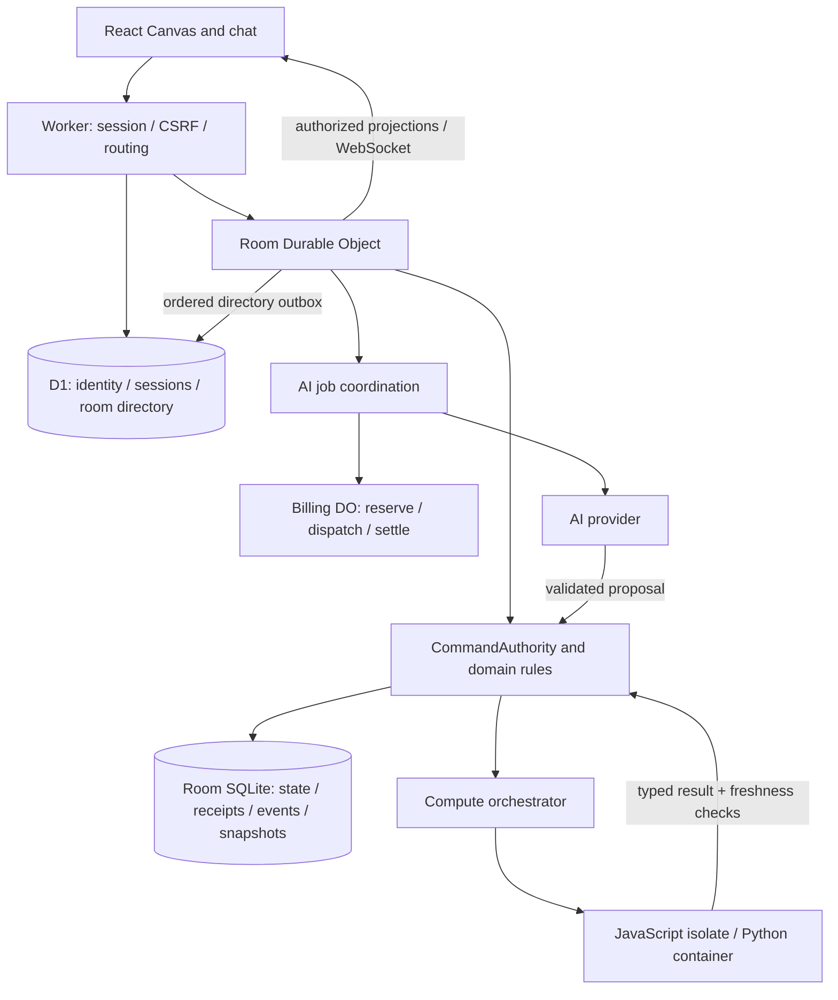

# Current architecture and capability map

This is the entry point for the implemented architecture. Read [product intent](../product.md) for why Tabletop exists, [spec](../spec.md) for development status, and [Deployments](DEPLOYMENTS.md) for the source/version observed in each hosted environment. Implementation in a branch is not proof that an environment runs it.

Reviewed against dev `9efebab0c4c9` on 2026-10-24. F078 changes documentation and development verification; it does not authorize a production release.

## Ownership and data flow

| Module | Owns | Source / detailed contract |
| --- | --- | --- |
| Client shell and Canvas | Navigation, camera/selection, pending inputs, previews, command submission and acknowledgement readback | [`TabletopApp`](../src/tabletop/TabletopApp.tsx), [`CanvasWorkspace`](../src/tabletop/ui/CanvasWorkspace.tsx) |
| Shared domain | Program validation, actions, evolution, membership permissions and projections | [`domain/`](../src/tabletop/domain/), [`contracts`](../src/tabletop/shared/contracts.ts) |
| Command authority | Actor, epoch, revision, idempotency and transactional state changes | [`authority.ts`](../server/authority.ts) |
| Persistence adapters | Current state, receipts, events, snapshots, memberships and outboxes (`WorkspaceRepository`); sessions and one-shot invitation redemption only where an identity store exists (`IdentityRepository`, F078-T17) | [`WorkspaceRepository`](../server/repository.ts), [`RoomRepository`](../cloudflare/room-repository.ts) |
| Worker and D1 | OIDC/session/CSRF and discovery of rooms | [`index.ts`](../cloudflare/index.ts), [`auth.ts`](../cloudflare/auth.ts), [R1 auth/storage](R1_ARCHITECTURE.md) |
| Room | WebSocket transport, authority composition, AI/compute wakeups and directory reconciliation; the HTTP route table and every route that does not need the instance live in `room-http.ts` (F078-T6c) | [`room.ts`](../cloudflare/room.ts), [`room-http.ts`](../cloudflare/room-http.ts) |
| AI and billing | Consent checks, request context, structured output, progress/recovery and recorded usage | [`ai.ts`](../cloudflare/ai.ts), [`table-assistant.ts`](../cloudflare/table-assistant.ts), [`billing.ts`](../cloudflare/billing.ts) |
| Reusable compute | Resolve declared inputs, isolated execution, typed output validation and revision-bound lineage | [`orchestrator`](../server/table-compute-orchestrator.ts), [Reusable compute](REUSABLE_COMPUTE.md) |

The client displays the authority's projection. A preview or a cleared composer is not an accepted command. A receipt and fresh authorized readback establish committed behavior. D1's directory supports discovery; Room membership remains the authorization source.

## Runtime capability matrix

| Capability | Node guest local | Cloudflare emulator | Hosted Worker |
| --- | --- | --- | --- |
| Shared domain and command authority | SQL/PGlite adapter and guest sessions | Room SQLite adapter with test identity/session fixtures | Room SQLite with authenticated accounts |
| AI draft / assistant | Public local feature route reports disabled | Synthetic provider in acceptance fixtures; no live-provider proof | Depends on configured key, consent and availability; execution evidence belongs to deployment/acceptance records |
| No-file table creation and files later | Shared UI/domain path; generation still needs a configured provider path | Covered through synthetic workflow fixtures | Implemented; verify current environment evidence before making a release claim |
| JavaScript/Python reusable compute | Host-injected runner can be exercised locally; this is not a hosted capability advertisement | Engine and OS support differ; Linux Container API checks are separate from Windows Docker checks | `/api/capabilities.compute` advertises configured engines/profile; a successful run is a separate proof |
| Generic source text | Authorized table commands | Authorized table commands | Authorized table commands |
| Legacy invoice upload | Local parser/private filesystem when enabled | Production route remains unavailable | `uploads: false`; not the generic-source or canvas-image endpoint |
| Canvas images | Not advertised by the guest feature route | Worker route and disposable Room storage | Separate authenticated image route, advertised as `images: true` |
| Runtime limits / read-only switches | Local route and adapter-specific configuration | Fixture/configuration-specific | Read `/api/capabilities` and retain server-side checks |

Capability handlers: [`server/features.ts`](../server/features.ts) and [`cloudflare/index.ts`](../cloudflare/index.ts). The same React/domain code does not imply equal authentication, engine availability or acceptance evidence. See [Local development](LOCAL_DEVELOPMENT.md).

## Effective policies to preserve

| Concern | Current policy | Owning source / contract |
| --- | --- | --- |
| Table visibility | `open`: members can read the whole table state and member AI chats. Membership is still required; hiding a control is not access control. The private projection policy is retained in code. | [`visibility.ts`](../src/tabletop/shared/visibility.ts), [F034](features/F034-open-visibility.md) |
| AI consent | Once per actor/table/epoch, remembered in that browser. It covers draft and ask and later files; each server request still requires consent. Reset/new epoch asks again. | [`table-chat-consent.ts`](../src/tabletop/ui/table-chat-consent.ts), [consent decision](../spec.md#การตัดสินใจ) |
| Rule drafts | The host may run the simulate/validate/approve/activate sequence automatically when its guards pass; failure leaves the draft for review. Model output alone does not activate rules. | [`evolution.ts`](../src/tabletop/domain/evolution.ts), [`Room.autoApplyDraft`](../cloudflare/room.ts), [F039](features/F039-auto-apply-rules.md) |
| Assistant action proposal | Only the requester confirms the stored action proposal. It remains bound to actor/epoch/revision and normal action permissions. | [`table-assistant.ts`](../cloudflare/table-assistant.ts), [generic conversation](GENERIC_TABLE_DESIGN.md#table-conversation-and-requested-actions) |
| AI spending | Monetary caps are deliberately disabled. Reservations, one dispatch per stable job, settlement, token limits, concurrency and job-count guards remain. This ledger does not account for other applications or infrastructure costs. | [`billing.ts`](../cloudflare/billing.ts), [billing implementation](../cloudflare/billing.ts) |
| Rule edits and imports | Rule changes preserve existing data and compatible definitions. Source evidence and importing collection rows are distinct commands; Replace preserves referenced row identity under its declared matching rules. | [`table.ts`](../src/tabletop/domain/table.ts), [Reusable compute/import contract](REUSABLE_COMPUTE.md) |
| Generated execution | Curated React renderers and bounded expressions in the client; accepted JavaScript/Python compute runs in host isolation with declared inputs/outputs. No arbitrary browser HTML/code or host bindings. | [Generative runtime](GENERATIVE_CANVAS_RUNTIME.md), [Reusable compute](REUSABLE_COMPUTE.md) |
| Job lifetime | Accepted compute jobs belong to the actor/table, not the lifetime of the browser cookie. Recheck membership, permission, epoch and freshness before committing. AI jobs retain their distinct session/recovery contract. | [Compute execution sessions](REUSABLE_COMPUTE.md#ห้อง-บัญชี-และ-execution-session), [`room.ts`](../cloudflare/room.ts) |

These are descriptions of existing behavior, not policy changes introduced by F078.

## Limits and state lifetime

Use the owning constants rather than copying one limit across request types:

- Rule draft table input: `TABLE_AI_INPUT_BYTES` (128 KiB); complete provider envelope: `MAX_CHANGE_REQUEST_BYTES` (160 KiB), with reservation margin defined separately in [`ai-request-limits.ts`](../src/tabletop/shared/ai-request-limits.ts).
- Assistant: separate `MAX_REQUEST_BODY_BYTES` (48 KiB), active-state/context bounds and output limits in [`table-assistant.ts`](../cloudflare/table-assistant.ts). Changing draft limits does not change assistant limits.
- Collections/records/actions: [`TABLE_LIMITS`](../src/tabletop/domain/table.ts) and [`tableCapabilitySummary`](../src/tabletop/shared/table-capabilities.ts).
- Source slots/text: `MAX_TABLE_SOURCES`, `TABLE_FILE_BYTES`, `TABLE_TOTAL_SOURCE_BYTES` in [`table.ts`](../src/tabletop/domain/table.ts). Web sources share those slots; canvas image bytes use their own route/limits in [`canvas-images.ts`](../src/tabletop/shared/canvas-images.ts).
- Compute programs, input/output and run history: [`COMPUTE_LIMITS`](../src/tabletop/shared/table-compute.ts), [`compute-runtime-profiles.ts`](../src/tabletop/shared/compute-runtime-profiles.ts) and [execution limits](REUSABLE_COMPUTE.md#ขอบเขต-execution).

Current state and derived results are different from storage history. A bounded list of visible compute runs does not bound historical full snapshots. [`RoomRepository.persistCommit`](../cloudflare/room-repository.ts) writes full snapshots with receipts/events; a reset scrubs prior contents. No general compaction or retention policy is introduced here.

## Verification and recovery boundaries

- [CI operations](AGENT_OPERATIONS.md#3-ci) defines required checks. Local tests, Workers emulator tests, synthetic provider fixtures and hosted multi-account acceptance prove different things.
- [Release9 acceptance](testing/f066-post-deploy/RELEASE9_RESULTS_TH.md) retains its actual PASS/BLOCKED/SKIPPED and UI-gate limits. It is not an assertion that every case ran on the same latest build.
- [Deployment smoke](../server/release-deploy.ts) reads health, readiness, capabilities, version and public pages. Advertising an engine is not proof that a generated program ran.
- App-wide D1/Room/Billing restore, load/soak and physical-device acceptance require their own evidence. Restore must preserve membership/epoch, receipts and uncertain billing outcomes; durable storage alone does not establish this.
- Development merges target `dev` and can deploy staging. A production release requires the user's release instruction and the release pipeline. F078 is authorized for development only.

## Document map and improvement sequence

| Read this | For |
| --- | --- |
| [Product](../product.md) | Intent, users and current product scope |
| This page | Current ownership, runtime differences and effective policies |
| [Generic table base](GENERIC_TABLE_DESIGN.md) | Original data/action/transaction contract, with extension notices |
| [Generative runtime](GENERATIVE_CANVAS_RUNTIME.md) | No-file creation, bounded expressions, views and shared layout |
| [Reusable compute](REUSABLE_COMPUTE.md) | Isolated saved programs, lineage and imports |
| [R1 architecture](R1_ARCHITECTURE.md) | Identity, authority and storage foundations; historical case-specific sections |
| [F078 sequence](features/F078-architecture-improvements.md) | Separate PRs, prerequisites, ownership and acceptance for architecture improvements |
| [Deployments](DEPLOYMENTS.md) | Observed environment/source/version; no live claim is inferred from this page |
