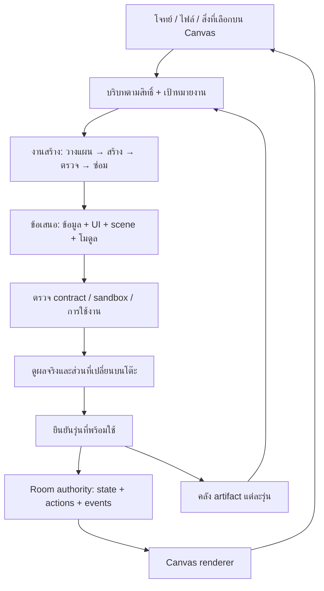

# Tabletop — จากโจทย์สู่โต๊ะที่สร้างเครื่องมือขึ้นมาใช้งานได้

วันที่ 2026-10-20 · แผนวิจัยต้นทาง; ตอนนี้เริ่ม implement ส่วน bounded runtime, generated views, shared layout และ bounded memory retrieval แล้ว ดู [ขอบเขต candidate](GENERATIVE_CANVAS_RUNTIME.md) และ [ผลทดสอบ](GENERATIVE_CANVAS_ACCEPTANCE.md) ส่วนภาพเป้าหมายและงานระยะถัดไปในเอกสารนี้ไม่ได้หมายความว่าส่งครบหรือ deploy แล้ว

ฐานที่ตรวจ: release `v1.0.0` / `ce2c50e`; เอกสารสถานะจาก `dev` / `135a367`

อ่านคู่กับ [ผลวิจัยเทคโนโลยีและแหล่งต้นทาง](GENERATIVE_CANVAS_RESEARCH_2026-10-20.md) และ [ขอบเขตระบบปัจจุบัน](GENERIC_TABLE_DESIGN.md)

ข้อกำหนดเพิ่มเติมจากผู้ใช้: เปิดรับทางเลือกเทคโนโลยี และต้องมี algorithm จัดการ์ดตามความสัมพันธ์ให้เข้าใจง่าย มีพื้นที่สร้างสรรค์ และรักษาการใช้งานจริง การจัดวางอยู่ในแกนรอบพิสูจน์ ไม่ใช่ตกแต่งภายหลัง

## 1. ข้อเสนอหลัก

Tabletop ต้องมี **ระบบสร้างและแก้เครื่องมือขนาดเล็กบนโต๊ะ** ที่รับโจทย์ → สร้างข้อมูล/พฤติกรรม/ภาพ → ทดลองรัน → ตรวจและซ่อม → ให้คนใช้ร่วมกัน งานนี้ใหญ่กว่าการเพิ่ม animation ให้การ์ด แต่ใช้ฐานห้อง สิทธิ์ ประวัติ และการตัดสินคำสั่งของเดิมต่อได้

เลือกแบบผสม: ชิ้นส่วนมาตรฐานที่เชื่อถือได้สำหรับงานทั่วไป + โมดูลคำนวณที่ AI สร้างในพื้นที่แยกสำหรับพฤติกรรมใหม่ ตัวโมเดลช่วยสร้างหรือแก้เครื่องมือ; หลังสร้างแล้ว คนกด ลาก เล่น และเห็นผลจาก runtime โดยไม่ต้องเรียกโมเดลทุกเฟรม

จุดที่ต้องพิสูจน์ก่อนลงทุนใหญ่คือ **โจทย์ใหม่ทำให้เกิดพฤติกรรมใหม่ได้โดยไม่แก้ source ของ Tabletop เป็นรายเคส** ไม่ใช่แค่เปลี่ยนชื่อหรือข้อมูลใน template

ประมาณการสำหรับทีมวิศวกรที่มีประสบการณ์ 2 คน และ designer/QA ช่วยบางเวลา:

- รอบพิสูจน์แกนผลิตภัณฑ์: **10–15 วันทำการ**
- private alpha ที่สร้าง แก้ ใช้ร่วมกัน และกลับมาทำต่อได้: **สะสม 5–7 สัปดาห์**
- beta สำหรับคนทั่วไปในขอบเขตข้อมูล/งาน 2D/เกมผลัดกันเล่น: **สะสม 8–12 สัปดาห์**

เป็นประมาณการวิศวกรรม ไม่ใช่กำหนดส่งที่พิสูจน์แล้ว; ปรับใหม่หลังรอบแรกจากอัตราสร้างสำเร็จ เวลาแก้บั๊ก และ sandbox ที่ใช้จริง เกม 3D ขนาดใหญ่ งานแข่งแบบ real-time และเครื่องมือที่เชื่อมบัญชีภายนอกมีขอบเขตเพิ่มแยกต่างหาก

## 2. ประสบการณ์ที่ต้องส่งมอบ

ผู้ใช้เริ่มด้วยไฟล์หรือข้อความก็ได้ ไม่ต้องเลือกประเภทแอปหรือเตรียม schema:

| ผู้ใช้เริ่มจาก | โต๊ะควรค่อย ๆ สร้าง | คนทำต่อเอง | เปลี่ยนกลางทาง |
| --- | --- | --- | --- |
| “ช่วยทดลองจัดคิวร้านกาแฟ มีสองเครื่องและสามคน” + CSV เวลาเตรียม | รายการออเดอร์, สถานีงาน, คน, ภาพคิว, กราฟเวลารอ | ลากคนไปสถานี ปรับจำนวนเครื่อง กดเดินเวลา | “มีออเดอร์เดลิเวอรีแทรก และคนพักได้” เพิ่มกฎโดยรักษางานที่ทำไปแล้ว |
| “ทำโจทย์ให้เด็กลองเรื่องแสงกับเงา” | หลอดไฟ วัตถุ ฉากรับเงา ตัวปรับระยะ และโจทย์ทดลอง | ลากวัตถุ ดูเงาเปลี่ยน ทดลองตอบและอธิบาย | “เพิ่มหลอดไฟอีกดวงและให้เทียบสองกรณี” สร้างภาพและการคำนวณเพิ่ม |
| “ทำเกมร่วมมือบริหารน้ำในหมู่บ้าน” + กติกา | แผนที่จุด/ท่อ อ่างเก็บน้ำ ปริมาณน้ำ บทบาทผู้เล่น และเทิร์น | ผู้เล่นสองคนเลือกซ่อม/เปิดวาล์ว เห็นผลบนสถานะเดียวกัน | “เพิ่มภัยแล้งทุกสามรอบ” แสดงผลกระทบก่อนใช้กับเกมเดิม |

ทั้งสามเป็นโจทย์พัฒนาและตัวอย่างภาพเป้าหมาย ไม่ใช่หลักฐานว่าระบบทำได้แล้ว และต้องมีชุดโจทย์ปิดที่ทีมพัฒนาไม่ได้เห็นเพื่อทดสอบการต่อยอดด้วย

### ความหมายของ “สร้างได้จริง”

1. **สร้างโจทย์:** สร้างสถานการณ์ ข้อมูลสมมติ เป้าหมาย และเงื่อนไขสำเร็จที่สอดคล้องกัน; แยกข้อมูลสมมติออกจากข้อเท็จจริงในไฟล์
2. **สร้างหน้าที่ใช้ได้:** UI ผูกกับข้อมูล การเลือก และคำสั่งจริง; ปุ่มทุกปุ่มมีผลหรือมีเหตุผลชัดเจนที่ยังใช้ไม่ได้
3. **สร้างภาพและการเคลื่อนไหว:** ตำแหน่ง สี เส้น และเวลาผูกกับค่าหรือแบบจำลอง เปลี่ยน input แล้ว output เปลี่ยนตาม ไม่เล่นคลิปผลเดิม
4. **แก้ต่อได้:** แก้เฉพาะส่วนที่ขอ รักษา ID, ข้อมูล, การจัดวางของคน และประวัติที่ไม่เกี่ยวข้อง
5. **ร่วมกันและกลับมาได้:** สถานะที่ยืนยันแล้วตรงกันหลัง reconnect และไม่ต้องสร้างเครื่องมือใหม่เมื่อเปิดวันถัดไป
6. **บอกขอบเขต:** ถ้าโมเดลยังทำโจทย์นั้นไม่ผ่าน ให้เก็บงานเดิมและระบุส่วนที่ขาด ไม่แสดงสถานะ “พร้อม” จากการ compile ผ่านอย่างเดียว

## 3. ทางเลือกและเหตุผลที่เลือก

| ทางเลือก | ข้อดี | เพดาน/ต้นทุน | ข้อเสนอ |
| --- | --- | --- | --- |
| เพิ่ม catalog การ์ด/กราฟ แล้วให้ AI เลือกและต่อกัน | เริ่มเร็ว สม่ำเสมอ ตรวจสิทธิ์ง่าย | เกิดได้เฉพาะสิ่งที่ renderer/ภาษาเดิมรองรับ; ใส่ 50 template ก็ยังติดเพดานเมื่อเจอโจทย์ใหม่ | ใช้เป็นเส้นทางปกติ แต่ไม่ใช่คำตอบทั้งหมด |
| ให้ AI สร้าง React/JS/app เต็มชุดทุกครั้ง | อิสระสูง ทำภาพแปลกใหม่ได้ | จัดการ build, dependencies, accessibility, ข้อมูลร่วมกัน, isolation และการแก้เวอร์ชันยาก; เสี่ยงได้แอปแยกหลายชิ้น | เก็บเป็นความสามารถขั้นถัดไปเมื่อมีเหตุผลจากการทดสอบ |
| **ชิ้นส่วนมาตรฐาน + scene ที่ประกอบใหม่ + custom compute module** | งานทั่วไปเร็ว งานใหม่มีทางออก ทุกชิ้นใช้ state/action contract เดียวกัน | ต้องสร้าง manifest, sandbox, validation และ revision lifecycle เพิ่ม | **เลือกแนวนี้**; วัดแยกว่าผ่านด้วย catalog หรือ custom module |

`json-render`/A2UI ช่วยเรื่องการส่งคำอธิบาย UI และ catalog แต่ไม่ได้ทำให้เกิด component หรือ engine ใหม่เอง; การเพิ่ม protocol จึงไม่แทนการออกแบบ runtime ดูแหล่งต้นทางและข้อจำกัดใน [research](GENERATIVE_CANVAS_RESEARCH_2026-10-20.md)

### หลักฐานจาก source และสิ่งที่ควรใช้ต่อ

| สิ่งที่ตรวจพบใน v1.0.0 | จุดอ้างอิง | ผลต่อแผน |
| --- | --- | --- |
| มี typed graph/compiler ตรวจ ports, version, visibility และ cycles; graph จำกัด 24 nodes/96 bindings | [runtime](../src/tabletop/runtime/index.ts) บรรทัด 6–117 | ขยาย compiler/registry เดิม; manifest ปัจจุบัน derive จาก workspace ยังไม่ใช่ authoring artifact ที่ persist |
| การ์ดและฉากถูกเลือกจาก ID ที่รู้จัก; มีกราฟที่เขียนไว้ล่วงหน้า | [CanvasObjectContent](../src/tabletop/ui/CanvasObjectContent.tsx) บรรทัด 33–48, 215–261; [TableCanvasObjects](../src/tabletop/ui/TableCanvasObjects.tsx) บรรทัด 22–28 | เพิ่ม ViewSpec/SceneSpec renderer แทนการเพิ่ม switch ตามชื่อโจทย์ |
| layout/viewport อยู่ใน browser localStorage | [CanvasWorkspace](../src/tabletop/ui/CanvasWorkspace.tsx) บรรทัด 63–100, 376–382, 528–543 | room persistence เดิมยังไม่พิสูจน์ shared/cross-device layout; ต้องออกแบบ lane ใหม่ |
| DSL มี operand และ effects แบบจำกัด เช่น field/input, compare, set, add; ไม่มี arbitrary expression | [table-contracts](../src/tabletop/shared/table-contracts.ts) บรรทัด 3–27 | ต่อกฎข้อมูลเดิมได้ แต่ simulation/formula ใหม่ต้องมี expression/compute runtime |
| หลัง activate ต้องรักษา collection/field เดิม | [table domain](../src/tabletop/domain/table.ts) บรรทัด 112–126 | schema edits เป็น migration workflow; ไม่ใช่เพียง regenerate UI |
| candidate/approval ผูก revision; คำสั่งตรวจ actor/epoch/revision และ commit transaction | [evolution](../src/tabletop/domain/evolution.ts) บรรทัด 86–152, 311–395; [authority](../server/authority.ts) บรรทัด 637–698 | ใช้กลไกควบคุมเดิม แต่เพิ่ม manifest/module revision และ proof |
| source draft กับ chat context แยกกัน; chat ส่ง shared records แต่ draft generator ไม่ได้ส่ง current records | [AI draft](../cloudflare/ai.ts) บรรทัด 228–246; [assistant](../cloudflare/table-assistant.ts) บรรทัด 179–260 | ออกแบบ context builder ตามงานและสิทธิ์ อย่าอ้างว่า “ทั้งโต๊ะ” เข้าโมเดลอยู่แล้ว |
| มี events/snapshots/model jobs และ participant projection ลบ private drafts/sources | [room repository](../cloudflare/room-repository.ts) บรรทัด 86–140; [projections](../src/tabletop/domain/projections.ts) บรรทัด 4–10 | reuse persistence/privacy; เพิ่ม artifact references โดยไม่ย้ายอำนาจไป renderer |

ชื่อใหม่ `WorkspaceManifest`, `ViewSpec`, `SceneSpec`, `ModuleSpec` ในเอกสารนี้เป็นข้อเสนอ ยังไม่มี implementation ภายใต้ชื่อนี้ในฐานที่ตรวจ

## 4. โครงสร้างที่ต้องเพิ่ม

### 4.1 เอกสารงานหนึ่งชุด: WorkspaceManifest

เอกสารนี้เชื่อมส่วนต่าง ๆ ด้วย ID คงที่ ไม่เป็น HTML ก้อนที่แยกจากห้อง:

| ส่วน | เก็บอะไร | ผู้ตัดสิน |
| --- | --- | --- |
| Intent + provenance | เป้าหมาย ข้อสมมติ แหล่งข้อมูล ข้อเท็จจริง/ข้อมูลสมมติ | ผู้ใช้ตรวจความหมาย; ระบบตรวจการอ้างอิง |
| DataSpec | entity, type, unit, constraints, visibility และ schema version | authority/validator |
| ActionSpec | input, permission, precondition, transition และ invariant | authority |
| ViewSpec | ชิ้นส่วนหน้าจอ layout และ bindings ไปยัง projection | trusted renderer |
| SceneSpec | รูปทรง กลุ่ม เส้นแกน label จุดจับ และ bindings | trusted renderer |
| MotionSpec | transition, timeline, trigger, reduced-motion และ run clock | visual runtime; ไม่ถือเป็นการแก้ข้อมูลเอง |
| ModuleSpec | โค้ดคำนวณ input/output schema, hash, engine version, limits และผลทดสอบ | sandbox + host validation |
| AssetRef | ภาพ/ไฟล์ที่อนุญาต ขนาด hash เจ้าของ สิทธิ์ และที่มา | asset gateway |
| Version/proofs | base revision, dependencies, compatibility, test results, ผู้อนุมัติ | authority |

รายละเอียด field เป็นสิ่งที่จะตัดสินในรอบพิสูจน์; ตารางนี้กำหนดหน้าที่และขอบเขต ไม่ใช่ schema ที่ deploy แล้ว ทุก binding ต้องตรวจได้ว่า field/action มีจริง, type/unit ตรง และผู้รับเห็นข้อมูลได้

Public/shared view generation รับเฉพาะ projection และข้อมูลที่อนุมัติให้แชร์แล้ว การยินยอมส่งไฟล์ส่วนตัวเข้า AI ไม่เท่ากับอนุญาตเผยแพร่ไฟล์นั้นให้สมาชิกทุกคน ต้องแยก owner-only extraction/draft ออกจาก shared artifact; ตรวจทั้ง literal text, generated image/asset และ references เพื่อไม่ให้ข้อมูลส่วนตัวถูกฝังในภาพหรือโค้ดที่ส่งให้สมาชิก

ตัวอย่าง “เงา” ต้องสร้าง geometry/สูตรและการเชื่อม drag → ระยะ → ความยาวเงา โดยไม่มี `kind: shadow-lesson` hardcode ในแอป ถ้าผู้ใช้เพิ่มหลอดไฟ ต้อง patch scene/compute ที่เกี่ยวข้อง ไม่สร้างห้องใหม่

### 4.2 ชิ้นส่วนภาพที่เล็กพอให้ประกอบใหม่ได้

เริ่มจากข้อความ/form/list/table/chart + รูปทรงพื้นฐาน SVG, path, group, connector, axis, label, handle, sprite และ bindings ไม่เริ่มจาก component ชื่อกรณีใช้งาน เช่น CoffeeShop หรือ WaterVillage

ใช้ React/CSS/SVG กับของเดิมก่อน; ใช้ Canvas/Pixi เฉพาะเมื่อ scene หนาแน่นจน SVG ไม่พอจากการวัดจริง การเปลี่ยน canvas engine/tldraw ทั้งตัวต้องมีผลทดสอบด้าน drag/zoom/touch และตรวจ license ก่อน ไม่มีเหตุผลต้อง rewrite shell เพื่อให้สร้างสิ่งใหม่ได้

ทุกชิ้นมีชื่อ หน้าที่ input/output และการเลือกที่ host เข้าใจ ขยับด้วยหัวกล่อง ใช้ control ภายในได้ทันที กดส่วนใดแล้วพิมพ์ “ทำให้…” ระบบรับ selection เป็นบริบท รักษาแนว calm/tactile ใน [design เดิม](CALM_CANVAS_DESIGN.md)

### 4.3 Custom compute เพื่อข้ามเพดาน catalog

เสนอ interface แคบ: `initialize(inputs, seed)`, `reduce(state, action, logicalTime, seed)`, `derive(projection, parameters)` คืนข้อมูล/scene ที่ตรวจ schema ได้ การสร้าง UI ไม่ได้รับสิทธิ์เขียนฐานโดยตรง

- โค้ดที่สร้างเป็น artifact แยกจาก source/deploy ของแอป ไม่ต้องออก release ใหม่ทุกครั้งที่คนสร้างโต๊ะ
- รันใน VM/isolate ที่ไม่มี session cookie, key, raw database binding, network หรือ filesystem ให้โดยปริยาย; ห้าม `eval` โค้ดของโมเดลใน React/Worker authority ตัวหลัก
- Client ใช้ Worker เพื่อให้ยกเลิกได้และไม่ค้าง UI; **Web Worker อย่างเดียวไม่ใช่ security sandbox** ต้องควบคุม capabilities ใน runtime ด้วย
- เลือกและทดสอบ runtime ที่จำกัด CPU/หน่วยความจำได้; ไม่ถือว่า AST scan หรือ unit test ทำให้ arbitrary JS ปลอดภัย
- ตัด clock/random/async I/O ที่ไม่อยู่ใน contract; ใช้ logical time และ seeded randomness จาก host บันทึก engine/dependency version; sandbox ที่กัน network ได้ไม่ได้รับประกัน determinism โดยตัวมันเอง
- การคำนวณที่มีผลต่อ shared state ต้องรัน/ตรวจที่ server และผ่าน membership, action allowlist, revision, invariant และ transaction เดิม; client ส่ง “เจตนา” ไม่ส่งผลลัพธ์ที่ server เชื่อเลย
- ถ้า sandbox time out/ผลลัพธ์ผิด ให้คงรุ่นที่ใช้ได้และเก็บ draft ไว้แก้ ไม่ปล่อย partial state

รอบแรกอนุญาต custom module ใน preview ที่แยกอยู่ก่อน จึงค่อยเปิดให้มีผลต่อ shared state หลังผ่าน isolation, deterministic replay และ negative tests ใช้ QuickJS/WASM หรือ Cloudflare Dynamic Workers เป็นตัวเลือกของ spike ตามหลักฐานใน research; ยังไม่ล็อก vendor runtime ก่อนพิสูจน์ข้อจำกัด

ต้องแยก **replay accepted events** ซึ่งใช้ผลที่ server บันทึกแล้ว ออกจาก **คำนวณ simulation ใหม่** ซึ่งต้องใช้ engine/version/seed/input เดิม การรันซ้ำไม่กี่ครั้งตรงกันไม่ใช่หลักฐานว่า arbitrary JS deterministic; shared reducer ต้องอยู่ในภาษา/VM ที่ควบคุม capabilities ได้จริง และมี resource/semantic validation เพิ่ม

### 4.4 Algorithm จัดโต๊ะ: ความสัมพันธ์นำ ความสร้างสรรค์ตามหน้าที่

เป้าหมายคือให้คนมองออกว่า **อะไรเป็นต้นทาง → ทำอะไรกับมัน → ผลอยู่ไหน** และรู้ว่ากำลังทำส่วนไหน ไม่บังคับทุกโต๊ะให้เป็น flowchart หรือ dashboard แบบเดียว

เลือก **semantic grouping + composition patterns + constrained incremental layout** เป็นฐาน: ใช้ ELK layered จัดลำดับ dependency ภายในกลุ่มเมื่อเหมาะ แล้วให้ตัวจัดองค์ประกอบของ Tabletop วางกลุ่ม/ภาพหลัก/controls และรักษาตำแหน่งเดิม ELK เป็นตัวคำนวณ geometry ไม่ใช่ผู้เข้าใจงานหรือออกแบบบรรยากาศให้เรา

หลักฐาน: React Flow ไม่มี layout engine ของตัวเอง และเปรียบเทียบ ELK ว่ารองรับ dynamic sizes, subflows และ edge routing; ELK layered รองรับ ports/compound graphs และการลด crossings; `elkjs` รันงาน layout ใน Web Worker ได้ ([React Flow layout](https://reactflow.dev/learn/layouting/layouting), [ELK Layered](https://eclipse.dev/elk/reference/algorithms/org-eclipse-elk-layered.html), [elkjs](https://github.com/kieler/elkjs)).

**Input ที่ layout engine ต้องได้รับ**

- node ID, measured width/height, minimum readable size, semantic role, importance, group, visibility และ actual input/output ports
- typed relations เช่น `derived-from`, `controls`, `produces`, `compares-with`, `belongs-to`; relation จาก binding จริงต่างจากความเกี่ยวข้องด้านหัวข้อที่ AI เสนอ
- ตำแหน่งเดิม, สิ่งที่ผู้ใช้ลาก/ตรึงไว้, selection, object/layout revision, viewport และพื้นที่ซ้อน UI ที่ต้องเว้น
- ไม่ส่ง hidden/private nodes เข้า layout ของผู้ไม่มีสิทธิ์ แม้ไม่แสดงเนื้อหาก็อาจเผยว่ามีข้อมูลลับหรือจำนวนเท่าไร

**ขั้นตอน**

1. **วัดก่อนวาง:** ใช้ขนาดจาก renderer รวม label/expanded content และ action area; estimate ได้ระหว่างสร้าง แต่ทำ correction เฉพาะบริเวณเมื่อวัดจริงแล้ว ห้าม fit ทั้งโต๊ะจนตัวอักษรเล็กเพื่อแก้ collision
2. **จัดกลุ่มตามงาน:** รวม control กับสิ่งที่มันควบคุม; รวมหลักฐานที่ช่วยอธิบายผลนั้น ใช้ actual bindings/provenance ก่อน topic affinity จัดการ feedback cycles เป็นกลุ่มเดียว ไม่ลบเส้นข้อมูลเพื่อหลอกให้เป็น DAG
3. **เลือกองค์ประกอบตามรูปร่างงาน:** เริ่มด้วยสี่แบบ—เส้นทางข้อมูลซ้ายไปขวา, scene หลักกับเครื่องมือรอบข้าง, ผลเปรียบเทียบวางคู่, หรือกลุ่มงานหลายหย่อมที่เชื่อมกัน เปลี่ยนได้จาก structure ไม่ใช่ `if scenarioName`
4. **ให้ลำดับสายตา:** scene/ผลที่กำลังใช้อยู่มีพื้นที่มากกว่า reference card; จัด controls ใกล้จุดเกิดผล; หลักฐาน/รายละเอียดรองเป็นชั้นเปิดอ่าน ไม่ตีกรอบทุกอย่างเป็นการ์ดขนาดเดียว
5. **สร้าง candidate ตำแหน่ง:** ใช้ ELK กับ dependency graph ภายในกลุ่ม แล้ว packing กลุ่มรอบ anchor; ใช้ stable sort/seed และ bounded candidate count เพื่อให้ผลไม่สุ่มใหม่ทุกครั้ง
6. **ตรวจข้อบังคับ:** auto-placed card ต้องไม่ทับ card/control/label, ไม่ออกนอกกลุ่มที่กำหนด, เคารพ minimum size และ pinned/user-positioned nodes ถ้า constraints ขัดกันขยายพื้นที่หรือวางกลุ่มข้าง ๆ แล้วให้คนเลือก ไม่แอบย้ายชิ้นที่ตรึงไว้
7. **เลือกผลที่รบกวนน้อย:** เรียงความสำคัญเป็นรักษาตำแหน่งที่คนจัด → ลดการทับ/เส้นผ่านการ์ด → ลดระยะของชิ้นที่สัมพันธ์ → ลด crossings/พื้นที่สูญเปล่า → ปรับสมดุลและจังหวะช่องไฟ ใช้คะแนน normalized สำหรับ candidate ที่ผ่าน hard constraints แล้ว; น้ำหนักต้องจูนด้วยงานจริง
8. **วางเฉพาะส่วนที่งอก:** เมื่อเพิ่ม/ขยายชิ้น ให้แก้ subgraph ที่ได้รับผลและเพื่อนบ้านใกล้ที่สุด ตำแหน่งนอกขอบเขตคงเดิม; ขณะลากหรือพิมพ์ไม่เริ่ม relayout ที่แย่ง pointer/focus
9. **route และเผยความสัมพันธ์:** เส้นจาก ports หลีกการ์ด และแสดงเฉพาะเส้นที่สำคัญ/เกี่ยวกับ selection เป็นค่าเริ่มต้น เปิดดูทั้งหมดได้ เส้นจำนวนมากต้องมี group summary ไม่กลายเป็นใยแมงมุม
10. **commit เป็นรุ่น:** ผูกผลกับ layout/object revision ปัจจุบัน; ผล async ที่ช้ากว่า user drag ต้องทิ้ง; animate การย้ายสั้น ๆ ตาม reduced-motion โดย viewport ไม่เคลื่อนเอง เก็บตำแหน่งที่ commit แล้ว ไม่คำนวณใหม่บนอุปกรณ์ทุกคนจนคนละ layout

ELK มี interactive strategies ที่ใช้ตำแหน่งก่อนหน้าเพื่อคง order และมี random seed แต่ **ไม่รับประกัน pixel-exact pinning หรือไม่ขยับกลุ่มอื่นให้ Tabletop อัตโนมัติ** ต้องมี host constraints/validation และบันทึกผลเอง ([interactive order](https://eclipse.dev/elk/blog/posts/2025/25-08-21-layered.html), [seed](https://eclipse.dev/elk/reference/options/org-eclipse-elk-randomSeed.html)).

**ความสร้างสรรค์ที่ไม่ทำลายการใช้**

โต๊ะทดลองให้ scene เด่นและ controls กระชับข้างภาพ; โต๊ะวิเคราะห์ให้หลักฐานกับผลวางคู่; เกมให้พื้นที่เล่นกลางโต๊ะและทรัพยากรอยู่ตามบทบาท ความหลากหลายมาจากสัดส่วน กลุ่ม พื้นที่ว่าง และภาพที่เหมาะกับงาน ใช้สี/ตัวอักษร/วัสดุชุดเดียวกัน ไม่ใช้การสุ่มตำแหน่ง หมุนการ์ด หรือให้ force simulation ดันสิ่งที่คนกำลังกด

ตำแหน่งที่คนลากเองถือเป็น anchor โดยปริยาย มี Undo และ “จัดกลุ่มนี้” เป็นคำสั่งเสริมจาก Canvas ปกติ **ไม่คืนโหมด Use/Arrange** บนมือถือเริ่มจากกลุ่มงาน/scene ที่กำลังใช้ พร้อมรายชื่อกลุ่มและ focus view; shared world coordinates คงเดิม ไม่ให้หน้าจอเล็กของคนหนึ่งไปจัดโต๊ะของทุกคน

**เกณฑ์ตรวจของ layout**

- fixture 5/12/24 nodes ที่ตรงขอบเขตเดิม และ stress 50 nodes สำหรับ engine ใหม่ แยกจากคำรับรอง capacity ของผลิตภัณฑ์
- test graphs: chain, branch, feedback cycle, disconnected groups, wide table + small card, Thai long labels, scene expansion, many-to-many และสมาชิกที่มี private nodes ต่างกัน
- zero unintended overlaps สำหรับผล auto-placement ที่เริ่มจาก input feasible; pinned/manual overlap เดิมต้องรายงานและรักษาสิทธิ์ตัดสินของคน
- node ที่ตรึงและ node นอก affected group ต้องไม่ขยับ; stale layout result ห้าม overwrite user drag; add/remove/reopen ไม่ทำ camera jump
- วัด distance ของ controls จากสิ่งที่ควบคุม, crossings, edge/node intersections, displacement, runtime และพื้นที่ว่าง โดยไม่ตั้งเป้า zero crossings สำหรับ graph ที่ทำไม่ได้
- เป้าหมาย initial layout P95 ≤500ms ที่ 24 nodes และ incremental update P95 ≤100ms บนอุปกรณ์ที่ระบุ; คำนวณนอก main thread และมี fallback preserving positions เมื่อเกินเวลา
- เปรียบเทียบอย่างน้อยสอง composition ต่อโจทย์กับคนใหม่: หา input/action/result ได้ใน 10 วินาที และบอกได้ว่าอะไรสัมพันธ์กัน; “creative” เป็น human assessment ไม่อ้างว่าค่า overlap เป็นศูนย์แปลว่าสวย

## 5. การสร้างต้องเป็นงานที่รันต่อและซ่อมได้

สถานะ: `requested → planning → building → testing → ready-for-review → active` หรือ `failed/cancelled` บันทึก checkpoint แยกจากแชทและสถานะโต๊ะ

1. **เข้าใจงาน:** ดึงเฉพาะ source/projection/ชิ้นที่เกี่ยวข้อง; ถ้าโจทย์เริ่มเปล่า สร้าง synthetic seed data โดยระบุที่มา ไม่อ้างว่ามาจากไฟล์
2. **วางแผนสั้น:** ระบุชิ้นที่จะเพิ่มและสิ่งที่ต้องคำนวณ พร้อมตัวอย่าง input/output ที่ใช้ตรวจ
3. **สร้าง:** ใช้ catalog ก่อน; ส่วนที่ทำไม่ได้สร้าง module เฉพาะส่วน จำกัด dependency ด้วยชุดที่ pin ไว้
4. **ตรวจ:** type/schema/binding → permission/limits → ตัวอย่างคำนวณ/กฎ → browser interaction และ console → ภาพอ่านรู้เรื่อง ข้อมูลถูกต้อง และควบคุมได้
5. **ซ่อม:** ส่งข้อผิดพลาดจริงกลับโมเดล กำหนด attempt/time/token budget; เริ่มที่ไม่เกิน 3 attempts รวมรอบแรกและ fallback ไม่ซ่อมวนไม่สิ้นสุด
6. **แสดงแบบค่อยเป็นค่อยไป:** วางเฉพาะชิ้นที่ parse และ validate แล้ว; ชิ้นกำลังสร้างแสดงสถานะ draft ไม่แกล้งเติมข้อมูลจริงหรือ animation ที่ยังไม่ผูก state
7. **ใช้รุ่นใหม่:** แสดง “เพิ่ม/เปลี่ยนอะไร” กับผลตรวจ ให้คนยืนยันก่อนเปลี่ยนกฎ/ข้อมูลร่วม; backend ยังรักษาการผูก approval กับ candidate และ revision

คนไม่ต้องอ่าน code, schema หรือรายงาน compiler เพื่อใช้โต๊ะ UI แสดงแค่ผลและส่วนที่ต้องตัดสินใจ เปิดรายละเอียดได้ งานตกแต่งใน private preview ทำได้ทันทีและ undo ได้; การ publish shared rules ยังคงขอบเขตอนุมัติเดิม

Job ต้องมี stable ID และ billing receipt ใช้งานต่อหลังปิดแท็บได้ ยกเลิกงานได้ และไม่เรียก provider ซ้ำอัตโนมัติเมื่อผลครั้งก่อนไม่แน่ชัด Workflows อาจใช้จัดขั้นตอน แต่คลัง artifact/ประวัติงานต้องถาวรกว่าระยะเก็บ log ของ Workflows

## 6. Animation, simulation และภาพประกอบใช้ต่างหน้าที่

| ชนิด | ทำงานอย่างไร | ตัวอย่าง | ต้องเรียก AI ตอนเล่นหรือไม่ |
| --- | --- | --- | --- |
| UI motion | CSS/animation library เคลื่อนเมื่อ state เปลี่ยน | การ์ดปรากฏ ย้ายคิว ลูกศรไหล | ไม่ต้อง |
| Data-bound visual | ค่าจริงขับตำแหน่ง/สี/ขนาด/กราฟ | เงายาวขึ้น คิวสะสม น้ำลด | ไม่ต้อง |
| Simulation | แบบจำลอง + fixed timestep/logical time + seed | ทดลองคิว/วงจร/ทรัพยากร | ไม่ต้อง; AI ใช้ตอนสร้างหรือแก้โมเดล |
| Illustration | asset ที่ใช้ซ้ำ มีที่มาและสิทธิ์ | ฉาก เกม token ภาพอธิบาย | เฉพาะตอนสั่งสร้างภาพใหม่ |
| Video export | render ผลเพื่อเล่าหรือแชร์ | คลิป/README/บันทึกการสอน | แยกจาก runtime; Remotion เหมาะกับทางนี้ |

ภาพ generated ไม่เป็นตัวแทนตัวเลข/ผลทดลอง และแผนภาพที่สวยไม่ใช่หลักฐานว่าแบบจำลองถูกต้อง ใช้สูตร/ผลอ้างอิง/การตรวจโดยคนตามเรื่องนั้น เมื่อเป็นแบบจำลองเพื่อการเรียนรู้ ต้องบอกสมมติฐานและหน่วย

เริ่มด้วย procedural SVG/Canvas และ asset library ที่ใช้ได้ตามสิทธิ์ เพิ่ม image generation เมื่อภาพช่วยงานจริง ภาพชิ้นเดิมเก็บและใช้ซ้ำ ไม่สร้างทุกครั้งที่เปิดห้อง

## 7. Multiplayer, การแก้รุ่น และความจำ

### สถานะร่วม

- Room authority เดิมยังตัดสินรายการ คะแนน จำนวนสินค้า เทิร์น และ state ของ simulation; browser ไม่เขียนทับ state รวม
- แยกกล้อง/selection/drag preview เป็น ephemeral state; commit ตำแหน่งเมื่อปล่อยด้วย object revision แยกจาก game revision เพื่อไม่ให้การลากทำ action ของคนอื่น stale ทุกพิกเซล
- shared layout และ presentation ของเจ้าของต้องกำหนดสิทธิ์ชัดเจน ส่วนมุมมองส่วนตัวไม่บังคับย้ายหน้าจอทุกคน
- เริ่มด้วย versioned operations/WS เดิม ไม่ใส่ CRDT กับคะแนนหรือการจอง; พิจารณา CRDT ภายหลังเฉพาะ text/layout ถ้าต้องการแก้พร้อมกัน/offline
- simulation แชร์ start/pause/parameters/seed/checkpoints และ event order; client interpolate ภาพ ไม่เขียนฐาน 60 ครั้ง/วินาที ไม่มี requirement ให้ภาพตรงทุกพิกเซลทุกเฟรม แต่ผล state ต้องตรงกัน
- reconnect ส่ง snapshot + cursor/sequence ที่เชื่อถือได้ ถ้า runtime/module version ไม่ตรงต้องโหลดรุ่นนั้นก่อนส่งคำสั่ง

### แก้เครื่องมือระหว่างใช้งาน

สร้าง candidate จาก revision ปัจจุบัน → diff → ทดสอบด้วยสำเนาข้อมูล → ตรวจ compatibility → อนุมัติ → เปลี่ยน active manifest pointer และ state ที่จำเป็นแบบ atomic ใน Room authority

แยก renderer-only update ออกจาก rule update และ schema migration การเพิ่ม field ที่มี default อาจ migrate ได้; การลบ/เปลี่ยนความหมาย field ต้องมีแผนข้อมูลเก่าและ recovery ไม่เอา summary ของ AI มาแทน migration script

artifact bytes เป็น immutable/content-addressed เขียนเสร็จก่อน Room commit ชี้ไป; เก็บ references ตรวจสิทธิ์และ hash ไม่ทำเหมือน R2+D1+DO มี transaction ร่วมกัน garbage collection ทำภายหลังและต้องไม่ลบ asset ที่รุ่นเก่ายังอ้าง

Undo การจัดหน้าได้เร็ว ส่วนย้อนกฎสร้าง revision ใหม่ การย้อนหลังมีรายการเกิดขึ้นแล้วต้องใช้ compensating change หรือ migration ที่ตรวจแล้ว ห้ามเอา snapshot เก่าทับข้อมูลใหม่ของผู้เล่นคนอื่น

### ความจำของโครงการ

เก็บสามชั้น: **state/กฎ/artifact ที่ใช้อยู่**, **event/source/transcript ที่ค้นย้อนหลังได้**, และ **บันทึกเป้าหมาย/การตัดสินใจ/คำถามค้างที่มีแหล่งอ้างอิง** การเรียกโมเดลเป็นงานย่อยภายในห้อง ไม่ใช่ session ใหม่ของผู้ใช้

ก่อนเรียก AI ให้เลือก manifest summary, selection, current revision และข้อมูลที่เกี่ยวข้องจากแหล่งจริง สรุปบทสนทนาได้แต่ห้ามแทน authoritative state หรือซ่อนความขัดแย้งกับกฎล่าสุด ต้องเก็บ source/event IDs และตรวจสิทธิ์ก่อนค้นและก่อนส่ง ไม่ให้ summary/cache/embedding ของสมาชิกคนหนึ่งรั่วไปอีกคน

เริ่มจากค้น ID/ชื่อ/ข้อความและบันทึกที่คนแก้ได้ แล้ววัดว่าต้องมี semantic retrieval หรือไม่ ไม่เพิ่ม vector database เพียงเพราะมีแชทยาว แนวทางนี้อาศัย retrieval และ structured memory ตาม [context engineering ของ Anthropic](https://www.anthropic.com/engineering/effective-context-engineering-for-ai-agents) แต่ contract การเข้าถึงและข้อมูลถาวรเป็นหน้าที่ Tabletop

## 8. Cloudflare และโมเดล

ใช้ Worker + D1 + Room/Billing DO เดิมต่อ เพิ่มส่วนต่อไปนี้เมื่อ phase ที่ต้องใช้พร้อม:

| ส่วน | ข้อเสนอ | ข้อจำกัดที่ต้องวัด |
| --- | --- | --- |
| Artifact/source storage | R2 private สำหรับ immutable bundles, source และภาพ; auth gateway ตรวจสิทธิ์ | ยังไม่มี R2 ใน v1; ต้อง provision/retention/restore/access tests |
| Build orchestration | Workflows สำหรับขั้นตอนและ checkpoint; durable room job เป็นดัชนี | Free CPU 10ms จำกัดงาน compile/test; log retention ไม่ใช่ project memory |
| Code execution | runner แยกพร้อม deny-by-default capabilities | Dynamic Workers ต้อง Paid และคิดจำนวน distinct workers/usage; sandbox ไม่ได้ตัด ambient time/random โดยอัตโนมัติ |
| Browser verification | local/CI ก่อน; managed runner ที่แยกข้อมูลสำหรับ generation งานจริง | compute/latency เพิ่ม ต้องวัดค่าเฉลี่ยและ tail latency |
| New formats | parser adapter + private originals + source chunks | PDF/image/XLSX ต้องออกแบบ parsing/provenance/limits; ไม่แค่เพิ่มนามสกุลรับไฟล์ |

Workflows มีทั้ง Free/Paid และคิด CPU/requests/storage/steps; Free มี compute limit 10ms และ state retention เริ่มต้น 3 วัน ([limits](https://developers.cloudflare.com/workflows/reference/limits/), [pricing](https://developers.cloudflare.com/workflows/reference/pricing/)). R2 Standard มี free usage 10 GB-month พร้อมโควตา operations แต่ต้องเปิด R2 subscription ก่อน ([pricing](https://developers.cloudflare.com/r2/pricing/), [setup](https://developers.cloudflare.com/r2/get-started/)).

Dynamic Workers ใช้ Workers Paid และมีการคิดค่าใช้จ่าย distinct Worker/requests/CPU; อย่าสร้างตัวใหม่ตามผู้เล่นหรือทุก frame ใช้ artifact hash/version เป็นหน่วย reuse ที่ตรวจสิทธิ์ก่อนเรียก และวัด cardinality ของ build ที่ถูกทิ้งด้วย ([Dynamic Workers pricing](https://developers.cloudflare.com/dynamic-workers/pricing/)).

**Model routing ที่เสนอ:** ใช้ provider ที่มีอยู่เป็น baseline สำหรับ intent, manifest, code, patch และคำอธิบาย; ทดลองโมเดล coding อีกหนึ่งตัวสำหรับโจทย์ที่ baseline ไม่ผ่าน ไม่สรุปว่าต้องเปลี่ยนโมเดลจากความรู้สึกหรือ benchmark ของผู้ขาย

เอกสารทางการยืนยันว่า `deepseek-flash` ชี้ไป V4.1-Flash-1017 และรองรับ JSON/tool calls/vision; API adapter ปัจจุบันใช้ชื่อนี้แล้ว การมี vision ไม่ทำให้ Tabletop รับภาพได้ทันที ต้องทำ ingestion และ consent เพิ่ม ([model/API](https://api-docs.deepseek.com/), [pricing](https://api-docs.deepseek.com/quick_start/pricing/), [adapter](../server/providers/deepseek-changes.ts)).

ตัวเลือกเปรียบเทียบ: Claude Sonnet 5.5 สำหรับ build/repair ที่ยาก และ Gemini 3.8 Flash สำหรับงานภาพ/เอกสาร โดยยังไม่มีผลเปรียบเทียบของ Tabletop เลือกจาก **cost per accepted artifact**, pass rate และ latency บนชุดเดียวกัน การ fallback ไป provider ใหม่ต้องอยู่ใน data-consent และงบที่กำหนด ไม่ส่งข้อมูลเงียบ ๆ ([Claude pricing](https://platform.claude.com/docs/en/about-claude/pricing), [Gemini pricing](https://ai.google.dev/gemini-api/docs/pricing)).

Structured output ช่วยให้ parse ได้ แต่ไม่ได้รับประกันความหมาย/สูตร/สิทธิ์ เอกสาร Gemini ก็ระบุให้ตรวจ values และรับมือ schema-compliant แต่ semantically incorrect output ([structured output](https://ai.google.dev/gemini-api/docs/structured-output)).

### ตัวอย่างต้นทุนที่คำนวณซ้ำได้

ราคาที่ตรวจ 2026-10-20, USD, ไม่รวมภาษี; เป็นตัวอย่าง capacity planning ไม่ใช่ใบเสนอราคา และไม่มีการเพิ่มงบจริงในรอบวิจัยนี้

| รายการ | สมมติฐาน | ผลคำนวณ |
| --- | --- | --- |
| Build/repair ด้วย Flash | รวมทุก call ของงานหนึ่งงาน 40,000 input + 10,000 output ที่คิดเงิน; ไม่หักส่วนลด cache | $0.012 ช่วง off-peak / $0.024 ช่วง peak |
| 1,000 งานสร้าง/แก้ต่อเดือน | ใช้ token mix ข้างบนทุกงาน | $12–24 |
| fallback Sonnet 100 งาน | **เพิ่มจาก**ค่า baseline; งานละ 40,000 input + 10,000 output | $0.18/งาน = $18 |
| Workers Paid | base subscription ตามราคาเอกสาร; usage ที่เกินโควตาคิดเพิ่ม | เริ่ม $5/เดือน |
| รวมรายการข้างบน | 1,000 งานและ fallback 10% | **$35–47/เดือน ก่อนค่าใช้จ่ายอื่น** |

สูตร Flash: `(40,000 × 0.15 + 10,000 × 0.60) / 1,000,000 = 0.012`; peak คูณสอง สูตร Sonnet: `(40,000 × 2 + 10,000 × 10) / 1,000,000 = 0.18` ใช้ billable output รวม thinking ตาม usage ที่ provider ส่งกลับ ไม่ใช่นับเฉพาะข้อความผู้ใช้เห็น

อ้างอิง [Flash pricing](https://api-docs.deepseek.com/quick_start/pricing/), [Sonnet pricing](https://platform.claude.com/docs/en/about-claude/pricing), [Workers pricing](https://developers.cloudflare.com/workers/platform/pricing/).

ยอดนี้ **ยังไม่รวม** sandbox/containers/dynamic execution ที่คิดแยกตามบริการ, browser tests, R2/DO/D1/Workflows usage ที่เกิน included quota, OCR/ภาพ, embeddings, web search, แชทเพิ่ม, งานที่กิน token มากกว่าสมมติฐาน และค่าแรง จึงยังใช้รับรองค่า infrastructure ทั้งระบบไม่ได้ การสร้างไฟล์ภาพต้องบวกเพิ่มตามโมเดลและจำนวนรูป; MVP ใช้ vector/procedural ก่อน

การกดเล่น/ลาก/ปรับค่าตรง ๆ ไม่มีค่า LLM แต่ยังมี runtime/storage/network costs; retry/fallback และการสร้างของที่ใช้ไม่ได้ต้องนับในต้นทุนด้วย ตั้ง per-job token/time/cost ceiling และ concurrent reservation ผ่าน Billing DO ก่อนทุก dispatch

## 9. แผนส่งมอบแบบมีจุดหยุดตัดสินใจ

| ช่วง | งานและเจ้าของ | ส่งมอบ/เกณฑ์ผ่าน | ยังไม่อ้างว่าได้ |
| --- | --- | --- | --- |
| วัน 1–2 | main/product + frontend/backend: ล็อก contract ขั้นต่ำและโจทย์วัด | manifest ฉบับแรก, risk register, eval rubric, sandbox spike plan, baseline ที่รันซ้ำได้ | ไม่มี production feature ใหม่ |
| วัน 3–10/15 | frontend: renderer/bindings + semantic layout; backend: generator + bounded runner; QA: cold prompts | สามโจทย์ในข้อ 2 ทำครบ prompt/file → scene/behavior → จัดกลุ่มตามงาน → ลงมือแก้ → save/reopen ใน local โดยไม่เพิ่ม code ตามชื่อเคส; custom module อย่างน้อยหนึ่งแบบที่ catalog ทำไม่ได้ | ยังไม่เปิด arbitrary code ให้ผู้ใช้ทั่วไป |
| สัปดาห์ 3–5/7 | backend: artifact/job/version/authority; frontend: revision diff/selection edits; QA: two-account | shared actions, invite, edit while playing, reconnect, stale/duplicate rejection, private context, bounded repair | ยังไม่ผ่าน public/load/restore acceptance |
| สัปดาห์ 6–8/12 | ทีม: format adapters, memory retrieval, performance, restore, accessibility | hidden eval + usability + security + recovery + hosted acceptance; staged rollout | ไม่รับประกันทุกโจทย์และไม่รวม 3D/MMO/การจ่ายเงินจริง |

รอบพิสูจน์ **ต้องรวมเส้นทาง custom behavior** ตั้งแต่แรก ถ้าทำแต่ catalog แล้วค่อยผัด custom code ไปท้ายโครงการ จะยังไม่ตอบคำถามหลัก หากแกนนี้ไม่ผ่าน ให้หยุดขยาย template และแก้ generation/runtime ก่อน

แบ่ง implementation เป็น PR ที่ตรวจแยกได้: (1) versioned contracts/compiler tests (2) renderer/selection/bindings + layout planner (3) generator job/context/budget (4) isolated compute + hostile-input tests (5) manifest revision/persistence/migration (6) shared commands/reconnect/layout persistence (7) retrieval/format adapters (8) cold-prompt/browser/hosted acceptance คู่ (2)/(3) ทำขนานหลัง (1); custom spike (4) เริ่มพร้อมกัน ไม่รอ feature อื่นเสร็จ ระบบเดิมยังมี adapter รองรับห้อง v1 ระหว่างช่วงเปลี่ยนผ่าน

### เกณฑ์วัดก่อนเปิด beta — เป้าหมาย ไม่ใช่ผลที่ตรวจผ่านแล้ว

- Development set 10 โจทย์ และ hidden set 10 โจทย์ที่คนอื่นเลือกหลัง freeze prompt/renderer; ครอบคลุมงานข้อมูล การเรียนรู้ และเกม/การจำลอง
- รัน 3 trials ต่อโจทย์ด้วยไฟล์/seed เปลี่ยนไป เก็บทุก failure, repairs, token/cost, latency และ source snapshot; ห้ามเลือกโชว์เฉพาะรอบสำเร็จ
- hidden set เป้าหมาย ≥24/30 trials สำเร็จภายใน 3 attempts; รายงาน first-attempt และ repaired success แยกกัน ไม่อ้าง pass@k สูงว่า first-pass สูง
- hidden set ต้องมี ≥3 โจทย์ custom behavior; **custom trials ต้องผ่าน ≥80% ปัดขึ้น และแต่ละโจทย์ผ่าน ≥2/3 trials** แยกจากเกณฑ์รวม ตัวอย่าง 3 โจทย์ = 9 trials ต้องผ่านอย่างน้อย 8/9 จึงไม่เอางานตารางมาชดเชยความล้มเหลวของความสามารถใหม่
- ล็อกก่อนรันว่า behavior ของแต่ละ custom case เกิน catalog baseline ตรงไหน; ตรวจว่าผลสร้างทำงานนั้นได้โดยไม่แก้ platform source หรือเพิ่ม branch ตามชื่อเคส รายงาน first-attempt/repaired success และ cost ของ custom subset แยกต่างหาก พร้อม artifact hash ที่ตรวจซ้ำได้
- hard gates: ไม่มีข้อมูลผิดสิทธิ์รั่ว, ไม่มี shared mutation ที่ไม่ได้อนุมัติ, ไม่มีข้อมูลเสียหาย; พบหนึ่งกรณีต้องหยุด rollout
- numerical examples ตรวจด้วยสูตร/solver/expected result ที่ทีมเตรียมอิสระ ไม่ให้โมเดลที่สร้างงานเป็นผู้ตัดสินเพียงผู้เดียว
- UI: ทุก control ใช้จริง ตรวจ desktop/mobile/keyboard/reduced-motion; ขอคนใหม่ 5 คนเริ่มและแก้งาน เป้าหมาย ≥4 คนทำงานหลักได้โดยไม่ต้องเปิดคู่มือ
- เป้าหมาย latency เริ่มต้น: first useful preview P50 ≤15s/P95 ≤45s, accepted catalog artifact P95 ≤90s, custom build P95 ≤180s; วัดจริงก่อนสัญญากับผู้ใช้
- เป้าหมาย runtime: control feedback <100ms local, scene อย่างน้อย 30fps บนอุปกรณ์เป้าหมาย, shared committed update P95 <1s ภายใต้เครือข่ายทดสอบที่ระบุ
- ปิด AI แล้วเครื่องมือที่ active ยังเล่นได้; ปิดแท็บ/restart/sign-in ใหม่ต้องกลับมารุ่นและ state เดิม; สอง Google accounts จริงและสองอุปกรณ์เป็น hosted gate

แนวการประเมินหลาย trials, outcome checks, browser interaction และ human calibration สอดคล้องกับ [Demystifying evals for AI agents](https://www.anthropic.com/engineering/demystifying-evals-for-ai-agents); จำนวนและเกณฑ์ข้างบนเป็นข้อเสนอของโครงการ ไม่ใช่มาตรฐานจากบทความ

## 10. งานที่ต้องกำหนดก่อนเริ่ม implement

| ประเด็น | ค่าเริ่มที่แนะนำ | วิธีตัดสิน |
| --- | --- | --- |
| เป้าหมายรุ่นแรก | interactive 2D + งานข้อมูล + turn-based/cooperative play | ใช้สามโจทย์พัฒนาและ hidden set ไม่เพิ่มเคสเป็น hardcode |
| Novel code | pure compute/scene module ใน runner แยก | spike isolation + deterministic replay + CPU limits |
| Rendering | React/SVG เดิม + scene primitives | วัด performance ก่อนเพิ่ม Canvas/Pixi หรือเปลี่ยน canvas engine |
| AI | provider เดิมเป็น baseline, อีกตัวเป็น comparator | รันชุด eval เดียวกันก่อนตั้ง routing policy |
| Storage/migration | immutable artifacts + revisioned room state | ออก migration/retention/restore plan พร้อม scope ก่อน persistent change |
| UI approvals | draft ลองได้; shared rule/data change ตรวจและยืนยัน | รักษา backend authority; ลดข้อความและขั้นตอนซ้ำบนหน้าโต๊ะ |

สิ่งที่ยัง Unknown: คุณภาพ custom artifact บนโจทย์ปิด, sandbox tier/limits ที่บัญชีใช้ได้จริง, mobile scene budget, จำนวน concurrent active rooms, ค่า run ต่อ artifact, คุณภาพ memory retrieval และเวลา migration งานเก่า ทั้งหมดมี spike/acceptance ของตัวเอง ห้ามเติมว่า “พร้อม” จากการอ่าน docs

ลำดับถัดไปคือ **รอบพิสูจน์ 10–15 วันตามข้อ 9** เพื่อใช้ผลจริงตัดสินขยาย beta งานวิจัยนี้ไม่สร้างฐานข้อมูล ไม่เรียก AI แบบคิดเงิน ไม่แก้ runtime และไม่ deploy; scope ของทรัพยากรถาวร/งบจะระบุเป็นรายการที่ตรวจได้เมื่อจัดแผน implementation

การตรวจเอกสาร: independent read-only review ผ่านหลังเพิ่มเกณฑ์ hidden custom behavior แยกจากผลรวม; ตรวจ local links และสูตรต้นทุนแล้ว ข้อสรุปนี้เป็นผลตรวจความสอดคล้องของแผน ยังไม่ใช่ผลทดสอบ runtime ตามเป้าหมายข้างบน
