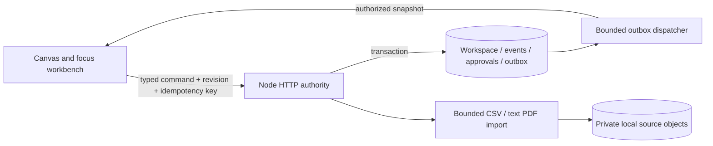

# R1 implementation boundaries

Status: local implementation candidate, 18 October 2026. [Local verification](R1_LOCAL_VERIFICATION.md) records the executed checks. The earlier [master plan](../handoff/Final/planning-review/TABLETOP_R1_MASTER_PLAN.md) remains a planning baseline; its hosted and live-model acceptance criteria have not all been completed.

## One application, three workflows

The React client renders invoice, teaching, and encounter workspaces through one typed capability registry and manifest compiler. The compiler validates ports, required inputs, capability versions, visibility, duplicate IDs, resource limits, and cycles before evaluating a plan. It returns no partial plan on failure. The invoice surcharge adds a review composition; physics representations derive from one model. Components are curated application code. The application does not execute model-generated JavaScript.

`src/tabletop/shared/contracts.ts` defines the contracts. `src/tabletop/domain/` contains deterministic domain decisions and role projections. `src/tabletop/runtime/` compiles and evaluates the display graph. The domain can run on the server without React; the graph calculates views from a projection that has already been authorized by the server.

## Authority, persistence, and recovery

The Node service serves the built frontend, API, and WebSocket from one origin. HttpOnly SameSite cookies identify a session. Mutations require Origin and CSRF checks. The server derives role and membership from the session; client-supplied identities cannot grant authority. Invitations are one-use, seat-scoped, and expire after ten minutes, including their lost-ack retry window.

Each command is bound to a workspace, epoch, opaque projected revision, and command ID. The transaction checks authority and current state before updating the domain, receipts, audit events, and outbox. Retries return the accepted receipt. A stale or changed command is refused. Approval is stored separately and bound to the exact candidate, source state, and validation proof. Rollback appends a new revision.

WebSockets send the latest authorized projection after commit. A private change that does not change a learner's visible projection does not send that learner an update. Per-peer sends are serialized and coalesced. The outbox dispatcher polls bounded batches; a reconnect or `/events` read resynchronizes a full snapshot. This implementation does not offer client event-by-event replay or exactly-once network delivery.

Local mode uses an on-disk PGlite database and a private filesystem object store. These are real local persistence, exercised across database close/reopen. Production mode requires external PostgreSQL, explicit HTTPS `PUBLIC_ORIGIN`, and a pre-applied schema. It refuses automatic production migration. Database schema version is 4; API and manifest schema versions are 1.

Workspaces expire after seven days. Session idle/hard limits are 24 hours/seven days. Reset advances the epoch, revokes invited sessions, scrubs prior private content, and queues source-object deletion. Bounded expiry sweeps scrub expired workspaces, and the local bootstrap removes queued private files. Tombstones preserve only the minimal state needed to reject retries. These controls are not a backup or account-management service.

## Evidence, imports, and calculations

Invoice money uses integer satang; weight uses integer grams. Rule dates use inclusive start and exclusive end boundaries. Missing, duplicate, ambiguous, or unreviewed evidence remains unresolved. Imported shipment and invoice datasets replace their respective current rows, while source records, rules, and saved runs remain.

Local uploads accept bounded CSV, supported text-PDF templates, and rate-card text. Files start as `provided`; only explicit human review can mark them `verified`. Original objects have opaque immutable IDs and authenticated downloads. Exports escape HTML and neutralize spreadsheet formula prefixes. PDF parsing runs in a bounded child process with page, text, time, and memory limits. Scanned PDFs, arbitrary invoice layouts, encrypted PDFs, and active content are outside this slice.

Public production uploads return a typed unavailable response until a private durable object store, quarantine/scanning path, and deletion/recovery workflow are integrated and tested. The local parser is not malware-scanning proof.

## AI boundary

No live model provider is configured. The UI explicitly uses manual typed rules; the HTTP model endpoint reports `MODEL_NOT_CONFIGURED`. The injected model gateway is tested for validation, reservation/deduplication, budget caps, timeout, cancellation, and reset tombstones. Those tests use test providers only and do not demonstrate live model quality or cost.

Before enabling a provider, implement the adapter and atomic dispatch into the authority, approve the provider/model/data/budget, then run the plan's holdout and failure tests. A proposal must still pass simulation, validation, human approval, and activation. No model can approve its own output.

## Hosting direction

The current implementation fits one long-running Node service with managed PostgreSQL in one region. Keeping the UI, API, and WebSocket on one origin simplifies cookie and Origin handling. The included Dockerfile packages that shape; no host, database, domain, billable service, or external migration has been created.

Cloudflare remains an option for an edge layer or private object storage. A Workers/Durable Objects implementation would need a deliberate adapter for the current Node process, filesystem, SQL, and PDF-worker boundaries. Durable Objects support WebSocket coordination, but that does not make this container a drop-in Worker. This is an inference from the current code and [Cloudflare's WebSocket model](https://developers.cloudflare.com/durable-objects/best-practices/websockets/). A long-running service such as Render also supports WebSockets; see its [official deployment guidance](https://render.com/docs/websocket). Provider and cost selection remain deferred under the local-first decision.

Before any hosted preview, complete: provider/region/budget selection; external PostgreSQL integration and approved migration; secure proxy/client-rate-key handling; operational quotas; private uploads if enabled; live-model proof if enabled; build/served-asset parity; two-device testing; backup/restore and rollback. No production-readiness claim follows from the local test results.

## Repository validation

The validation workflow uses pinned official GitHub Actions, read-only repository permission, no deployment credentials, and no publishing step. It installs locked dependencies, checks high-confidence credential patterns, audits dependencies, runs unit/integration and browser tests, and builds the application. It retains only JSON test summaries. The publication scanner is a mistake detector, not a complete secret-audit service.

The original demo is available only at `?legacy-demo=1`. Its authored simulation and optional local Component Lab are separate from R1 authority and live-model claims. The production runtime does not mount the development Component Lab handler.
