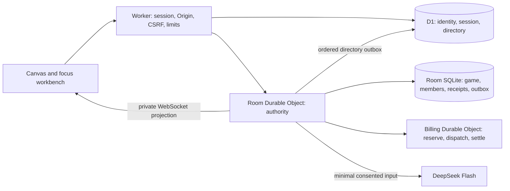

# R1 implementation boundaries

> **Visibility policy (F015, 2026-10-21):** tables currently run with `VISIBILITY_POLICY = 'open'` ([`visibility.ts`](../src/tabletop/shared/visibility.ts)): every member receives the whole table state (drafts, notes, hidden values, other learners' answers) and can read every member's AI chat. Only the asker can confirm their chat's action proposal, and the AI context still uses only the asker's own recent exchanges. Statements below about owner-private drafts, hidden values and actor-private conversations describe the retained `'private'` policy. See [F015](features/F015-open-visibility.md).

This document describes the shared runtime and original three workflows. The deployed file-driven `table` and its private assistant are detailed in [Generic table design](GENERIC_TABLE_DESIGN.md). See [current deployments](DEPLOYMENTS.md) and [acceptance](GENERIC_TABLE_ACCEPTANCE.md) for current release evidence; the [initial release record](CLOUDFLARE_RELEASE.md) and [master plan](../handoff/Final/planning-review/TABLETOP_R1_MASTER_PLAN.md) retain their historical scope.

## Shared application and domain

The React client renders invoice, teaching, encounter and generic table workspaces. The original workflows use a typed capability registry and manifest compiler. The compiler checks ports, required inputs, versions, visibility, duplicate IDs, limits, and cycles before evaluating a plan. It returns no partial plan on failure. Generic tables add a bounded data-only interpreter for typed collections, records, actions, conditions and atomic effects. Components are curated application code; the application does not execute model-generated JavaScript.

`src/tabletop/shared/contracts.ts` defines the contracts. `src/tabletop/domain/` contains deterministic decisions and role projections. `src/tabletop/runtime/` calculates displays from an authorized projection. `server/authority.ts` applies the same command rules through either the PostgreSQL/PGlite repository or the Cloudflare room repository.

## Cloudflare identity and sessions

Google OIDC in `cloudflare/auth.ts` validates state, a browser binding, PKCE, nonce, signature, issuer, audience/authorized party, token age, and verified email. Google subject identifies the stable account. The first verified login matching the configured admin email pins that subject; another account reusing the email cannot claim its privileges.

An HttpOnly, SameSite cookie carries a random session token. D1 stores its hash, expiry, and revocation. Sessions idle out after 24 hours and expire after seven days. Logging in again with the same Google account recovers room membership without another invitation. Logout revokes that session; it does not erase a room or log out every other device. HTTPS uses `__Host-` cookies; loopback development uses separate cookie names.

Mutations require the configured Origin and CSRF token. The browser cannot grant itself a role or another actor ID. Room WebSockets recheck session expiry/revocation through D1 primary before private projections and on received messages. Socket attachments are references, not continuing authorization. Authentication failure blocks delivery.

## Rooms, invitations, and recovery

A canonical UUID names each Room Durable Object, independently of its opaque runtime ID. SQLite persists identity, game state, membership, invitations, command receipts, approvals, snapshots, events, and outboxes. Saved Cloudflare rooms do not expire with a login or after seven days. Explicit reset advances the epoch, removes invited memberships, and scrubs previous private contents. Account deletion and configurable retention are outside this slice.

Invitations are one-use, seat-scoped, and valid for ten minutes. Only the room owner can invite. A pending invitation survives Google login in the same browser session and is redeemed as the verified account. Servers store bearer tickets only as hashes. An explicit revoke-and-reissue action can replace a lost unused link atomically for an unoccupied seat; it cannot evict a joined player.

Each command is bound to the room, epoch, opaque projected revision, actor, and command ID. A transaction validates authority and state before updating the domain, receipt, audit, and outbox. Matching retries return the receipt; conflicting or stale commands fail. Approval is bound to the candidate, source state, and validation proof. Rollback appends a revision.

D1 provides discovery, not membership authority. Its directory stores opaque room references. My tables and admin metadata resolve references through current Room authorization. An ordered outbox records increasing membership sequences; D1 rejects older sequence/epoch writes. SQLite and D1 do not share a transaction. Retries repair index lag without using stale directory membership to authorize access.

Hibernating WebSockets send current authorized snapshots after commits. Hidden DM notes, rolls, and learner answers stay outside other roles' projections. Delivery is not exactly once; reconnect and view/event reads resynchronize a snapshot. Durable alarms cover pending work and reaction deadlines, and commands also check the server clock. DM pause stores remaining reaction time and blocks gameplay; resume restores that duration. Closing a tab alone does not pause an encounter.

The admin panel exposes room metadata such as title, owner/members, kind, and status. It does not expose private game contents, impersonation, deletion, or support overrides.

## AI and cost control

`cloudflare/ai.ts` dispatches DeepSeek Flash with explicit consent. Invoice requests include the selected verified source excerpt and relevant rules; teaching and encounter requests include bounded rule parameters. Private answers, DM notes, unrelated files, and event histories are excluded. Structured output is validated before creating a draft. The model cannot approve or activate it.

The Billing Durable Object reserves a conservative peak-price maximum before a provider call, limits concurrency and per-actor activity, and permits one dispatch per stable job ID. Valid usage settles once, including cached input charges. Unknown outcomes retain the reservation. Positive daily/monthly budgets and a provider key are required; defaults are zero. This ledger does not cover other applications using the key or Cloudflare infrastructure charges.

Room jobs recheck epoch, revision, role, and session before committing. Duplicate commands do not redial the provider. Reset scrubs old job payloads. A failed completion-status write is reconciled against the command receipt, preserving a successfully committed draft. Uncertain provider outcomes after a restart are not automatically retried.

Local browser acceptance uses a synthetic provider with the real local ledger and room commit. [Provider verification](AI_PROVIDER_VERIFICATION.md) records earlier bounded live API calls; [generic acceptance](GENERIC_TABLE_ACCEPTANCE.md) records later real-provider and two-Google-account staging checks. Full latency/load and live budget-negative acceptance remain incomplete. Generic rule drafting and actor-private table conversation have distinct consent and context contracts in [Generic table design](GENERIC_TABLE_DESIGN.md).

## Evidence and uploads

Invoice money uses integer satang and weight uses integer grams. Dates include the start and exclude the end. Missing, ambiguous, duplicate, or unreviewed evidence remains unresolved. Explicit human review marks a source verified. Exports require authority, escape HTML, and neutralize spreadsheet formula prefixes.

Cloudflare advertises `uploads: false` for the legacy invoice upload endpoint and has no R2 binding. The sample invoice case, source review, rules, calculations, and exports remain available. Generic `table` rooms separately accept bounded UTF-8 CSV/JSON/TXT/Markdown source text through authorized commands into private Room storage. This is not PDF/image/binary upload support. Broader document imports require private storage, quarantine/scanning, bounded parsing, deletion, and restore testing before enablement.

## Alternate local Node runtime

The Node service serves the same frontend/domain using PGlite and private filesystem objects in local mode. It retains guest sessions and seven-day workspace expiry/scrubbing. Its model endpoint remains disabled. Local CSV and supported text-PDF imports work; arbitrary layouts, scans, encryption, and active content are outside this slice.

The alternate Node container requires external PostgreSQL, HTTPS, and explicitly applied schema. Startup never migrates a production database. The Dockerfile is not the Cloudflare deployment path. See [local development](LOCAL_DEVELOPMENT.md).

## Release limits

CI uses pinned actions, read-only repository permissions, synthetic credentials, and no deployment step. It checks publication paths, dependencies, types, domain/server tests, local D1/DO tests, browser behavior, and Worker dry-run bundling.

The testing release completed its approved resource/schema changes, hosted Google setup, asset parity, bounded live AI and two-account staging checks. Current evidence and remaining gates are listed in [Generic table acceptance](GENERIC_TABLE_ACCEPTANCE.md). Two physical devices, load/soak, live budget-negative tests and coordinated D1/Room/Billing restore are not fully verified. Durable storage alone does not prove an application-wide backup. The legacy `?legacy-demo=1` experience and local Component Lab remain separate.
