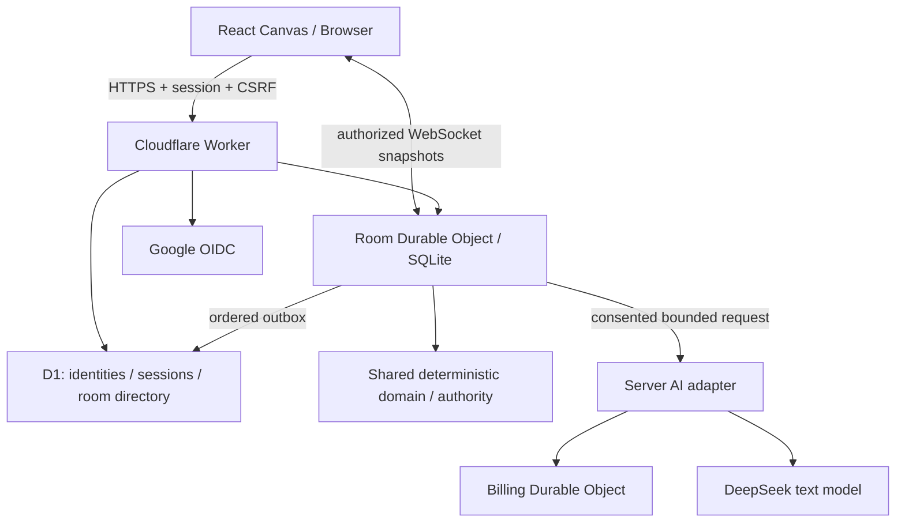

# ภาพรวมและงานสำหรับทีมพัฒนาต่อ

เอกสารนี้อธิบายระบบที่มีอยู่จริง ณ 19 ตุลาคม 2026 เริ่มอ่าน [README](../README.md) → [วิธีใช้](USER_GUIDE_TH.md) → เอกสารนี้ ก่อนแก้โค้ด ดู URL และ source ที่ deploy ใน [Deployment](DEPLOYMENTS.md)

## แนวคิดและขอบเขตผลิตภัณฑ์

ผู้ใช้มองโต๊ะเป็นงานหรือเกมที่กลับมาทำต่อได้ ห้องจึงเป็นหน่วยบันทึกหลัก ส่วนการล็อกอินและคำถาม AI เป็นกิจกรรมภายในห้อง การส่งข้อความใหม่หรือปิด browser ไม่สร้างโปรเจกต์ใหม่

มีสองเส้นทางใช้งาน: โต๊ะสำเร็จรูป invoice/physics/encounter สำหรับกฎเฉพาะทาง และ **Shared data table** ที่ใช้ interpreter ทั่วไปสำหรับ collections, typed fields, records, conditions, actions, atomic effects, uniqueness และ optional turns ตัวหลังไม่เลือกโค้ดตามชื่อเคส จึงใช้กับโจทย์ใหม่ได้ภายในข้อจำกัด schema

ทุกอย่างเปิดจาก Canvas ได้: ไฟล์ กฎ การตรวจร่าง ผลลัพธ์ actions ผู้ร่วมโต๊ะ และประวัติ การใช้ปุ่มเล่นเองเป็นทางหลัก AI ช่วยร่างหรืออธิบาย และต้องมีการยืนยันก่อนเปลี่ยนสถานะ การเปลี่ยนกฎต้องผ่าน simulate/validate/approve/activate

รายละเอียดขนาดไฟล์ จำนวน collections/actions/records การแก้ schema และบริบท AI มีแหล่งอ้างอิงหลักที่ [Generic table design](GENERIC_TABLE_DESIGN.md) ข้อจำกัดเหล่านี้เป็นข้อจำกัดผลิตภัณฑ์ปัจจุบัน ไม่ใช่เพียงข้อความแนะนำ

## สถาปัตยกรรม

| ส่วน | หน้าที่ / สิ่งที่ไม่ควรสลับหน้าที่กัน |
| --- | --- |
| Browser | แสดง projection ตามสิทธิ์ จัด Canvas ส่งคำสั่ง; ค่าใน browser ไม่เป็นผู้ตัดสินสิทธิ์หรือผลเกม |
| Worker + D1 | Google identity, session, CSRF, rate limits และดัชนี My tables; ดัชนีใช้ค้นหาห้อง ไม่ใช่ authority ของสมาชิก |
| Room DO | หนึ่งตัวต่อห้อง เก็บ state, membership, invitation, epoch/revision, command receipts, rules, events และ model jobs แบบถาวร |
| Shared domain / authority | ตรวจ role/seat/turn/conditions และ commit ผลแบบ atomic; คำสั่งซ้ำได้ receipt เดิม; คำสั่ง stale ไม่ทับข้อมูลใหม่ |
| Billing DO | จองงบก่อน dispatch, settle usage และคง reservation เมื่อผล provider ไม่ชัดเจน; ไม่ redial โดยอัตโนมัติ |
| AI adapter | ส่งเฉพาะข้อมูลในขอบเขต consent และตรวจ structured output; โมเดลไม่ให้สิทธิ์ ไม่อนุมัติ และไม่ execute code |

D1 กับ DO ไม่อยู่ใน transaction เดียวกัน การ sync directory ใช้ outbox ที่เรียงลำดับและ retry ได้ ส่วน WebSocket ส่ง snapshot ตามสิทธิ์และ resync เมื่อ reconnect ไม่ใช่การรับประกันส่ง event ครั้งเดียวเสมอ

ไฟล์ต้นฉบับและร่างกฎเป็นของเจ้าของห้อง แชท assistant เป็นของผู้ถามแต่ละคน กฎ/ข้อมูลที่ active เป็นส่วนร่วม หน้าจอและ API แอดมินของแอปให้ดูเฉพาะ metadata ส่วนสิทธิ์ผู้ดูแล Cloudflare/storage เป็นขอบเขตโครงสร้างพื้นฐานที่ต้องจัดการแยก อย่าเพิ่มการส่ง private content เพียงเพื่อทำให้หน้า UI สะดวกขึ้น รายละเอียด authentication และการแยก projection อยู่ใน [R1 architecture](R1_ARCHITECTURE.md)

## จุดเริ่มต้นในโค้ด

| งานที่จะทำ | จุดเริ่มอ่าน |
| --- | --- |
| หน้าเลือกโต๊ะ session และ API flow | [`src/tabletop/TabletopApp.tsx`](../src/tabletop/TabletopApp.tsx), [`client.ts`](../src/tabletop/client.ts) |
| Canvas และ object ที่เปิดใช้งาน | [`src/tabletop/ui/CanvasWorkspace.tsx`](../src/tabletop/ui/CanvasWorkspace.tsx), [`CanvasObjectContent.tsx`](../src/tabletop/ui/CanvasObjectContent.tsx), [`TableSurface.tsx`](../src/tabletop/ui/TableSurface.tsx), [`TableCanvasObjects.tsx`](../src/tabletop/ui/TableCanvasObjects.tsx) |
| แชทและยืนยันหนึ่ง action | [`TableAssistant.tsx`](../src/tabletop/ui/TableAssistant.tsx), [`table-assistant-contracts.ts`](../src/tabletop/shared/table-assistant-contracts.ts) |
| Schema และ interpreter โต๊ะทั่วไป | [`table-contracts.ts`](../src/tabletop/shared/table-contracts.ts), [`domain/table.ts`](../src/tabletop/domain/table.ts) |
| สิทธิ์ transaction และ command lifecycle | [`server/authority.ts`](../server/authority.ts), [`cloudflare/room.ts`](../cloudflare/room.ts), [`room-repository.ts`](../cloudflare/room-repository.ts) |
| Cloudflare routing / auth / directory | [`cloudflare/index.ts`](../cloudflare/index.ts), [`cloudflare/`](../cloudflare/) |
| Provider / consent / budget / recovery | [`cloudflare/ai.ts`](../cloudflare/ai.ts), [`billing.ts`](../cloudflare/billing.ts) |
| Demo ที่หยุดแล้วลองเอง | [`InteractiveDemo.tsx`](../src/tabletop/demo/InteractiveDemo.tsx), [`scenarios.ts`](../src/tabletop/demo/scenarios.ts), [`practice.ts`](../src/tabletop/demo/practice.ts) |
| AI-generated art ที่ใช้ตอน demo | [`public/demo-art/`](../public/demo-art/), [provenance](DEMO_ART.md) |
| Regression และ browser scenarios | [`domain/table.test.ts`](../src/tabletop/domain/table.test.ts), [`cloudflare/room.test.ts`](../cloudflare/room.test.ts), [`tests/generic-table-browser.mjs`](../tests/generic-table-browser.mjs) |
| CI | [`.github/workflows/validate.yml`](../.github/workflows/validate.yml) |

สำหรับ flow local และการเลือก Node/Cloudflare emulator ดู [CONTRIBUTING](../CONTRIBUTING.md) ตัว Node guest runtime เป็นเส้นทางพัฒนาเดิม มีอายุ workspace 7 วันและปิด AI จึงใช้แทนหลักฐาน Google resume ของ production ไม่ได้

## สิ่งที่ทดสอบแล้ว

แยกหลักฐานตามสิ่งที่ทดสอบจริง รายละเอียดและข้อค้นพบอยู่ใน [Generic table acceptance](GENERIC_TABLE_ACCEPTANCE.md)

| ชั้นการตรวจ | ผล / ขอบเขต |
| --- | --- |
| CI รุ่นที่ deploy `f1725c8` | [ผ่าน](https://github.com/Thanyers/tabletop/actions/runs/39235880486): unit/SQL 299, Cloudflare integration 65, Cloudflare browser 16 checks, Node browser 7 checks ไม่มี browser error; typecheck/build/Worker dry-run/public scans ผ่าน |
| บัญชีและ provider ใน CI | เป็น fixture/synthetic ไม่เรียก Google หรือ DeepSeek จริง |
| DeepSeek จริง | ร่างโจทย์ทั่วไปครบสามแบบและเปลี่ยนคะแนนระหว่างเล่นผ่าน review; บางร่างก่อนหน้าไม่ผ่านและถูกปฏิเสธ ไม่ activate อัตโนมัติ |
| Google สองบัญชีจริงบน staging | อุปกรณ์ยืมคืน, จัดเวร, River Race; invite, สิทธิ์ส่วนตัว, conflict, invalid actions, เปลี่ยนกฎ, logout/resume; ใช้ห้องจำลองรวม 4 ห้อง |
| แชทจริงสองบัญชี | คำถามภาษาไทย/current state, follow-up, private history หลัง reload, explicit confirmation และ direct play ทำให้ proposal เก่า stale |
| Recovery บน staging | เปิด `TABLE_READ_ONLY`, อ่านข้อมูลเดิมได้และปิดการแก้ไข แล้วเปิดกลับมาเล่นต่อได้; ไม่ใช่การกู้ backup ทั้งระบบ |
| Production | migration ที่อนุมัติรักษา directory/member เดิมครบ; health/readiness/capabilities และ asset parity ผ่าน; ห้อง encounter เดิม resume โดยข้อมูลเดิมอยู่ครบ |
| Prepared demo art | ตรวจ autoplay, pause/takeover, ภาพโหลดและ narrow layout; ภาพอยู่เฉพาะ demo; ไม่มี runtime image call |

ข้อผิดพลาดที่พบจริง: AI เคยอธิบายเหตุว่าไม่มีการเล่นจากการที่ proposal ไม่ยืนยัน ทั้งที่ผู้เล่นใช้ปุ่มเล่นเองแล้ว ปรับคำแนะนำและตรวจซ้ำได้คำตอบที่ระมัดระวังขึ้น แต่ **ข้อความ AI ยังไม่ใช่ action audit** ให้ใช้ Table history

การทดสอบมือถือจริง/สองอุปกรณ์จริง, load/soak, live budget-negative และ restore D1 + Room + Billing ให้สอดคล้องกันทั้งระบบยังไม่ครบ ไม่ควรใช้ตัวเลข CI หรือการมี persistent storage เป็นคำรับรอง production readiness ทุกกรณี

## งานที่ควรทำต่อ

ลำดับนี้เป็นข้อเสนอสำหรับทีม ไม่ใช่ฟีเจอร์ที่มีแล้วหรือคำอนุมัติให้เปลี่ยน production

1. **ความพร้อมเปิดใช้กว้าง:** ทดสอบสองอุปกรณ์และมือถือ, วัด concurrency/DO duration, ทดลองกู้ D1 + Room + Billing บนข้อมูลจำลอง แล้วกำหนด owner/ขั้นตอน incident ที่ทีมทำซ้ำได้
2. **ความต่อเนื่องระยะยาว:** ออกแบบ summary/retrieval ที่อ้างข้อความและ rule revision ได้ ผู้ใช้ตรวจ/แก้ได้ แยกจาก authoritative state; วาง retention/export/delete และทางออกเมื่อถึง 500 jobs ห้ามลบเงียบ ๆ
3. **ความเข้าใจคำสั่งเล่น:** เพิ่มการจับคู่ภาษาธรรมชาติกับ action โดยคง preview/confirmation, revision/actor checks และการถามเมื่อกำกวม ไม่ทำ autonomous turns โดยปริยาย
4. **ไฟล์และความเป็นส่วนตัว:** หากเพิ่ม PDF/ภาพ ให้มี private storage, quarantine/scanning, bounded parser, quota และ recovery ก่อนเปิดใช้งาน ส่วนการแก้ schema ระหว่างเล่นต้องมี data migration workflow แยก
5. **ประสบการณ์เริ่มใช้:** ทำ starter flows สำหรับโจทย์ทั่วไปและคำอธิบาย error ที่ชัดขึ้น โดยไม่ผูก production interpreter เข้ากับชื่อ scenario; คงเส้นแบ่ง public practice กับ saved multiplayer ให้เห็นในหน้าใช้จริง

## ส่งรุ่นใหม่และกู้คืน

1. เปิด branch งานจาก `feat/tabletop-r1` ตาม [CONTRIBUTING](../CONTRIBUTING.md) ตรวจ diff และ CI ก่อนขอ review; การ merge main ต้องเป็นการตัดสินใจของผู้ดูแล repo
2. ก่อน deploy ให้ operator ตรวจ Worker/D1/DO เป้าหมาย, current version, bindings, secrets ที่มี, migration ที่ใช้แล้ว และ source commit อย่าคัดลอก ID หรือ secret ลงไฟล์ tracked
3. ถ้าจะเขียนฐานหรือเปลี่ยน schema ถาวร ต้องระบุ environment/table/operation/ขอบเขต/จำนวนแถวและแผนกู้คืนเพื่อขออนุมัติก่อน จากนั้นใช้ scope เดิมและตรวจผล ไม่ถือว่าคำขอแก้ UI อนุมัติ migration ด้วย
4. ทดลอง staging ด้วยข้อมูลจำลอง ตรวจ served asset hashes, health/readiness/capabilities และ UI จริงที่เปลี่ยน แล้วจึงส่ง commit ที่ตรวจแล้วขึ้น production ภายใต้ขอบเขตที่อนุมัติ
5. หลัง release ตรวจ parity และ resume ของข้อมูลเดิม บันทึก version/source/test evidence ที่ไม่มี credential หรือข้อมูลผู้ใช้ แล้วอัปเดต [Deployment](DEPLOYMENTS.md)

เมื่อมีห้อง `table` แล้ว **อย่าถอยไป Worker รุ่นที่รองรับเพียงสามชนิดเดิม** ใช้ build ที่เข้ากับ schema พร้อม `TABLE_READ_ONLY=true` เพื่อหยุด table writes ใหม่ เก็บข้อมูลและอ่าน/resume ได้ รอหรือ reconcile provider jobs ที่ค้างก่อนประกาศว่า recovery สมบูรณ์ จากนั้นแก้ไปข้างหน้า ดู [compatible recovery](GENERIC_TABLE_ACCEPTANCE.md#compatible-recovery-build)

Config และ receipt ของ operator รวมถึงหลักฐานที่มี identity/room IDs อยู่ใน ignored local `test-results/` และไม่ติดไปกับ clone ผู้รับหน้าที่ deploy ต้องรับสิทธิ์และชุด config ผ่านเจ้าของระบบ ไฟล์ migration ใน Git ไม่ได้แปลว่าอนุญาตให้รันกับฐานถาวร และไม่มีคำสั่ง deploy production อัตโนมัติใน CI
