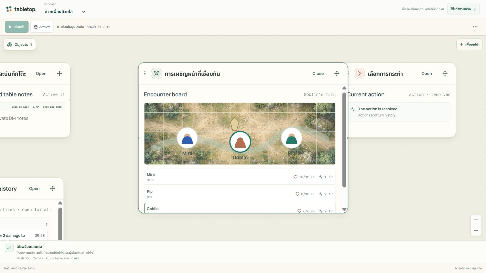

# วิธีใช้และวิธีเล่น Tabletop

คู่มือตาม source branch นี้ ณ 20 ตุลาคม 2026 เริ่มที่ [ภาพรวมผลิตภัณฑ์](../README.md) และตรวจ [Deployment](DEPLOYMENTS.md) เพื่อเทียบกับรุ่นที่เปิดใช้จริง หน้าเริ่ม `/new` และ Generative Canvas ด้านล่างเป็นงานรุ่นถัดไป ยังไม่ควรถือว่าอยู่บน production

งานรุ่นถัดไปรวม Generative Canvas (F005), การตั้งชื่อโต๊ะ (F002) และช่องแชทบนโต๊ะ (F006): เริ่มจากข้อความหรือไฟล์ ให้ AI ร่างภาพ/กราฟ/สูตร/ตัวควบคุม ทดลองร่างส่วนตัว แล้วเปิดใช้ร่วมกัน อ่าน [วิธีใช้ Generative Canvas](GENERATIVE_CANVAS_RUNTIME.md) และผลตรวจใน [spec.md](../spec.md); ความสามารถชุดนี้ยังไม่ได้ยืนยันบน production

## เลือกวิธีลอง

ก่อนล็อกอิน หน้าแรกเล่าแนวคิด Tabletop พร้อมภาพโต๊ะที่ค่อย ๆ เข้ารูปตามงาน และตัวอย่างงาน การเรียนรู้ และการเล่นร่วมกัน กด **Sign in** เพื่อไปปุ่ม **Continue with Google** หรือ **Auto demo** เพื่อลองโดยไม่สมัคร หลังล็อกอินจะเข้าสู่หน้าเริ่มโต๊ะเดิม; ใน Canvas ไม่มีข้อความแนะนำผลิตภัณฑ์ชุดนี้

| วิธี | เหมาะกับ | AI / ผู้เล่น / การบันทึก |
| --- | --- | --- |
| `/demo` | ดูขั้นตอนแล้วรับช่วงเล่นเอง | ลำดับเตรียมไว้, persona จำลอง, ไม่มี provider call, ข้อมูลอยู่ในแท็บ |
| แอปหลัก → **Start a new table** | เลือกโต๊ะตัวอย่าง พิมพ์โจทย์ หรือเริ่มจากไฟล์ตัวเอง | Google account, AI เมื่อยินยอม, ห้องบันทึกที่เซิร์ฟเวอร์ |
| `/demo/replay` | ทบทวนผลทดสอบที่เก็บไว้ | ดูย้อนหลัง 9 เรื่อง; ไม่แก้สถานะ |

## ลองเดโมใน 5 นาที

1. เปิด [Auto demo](https://tabletop.ptchrr.workers.dev/demo) ไม่ต้องล็อกอิน
2. เลือก **ตรวจบิลและแก้กติกา**, **ทดลองแรงและมวล** หรือ **ช่วยเพื่อนด้วยโล่** จากตัวเลือกโจทย์ด้านบน
3. กด **เล่นเดโม** หรือเปิด **ตัวเลือกเดโม (⋯)** → **ทำขั้นถัดไป** เริ่มจาก Canvas ว่าง แล้วเห็นการนำเข้าไฟล์ เพิ่มวัตถุบนโต๊ะ ตรวจ/เปิดกฎ และเล่นตามลำดับ
4. กด **Objects** บน Canvas แล้วเลือกไฟล์ กฎ ผลลัพธ์ หรือประวัติที่ต้องการเปิด; ใช้ **Previous view** เพื่อกลับจากวัตถุที่เลือก
5. กด **พักเดโม** เพื่อพักและเดินเดโมต่อภายหลัง หรือ **ลองเอง** เพื่อรับช่วง การกรอกค่าหรือใช้ปุ่มบนโต๊ะก็หยุดสคริปต์ทันที
6. เมื่อลองเองแล้ว เดโมจะไม่รันต่อมาทับสิ่งที่แก้ หากอยากดูใหม่ให้เปิด **ตัวเลือกเดโม (⋯)** → **เริ่มใหม่** แล้วยืนยันก่อนทิ้งสถานะเดิม
7. เปิด **ตัวเลือกเดโม (⋯)** → **ลองเป็น** เพื่อสลับครู/นักเรียน หรือ DM/Mira/Pip ส่วน **บันทึกและข้อมูลเดโม** ที่ท้ายหน้ามี **ดาวน์โหลดบันทึก** เพื่อเก็บ JSON ก่อนปิดหรือรีเฟรช

ไฟล์ที่ลากเข้าโหมดนี้ต้องเป็น CSV/JSON ตามรูปแบบตัวอย่างบนโต๊ะ ขนาดไม่เกิน 128 KiB เดโมอ่านและคำนวณจริงในแท็บ แต่ไม่ได้ใช้ AI แปลไฟล์อิสระและไม่ได้สร้างห้อง multiplayer

ภาพฉากและรถเป็นภาพประกอบที่เตรียมไว้ ตัวเลข HP/AP เทิร์น และผลคำนวณยังมาจากสถานะที่เล่นอยู่ ฉากไม่ได้เพิ่มกฎการชนหรือเส้นทางเดินใหม่ ดู [ที่มาของภาพ](DEMO_ART.md)

## สร้างโต๊ะจากข้อความหรือไฟล์ของตัวเอง

กด **Start a new table** ที่หน้าแรก หรือเลือก **New table** จากเมนูโต๊ะด้านบน จะเข้าหน้าเริ่ม (`/new`) ที่มี 3 ทาง: กดการ์ดโต๊ะสำเร็จรูป 3 ใบเพื่อเปิดโต๊ะตัวอย่าง · พิมพ์ว่าอยากทำอะไรแล้วกด **Start with this** เพื่อสร้างโต๊ะข้อมูลว่างที่มีข้อความนั้นรออยู่ในช่องร่างกฎ · หรือกดการ์ดใบที่สี่ **Start empty** แล้วทำตามขั้นตอนด้านล่าง

1. เปิด [แอปหลัก](https://tabletop.ptchrr.workers.dev/) แล้วกด **Continue with Google**; หน้าเริ่มโต๊ะถาม **What are you here to do?** และบอก **Start with what you're working on. Your table will take shape around it.** ถ้ากลับมาที่โต๊ะเดิม ให้กด **All tables** เพื่อกลับมาหน้าเริ่มโต๊ะ
2. เลือก **Start a new table** แล้วการ์ด **Start empty** เพื่อเริ่มโต๊ะว่าง หรือพิมพ์โจทย์แล้วกด **Start with this**; การ์ดตัวอย่างอยู่หน้าเดียวกัน
3. โต๊ะใหม่เริ่มด้วย Canvas ว่างและช่อง **Message** ด้านล่าง พิมพ์โจทย์ได้เลย หากมีไฟล์ให้ลากลง Canvas หรือใช้ปุ่มแนบไฟล์ข้างช่องข้อความ รองรับ UTF-8 `.csv`, `.json`, `.txt`, `.md` เท่านั้น: **32 KiB ต่อไฟล์, ไม่เกิน 4 ไฟล์, รวม 64 KiB**
4. กดส่งแล้วตรวจหน้าขอยินยอม ซึ่งบอกว่าคำขอ ข้อมูลโต๊ะ และไฟล์ชื่อใดจะส่งให้ AI ก่อนมีกฎ เจ้าของใช้ข้อความนี้ให้ AI ร่างโต๊ะได้โดยไม่ต้องแนบไฟล์ การแนบไฟล์อย่างเดียวยังไม่เรียก AI
5. เมื่อร่างพร้อม กด **Review rules** ที่การ์ดคำตอบเพื่อเปิด Rules บน Canvas ตรวจทั้ง collection, แถวข้อมูล, actions, เงื่อนไข, ผลที่จะเปลี่ยน และหลักฐาน/สมมติฐาน ทดลองบนสำเนาส่วนตัวได้ หาก AI เข้าใจผิดให้ขอแก้ก่อนเปิดใช้
6. ทำ **Preview change → Check rules → Approve rules → Use these rules** ตามลำดับ การอนุมัติผูกกับร่างและสถานะที่ตรวจ ถ้าข้อมูลเปลี่ยนต้องตรวจร่างใหม่
7. ตรวจชุดกฎที่เปิดใช้และข้อมูลบน Canvas แล้วลองหนึ่ง action พร้อมดูประวัติว่าเกิดผลตรงตามกฎ

บน Canvas กด **Objects** เพื่อเปิดเครื่องมือโต๊ะและเลือกวัตถุ; ลากการ์ดจากหัวการ์ดเพื่อย้ายได้เลย ไม่มีโหมด Use/Arrange ปุ่ม **Actions** มีตัวเลือกคำสั่งทั่วไป และเมื่อเลือกแถวในรายการข้อมูลจะเห็น actions ที่ใช้กับแถวนั้น

**ไฟล์บนโต๊ะทุกคนที่ถูกเชิญเห็นและอ่านได้** (สมาชิกเพิ่มไฟล์ได้ เฉพาะเจ้าของลบไฟล์) ส่วนร่างกฎอยู่ในมุมมองเจ้าของ เมื่อเปิดใช้แล้ว **ข้อมูลและกฎที่ active เป็นข้อมูลร่วมของสมาชิกห้อง** จึงควรใช้ข้อมูลตัวอย่างที่ไม่มีข้อมูลลับในรอบทดสอบ

เริ่มจาก [ไฟล์อุปกรณ์ยืมคืน จัดเวร และแข่งเรือ](examples/README.md) ซึ่งมี prompt และผลที่ควรตรวจ ต้องอ่านผลจริงและตรวจทุกขั้น ไม่กด **Use these rules** เพียงเพราะ **Check rules** ผ่าน

## ตั้งชื่อโต๊ะ

เจ้าของ ครู หรือ DM กดปุ่มดินสอข้างชื่อโต๊ะที่แถบด้านบน พิมพ์ชื่อใหม่ (1–100 ตัวอักษร) แล้วกด Enter หรือคลิกที่อื่นเพื่อบันทึก กด Esc เพื่อยกเลิก สมาชิกคนอื่นเห็นชื่อใหม่ทันทีและในรายการโต๊ะของตัวเอง แต่เปลี่ยนชื่อไม่ได้ โต๊ะข้อมูลที่ยังไม่เคยตั้งชื่อจะแสดงชื่อจากกฎที่เปิดใช้

## เชิญเพื่อนเข้าห้องเดียวกัน

**โต๊ะข้อมูล: ลิงก์เดียวใช้ได้หลายคน**

1. เจ้าของกด **Invite** หรือไอคอนคนมุมขวาบน ในส่วน **INVITE LINK** เลือกอายุลิงก์ (1, 7 หรือ 30 วัน) แล้วกด **Turn on invite link**
2. กด **Copy link** แล้วส่งในกลุ่มแชทได้เลย · ลิงก์ปิดเป็นค่าเริ่มต้น เจ้าของต้องกดเปิดเองทุกโต๊ะ
3. ใครเปิดลิงก์ใน browser ที่ล็อกอิน Google บัญชีของตัวเอง จะเข้าโต๊ะได้ทันทีและได้ที่นั่งว่างถัดไป สูงสุด **7 คน** ตัวนับ `N/7 members` บอกว่าเต็มหรือยัง
4. ต้องการหยุดรับคน กด **Turn off link** · ถ้าลิงก์หลุดไปที่ที่ไม่ควร กด **New link** ลิงก์เก่าใช้ไม่ได้ทันที
5. เอาใครออก: กด **Remove** ข้างชื่อแล้วยืนยัน คนนั้นหมดสิทธิ์ทันที และ **กลับเข้ามาทางลิงก์กลุ่มเดิมไม่ได้**

ลิงก์แสดงให้คัดลอกได้เฉพาะในแท็บที่สร้าง (ระบบเก็บไว้แค่ค่า hash) ถ้าปิดแท็บแล้วต้องการลิงก์อีก ให้กด **New link** ซึ่งจะทำให้ลิงก์เดิมที่แชร์ไปแล้วใช้ไม่ได้ · reset โต๊ะแล้วลิงก์เดิมใช้ไม่ได้

**โต๊ะสอนฟิสิกส์และโต๊ะเกม: เชิญทีละที่นั่ง** (ที่นั่งผูกกับบทบาท เช่น Learner, Mira, Pip)

1. เจ้าของกด **Invite** แล้วเลือกที่นั่งที่ยังว่าง สร้างคำเชิญ แล้วส่งลิงก์ให้คนที่จะนั่งตำแหน่งนั้น
2. ผู้รับเปิดลิงก์ใน browser ที่ล็อกอิน Google บัญชีของตัวเอง ลิงก์ใช้ได้ครั้งเดียวและหมดอายุใน **10 นาที**
3. หากลิงก์หายหรือหมดอายุก่อนใช้ เจ้าของยกเลิกและออกใหม่สำหรับที่นั่งว่างได้ การออกลิงก์ใหม่ไม่ไล่คนที่เข้าร่วมแล้ว

ทุกแบบ: เปิดสองแท็บใน browser profile เดียวกันยังเป็นบัญชีเดียวกัน การทดสอบสองคนให้ใช้คนละบัญชีและ browser profile หรือคนละ browser · สมาชิกเดิมกลับมาจาก **Pick up where you left off** ได้โดยไม่ต้องขอลิงก์ใหม่ · บน Node guest runtime (ใช้ตอน dev) โต๊ะข้อมูลยังเชิญทีละที่นั่ง

## เล่นเองและใช้แชท

- เปิดรายการ action บน Canvas เลือก record และกรอกค่าที่ action ต้องใช้ แล้วส่งคำสั่ง เซิร์ฟเวอร์ตรวจบทบาท ที่นั่ง เงื่อนไข และเทิร์นตามกฎของโต๊ะนั้น
- ถ้าสองคนแย่งอุปกรณ์เดียวกันหรือแก้ข้อมูลพร้อมกัน ระบบรับเฉพาะคำสั่งที่ยังตรงกับสถานะล่าสุด ผู้ที่พบข้อความ stale/conflict ต้องอ่านสถานะใหม่ก่อนส่งใหม่
- สำหรับโต๊ะข้อมูล พิมพ์ในช่อง **Message** ด้านล่าง Canvas เพื่อถามเรื่องกฎ ข้อมูล หรือ action คำตอบเป็นการ์ดส่วนตัวบนโต๊ะ ประวัติที่บันทึกแล้วกลับมาเมื่อเปิดห้องเดิม; สมาชิกคนอื่นไม่เห็นบทสนทนานี้
- ก่อนส่ง AI ครั้งแรกให้ตรวจหน้าขอยินยอม ระบบขอใหม่เมื่อเปลี่ยนขอบเขตการส่ง เช่น เพิ่มไฟล์ เปลี่ยนจากถามเป็นร่างกฎ เปลี่ยนห้อง รีเซ็ตโต๊ะ หรือรีโหลดหน้า การถามโต๊ะไม่ส่งไฟล์ต้นฉบับของเจ้าของ
- หากต้องการให้ช่วยเตรียม action ให้ระบุชื่อ action ที่เห็นจริงกับค่าที่จะใช้ เช่น `Advance boat, boat=red` ตรวจข้อเสนอและค่าก่อนกด **Confirm action** แยก
- AI ไม่เลือกเดินหลายตาเองและไม่ทำ action อัตโนมัติ การเล่นด้วยปุ่มยังใช้ได้ระหว่างรอคำตอบ หากสถานะเปลี่ยน proposal เก่าอาจยืนยันไม่ได้ ให้ทบทวนสถานะแล้วขอใหม่
- เจ้าของแก้กฎผ่าน **Rules → Edit rules** แล้วพิมพ์ในช่องเดิม เมื่อได้ร่างใหม่ให้กด **Review rules** และทำวงจร review เดิม กด **Cancel rule edit** เพื่อยกเลิกข้อความแก้กฎที่ยังไม่ส่งและกลับไปถามโต๊ะ ข้อความถามทั่วไปไม่เปลี่ยนกฎเอง การเปลี่ยนกฎที่เข้ากันได้เก็บคะแนน/ข้อมูลปัจจุบันไว้ การเปลี่ยนโครงสร้าง collection/field ระหว่างเล่นยังไม่รองรับ

ข้อความอธิบายของ AI อาจผิดได้ **Table history เป็นหลักฐานว่าคำสั่งใดเกิดขึ้นจริง** การที่ proposal ยังไม่ถูก Confirm ไม่ได้แปลว่าไม่มีคนเล่นผ่าน Canvas

## การบันทึกและความจำ

เมนู **Table options (⋯)** มุมขวาบนรวมข้อมูลบัญชีที่ลงชื่อเข้าใช้, **Refresh table** และ **Reset table** สำหรับเจ้าของ ครู หรือ DM ตามประเภทโต๊ะ ปุ่ม reset ปิดเมื่อโต๊ะไม่อนุญาตให้แก้ไข

| สิ่งที่เกิด | ผล |
| --- | --- |
| ส่งข้อความใหม่ในแชท | อยู่ในห้องเดิม ไม่สร้างโปรเจกต์หรือห้องใหม่ |
| ปิดแท็บ / logout / session หมดอายุ | ไม่ลบห้องและคำสั่งที่เซิร์ฟเวอร์รับแล้ว; แบบฟอร์มที่ยังไม่ส่งไม่รับประกัน |
| กลับมาล็อกอิน Google บัญชีเดิม | เลือกห้องใต้ **Pick up where you left off** แล้วกลับไปสถานะล่าสุดและแชทส่วนตัวที่บันทึกไว้ |
| คนอื่นยังเล่นตอนเราออก | กลับมาจะเห็นผลล่าสุด ไม่ย้อนเกมไปตอนที่ออก |
| **Reset table** ใน **Table options** | ล้างข้อมูลโต๊ะและ draft ปัจจุบัน ยกเลิกคำเชิญ/สิทธิ์สมาชิกเดิม และเริ่ม revision ใหม่; ย้อนกลับไม่ได้และไม่ใช่ปุ่มออกจากห้อง |
| เล่น public demo | รีเฟรชแล้วเริ่มใหม่; export JSON ได้ แต่ยังไม่มีปุ่มนำ JSON ประวัติกลับมา resume |

แชทส่วนตัวแยกตามสมาชิก/ห้อง/รอบข้อมูล เจ้าของห้องไม่ได้อ่านแชทของสมาชิกคนอื่นโดยอัตโนมัติ หน้าจอและ API แอดมินของแอปให้ดูเฉพาะ metadata ของห้องและสมาชิก สิทธิ์ผู้ดูแลบัญชี Cloudflare และการเข้าถึง storage เป็นอีกระดับหนึ่งที่เจ้าของระบบต้องจัดการแยก

ทุกคำถาม AI ใช้กฎและข้อมูลร่วมปัจจุบัน เทิร์นและที่นั่งของผู้ถาม รวมบทสนทนาที่เสร็จแล้วไม่เกิน **6 คู่ / 16 KiB**: สี่คู่ล่าสุดกับไม่เกินสองคู่ที่ค้นจากคำ/ชื่อที่ตรงกันใน 100 คู่ล่าสุดของผู้ถามในโต๊ะและรอบข้อมูลเดียวกัน คำขอทั้งหมดไม่เกิน **48 KiB** และคำตอบไม่เกิน **1,024 tokens** ไม่ส่งไฟล์บนโต๊ะหรือประวัติเหตุการณ์ทั้งหมดเข้าแชทอัตโนมัติ การร่างกฎส่งไฟล์ที่ระบุพร้อมกฎ/ข้อมูล/เทิร์นปัจจุบัน แต่ไม่ส่งบทสนทนาย้อนหลัง

ข้อความเก่ายังเปิดดูได้ การค้นข้างต้นมีขอบเขตจำกัด ยังไม่มี semantic search หรือสรุปแคมเปญอัตโนมัติ รุ่นทดสอบเก็บ assistant jobs ได้สูงสุด **500 คำขอต่อห้อง** หากชนขนาดบริบท/พื้นที่/งบ AI ระบบหยุดคำขอโดยเก็บข้อมูลเดิมและยังให้เล่นด้วยมือได้ ดูรายละเอียด [การจัดบริบท](GENERIC_TABLE_DESIGN.md#project-continuity-and-context-limits)

## เมื่อใช้งานไม่สำเร็จ

| อาการ | ทำอย่างไร |
| --- | --- |
| ล็อกอินไม่ได้หรือกลับมาหน้าเดิม | ใช้ URL จาก Deployment, ตรวจบัญชีและ cookie; แจ้งเวลา/หน้า/ข้อความผิดพลาดให้ผู้ดูแล โดยไม่ส่ง token หรือรหัสผ่าน |
| ไฟล์ไม่ผ่าน | ตรวจนามสกุล UTF-8 และขนาด; PDF/ภาพต้องแปลงเป็นข้อความเองก่อน แล้วทวนความถูกต้อง |
| AI ไม่ได้ร่างที่ใช้ได้ | อ่าน error และขอแก้กฎ/ข้อมูลให้ชัด; ไม่ลดการตรวจเพื่อฝืนเปิดใช้ร่าง |
| action หรือ Approve/Use these rules ถูกปฏิเสธ | ตรวจสิทธิ์ เทิร์น และ revision; ใช้ **Refresh table** ใน **Table options** แล้ว review สถานะล่าสุด |
| งบหรือความจำ AI เต็ม | เล่นด้วยปุ่มต่อได้; ให้ผู้ดูแลตรวจ quota ไม่กดส่งซ้ำต่อเนื่อง |
| คำขอ network ไม่ทราบผล | ใช้ **Retry same request** เมื่อหน้าจอเสนอ หรือดูสถานะคำขอเดิมก่อนเริ่มคำขอใหม่ |
| ห้องอยู่ใน read-only recovery | อ่านข้อมูล/ประวัติได้; ให้ผู้ดูแลตรวจระบบก่อนเปิดการแก้ไข |

สำหรับสามโต๊ะเดิม **Invoice check / Physics lesson / Shared encounter** ดู [คู่มือ runtime เดิม](R1_DEMO_GUIDE.md) ซึ่งมีตัวอย่างท้องถิ่น การอัปโหลดเอกสาร invoice แบบเดิมยังปิดบน Cloudflare แม้ Shared data table จะรับไฟล์ข้อความได้แล้ว
