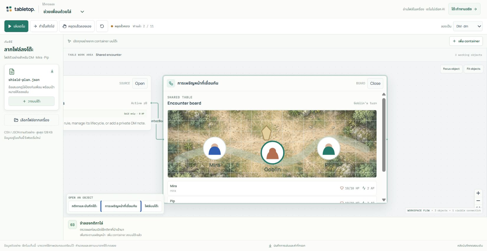

# วิธีใช้และวิธีเล่น Tabletop

คู่มือสำหรับรุ่นทดสอบวันที่ 19 ตุลาคม 2026 เริ่มที่ [หน้ารวม](../README.md) และดู URL ปัจจุบันที่ [Deployment](DEPLOYMENTS.md)

## เลือกวิธีลอง

| วิธี | เหมาะกับ | AI / ผู้เล่น / การบันทึก |
| --- | --- | --- |
| `/demo` | ดูขั้นตอนแล้วรับช่วงเล่นเอง | ลำดับเตรียมไว้, persona จำลอง, ไม่มี provider call, ข้อมูลอยู่ในแท็บ |
| แอปหลัก → Shared data table | สร้างโต๊ะจากไฟล์ตัวเองและชวนคนอื่น | Google accounts จริง, AI จริงเมื่อยินยอม, ห้องบันทึกที่เซิร์ฟเวอร์ |
| `/demo/replay` | ทบทวนผลทดสอบที่เก็บไว้ | ดูย้อนหลัง 9 เรื่อง; ไม่แก้สถานะ |

## ลองเดโมใน 5 นาที

1. เปิด [Auto demo](https://tabletop.ptchrr.workers.dev/demo) ไม่ต้องล็อกอิน
2. เลือก **ตรวจบิลและแก้กติกา**, **ทดลองแรงและมวล** หรือ **ช่วยเพื่อนด้วยโล่** จากตัวเลือกโจทย์ด้านบน
3. กด **เล่นเดโม** หรือ **ทำขั้นถัดไป** เริ่มจาก Canvas ว่าง แล้วเห็นการนำเข้าไฟล์ เพิ่ม container ตรวจ/เปิดกฎ และเล่นตามลำดับ
4. เปิด container บนโต๊ะหรือแถบ **Open an object** เพื่อดูไฟล์ กฎ ผลลัพธ์ และประวัติ ใช้ **Fit objects** เมื่อมองไม่เห็นของบนโต๊ะ
5. กด **หยุดเดโม** เพื่อพักและเดินเดโมต่อภายหลัง หรือ **หยุดแล้วลองเอง** เพื่อรับช่วง การกรอกค่าหรือใช้ปุ่มบนโต๊ะก็หยุดสคริปต์ทันที
6. เมื่อลองเองแล้ว เดโมจะไม่รันต่อมาทับสิ่งที่แก้ หากอยากดูใหม่ให้กดเริ่มโต๊ะทดลองใหม่ ยืนยันก่อนทิ้งสถานะเดิม
7. ใช้ **ลองเป็น** เพื่อสลับครู/นักเรียน หรือ DM/Mira/Pip และกดปุ่มดาวน์โหลดบันทึกที่ท้ายหน้า เพื่อเก็บ JSON ก่อนปิดหรือรีเฟรช

ไฟล์ที่ลากเข้าโหมดนี้ต้องเป็น CSV/JSON ตามรูปแบบตัวอย่างบนโต๊ะ ขนาดไม่เกิน 128 KiB เดโมอ่านและคำนวณจริงในแท็บ แต่ไม่ได้ใช้ AI แปลไฟล์อิสระและไม่ได้สร้างห้อง multiplayer

ภาพฉากและรถเป็นภาพประกอบที่เตรียมไว้ ตัวเลข HP/AP เทิร์น และผลคำนวณยังมาจากสถานะที่เล่นอยู่ ฉากไม่ได้เพิ่มกฎการชนหรือเส้นทางเดินใหม่ ดู [ที่มาของภาพ](DEMO_ART.md)

## สร้างโต๊ะจากไฟล์ของตัวเอง

1. เปิด [แอปหลัก](https://tabletop.ptchrr.workers.dev/) แล้วกด **Continue with Google** เมื่อเข้าได้จะเห็น **Choose a table**
2. เลือก **Shared data table** เพื่อเริ่ม Canvas ว่าง ข้อมูลชุดใหม่ใช้โต๊ะนี้ ไม่ต้องเลือก Invoice/Physics/Encounter ให้ใกล้เคียงก่อน
3. ลากไฟล์ลง Canvas หรือเลือกไฟล์จากส่วน Sources รองรับ UTF-8 `.csv`, `.json`, `.txt`, `.md` เท่านั้น: **32 KiB ต่อไฟล์, ไม่เกิน 4 ไฟล์, รวม 64 KiB**
4. เจ้าของเปิด **Change rules** ในแถบข้าง Canvas อธิบายข้อมูล บทบาท การกระทำ และเงื่อนไขที่ต้องการ อ่านรายการข้อมูลที่จะส่งแล้วกดยินยอมส่งข้อความต้นฉบับให้ AI
5. ขอร่าง แล้วเปิด **Review rule draft** ตรวจตาราง แถวข้อมูล ปุ่ม action เงื่อนไข ผลที่เปลี่ยน และหลักฐาน/สมมติฐาน หาก AI เข้าใจผิดให้ขอแก้ก่อนเปิดใช้
6. ทำ **Simulate → Validate → Approve → Activate** ตามลำดับ การอนุมัติผูกกับร่างและสถานะที่ตรวจ ถ้ามีข้อมูลเปลี่ยนต้องตรวจร่างใหม่
7. ตรวจ **View active rules** และรายการข้อมูลบน Canvas แล้วลองหนึ่ง action พร้อมดู **Table history** ว่าผลตรงตามกฎ

ไฟล์ต้นฉบับและร่างอยู่ในมุมมองเจ้าของ เมื่อเปิดใช้แล้ว **ข้อมูลและกฎที่ active เป็นข้อมูลร่วมของสมาชิกห้อง** จึงควรใช้ข้อมูลตัวอย่างที่ไม่มีข้อมูลลับในรอบทดสอบ

เริ่มจาก [ไฟล์อุปกรณ์ยืมคืน จัดเวร และแข่งเรือ](examples/README.md) ซึ่งมี prompt และผลที่ควรตรวจ AI อาจใช้ชื่อปุ่มหรือรูปแบบต่างกันในแต่ละร่าง ต้องอ่านผลจริง ไม่กด Activate เพราะเห็นคำว่า Validate ผ่านเพียงอย่างเดียว

## เชิญเพื่อนเข้าห้องเดียวกัน

1. เจ้าของเปิด **People at this table** แล้วเลือกที่นั่งที่ยังว่าง
2. สร้างคำเชิญ แล้วส่งลิงก์ให้คนที่จะนั่งตำแหน่งนั้น ห้องทั่วไปมีเจ้าของและผู้ร่วมโต๊ะได้อีกไม่เกิน **7 คน**
3. ผู้รับเปิดลิงก์ใน browser ที่ล็อกอิน Google บัญชีของตัวเอง และทำขั้นตอนเข้าร่วม ลิงก์ใช้ได้ครั้งเดียวและหมดอายุใน **10 นาที**
4. ทั้งสองฝ่ายตรวจรายชื่อ/ที่นั่งและข้อมูลในห้อง จากนั้นลอง action คนละรายการเพื่อดูผลร่วมกัน

ใช้ **ลิงก์เชิญเฉพาะที่นั่ง** ไม่ใช่เลขห้องสาธารณะ เปิดสองแท็บใน browser profile เดียวกันยังเป็นบัญชีเดียวกัน การทดสอบสองคนให้ใช้คนละบัญชีและ browser profile หรือคนละ browser

หากลิงก์หายหรือหมดอายุก่อนใช้ เจ้าของยกเลิกและออกใหม่สำหรับที่นั่งว่างได้ การออกลิงก์ใหม่ไม่ไล่คนที่เข้าร่วมแล้ว สมาชิกเดิมกลับมาจาก **My tables** ได้โดยไม่ต้องขอลิงก์ใหม่

## เล่นเองและใช้แชท

- เปิดรายการ action บน Canvas เลือก record และกรอกค่าที่ action ต้องใช้ แล้วส่งคำสั่ง เซิร์ฟเวอร์ตรวจบทบาท ที่นั่ง เงื่อนไข และเทิร์นตามกฎของโต๊ะนั้น
- ถ้าสองคนแย่งอุปกรณ์เดียวกันหรือแก้ข้อมูลพร้อมกัน ระบบรับเฉพาะคำสั่งที่ยังตรงกับสถานะล่าสุด ผู้ที่พบข้อความ stale/conflict ต้องอ่านสถานะใหม่ก่อนส่งใหม่
- แชท **Ask about the shared table** ใช้ถาม เช่น “ตอนนี้เป็นตาใคร” หรือ “กฎนี้ห้ามอะไร” หลังยินยอมส่งบริบทแล้วกด **Send to assistant**
- หากต้องการให้ช่วยเตรียม action ให้ระบุชื่อ action ที่เห็นจริงกับค่าที่จะใช้ เช่น `Advance boat, boat=red` เมื่อร่างตรงตามนั้นเท่านั้น ตรวจ preview แล้วกด **Confirm action** แยก
- AI ไม่เลือกเดินหลายตาเองและไม่ทำ action อัตโนมัติ การเล่นด้วยปุ่มยังใช้ได้ระหว่างรอคำตอบ หากสถานะเปลี่ยน proposal เก่าอาจยืนยันไม่ได้ ให้ทบทวนสถานะแล้วขอใหม่
- เจ้าของแก้กฎผ่าน **Change rules** และวงจร review เดิม การเปลี่ยนกฎที่เข้ากันได้เก็บคะแนน/ข้อมูลปัจจุบันไว้ การเปลี่ยนโครงสร้าง collection/field ระหว่างเล่นยังไม่รองรับ

ข้อความอธิบายของ AI อาจผิดได้ **Table history เป็นหลักฐานว่าคำสั่งใดเกิดขึ้นจริง** การที่ proposal ยังไม่ถูก Confirm ไม่ได้แปลว่าไม่มีคนเล่นผ่าน Canvas

## การบันทึกและความจำ

| สิ่งที่เกิด | ผล |
| --- | --- |
| ส่งข้อความใหม่ในแชท | อยู่ในห้องเดิม ไม่สร้างโปรเจกต์หรือห้องใหม่ |
| ปิดแท็บ / logout / session หมดอายุ | ไม่ลบห้องและคำสั่งที่เซิร์ฟเวอร์รับแล้ว; แบบฟอร์มที่ยังไม่ส่งไม่รับประกัน |
| กลับมาล็อกอิน Google บัญชีเดิม | เลือก **My tables** แล้วกลับไปสถานะล่าสุดและแชทส่วนตัวที่บันทึกไว้ |
| คนอื่นยังเล่นตอนเราออก | กลับมาจะเห็นผลล่าสุด ไม่ย้อนเกมไปตอนที่ออก |
| Reset table | เป็นการเริ่มข้อมูลรอบใหม่และถอนสมาชิกที่รับเชิญ; ไม่ใช่ปุ่มออกจากห้อง |
| เล่น public demo | รีเฟรชแล้วเริ่มใหม่; export JSON ได้ แต่ยังไม่มีปุ่มนำ JSON ประวัติกลับมา resume |

แชทส่วนตัวแยกตามสมาชิก/ห้อง/รอบข้อมูล เจ้าของห้องไม่ได้อ่านแชทของสมาชิกคนอื่นโดยอัตโนมัติ หน้าจอและ API แอดมินของแอปให้ดูเฉพาะ metadata ของห้องและสมาชิก สิทธิ์ผู้ดูแลบัญชี Cloudflare และการเข้าถึง storage เป็นอีกระดับหนึ่งที่เจ้าของระบบต้องจัดการแยก

ทุกคำถาม AI ใช้กฎและข้อมูลร่วมปัจจุบัน เทิร์นและที่นั่งของผู้ถาม รวมบทสนทนาที่เสร็จแล้วล่าสุดไม่เกิน **6 คู่ / 16 KiB** คำขอทั้งหมดไม่เกิน **48 KiB** และคำตอบไม่เกิน **1,024 tokens** ไม่ส่งไฟล์ต้นฉบับส่วนตัวหรือประวัติเหตุการณ์ทั้งหมดเข้าแชทอัตโนมัติ การร่างกฎเป็นขั้นตอนยินยอมส่งไฟล์อีกแบบหนึ่ง

ข้อความเก่ายังเปิดดูได้ แต่ยังไม่มีค้นความจำย้อนหลังหรือสรุปแคมเปญอัตโนมัติ รุ่นทดสอบเก็บ assistant jobs ได้สูงสุด **500 คำขอต่อห้อง** หากชนขนาดบริบท/พื้นที่/งบ AI ระบบหยุดคำขอโดยเก็บข้อมูลเดิมและยังให้เล่นด้วยมือได้ ดูรายละเอียด [การจัดบริบท](GENERIC_TABLE_DESIGN.md#project-continuity-and-context-limits)

## เมื่อใช้งานไม่สำเร็จ

| อาการ | ทำอย่างไร |
| --- | --- |
| ล็อกอินไม่ได้หรือกลับมาหน้าเดิม | ใช้ URL จาก Deployment, ตรวจบัญชีและ cookie; แจ้งเวลา/หน้า/ข้อความผิดพลาดให้ผู้ดูแล โดยไม่ส่ง token หรือรหัสผ่าน |
| ไฟล์ไม่ผ่าน | ตรวจนามสกุล UTF-8 และขนาด; PDF/ภาพต้องแปลงเป็นข้อความเองก่อน แล้วทวนความถูกต้อง |
| AI ไม่ได้ร่างที่ใช้ได้ | อ่าน error และขอแก้กฎ/ข้อมูลให้ชัด; ไม่ลดการตรวจเพื่อฝืนเปิดใช้ร่าง |
| action หรือ Approve/Activate ถูกปฏิเสธ | ตรวจสิทธิ์ เทิร์น และ revision; รีเฟรชแล้ว review สถานะล่าสุด |
| งบหรือความจำ AI เต็ม | เล่นด้วยปุ่มต่อได้; ให้ผู้ดูแลตรวจ quota ไม่กดส่งซ้ำต่อเนื่อง |
| คำขอ network ไม่ทราบผล | ใช้ **Retry same request** เมื่อหน้าจอเสนอ หรือดูสถานะคำขอเดิมก่อนเริ่มคำขอใหม่ |
| ห้องอยู่ใน read-only recovery | อ่านข้อมูล/ประวัติได้; ให้ผู้ดูแลตรวจระบบก่อนเปิดการแก้ไข |

สำหรับสามโต๊ะเดิม **Invoice check / Physics lesson / Shared encounter** ดู [คู่มือ runtime เดิม](R1_DEMO_GUIDE.md) ซึ่งมีตัวอย่างท้องถิ่น การอัปโหลดเอกสาร invoice แบบเดิมยังปิดบน Cloudflare แม้ Shared data table จะรับไฟล์ข้อความได้แล้ว
