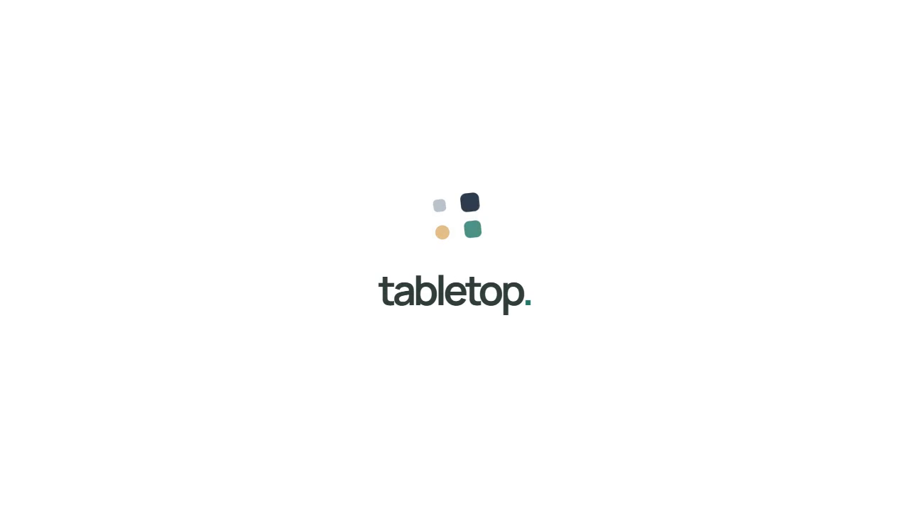

# tabletop.

## เครื่องมือที่ค่อย ๆ ปรับให้เข้ากับคุณ

Tabletop คือพื้นที่ทำงานร่วมกันบน Canvas ที่ให้คุณบอกสิ่งที่อยากทำ แล้วให้ AI ช่วยร่างตาราง แบบฟอร์ม ปุ่ม กราฟ และวิธีคำนวณ คุณตรวจและเปิดใช้ แล้วทำงานต่อบนโต๊ะเดียวกันได้เมื่อโจทย์เปลี่ยน

เริ่มจากข้อความก่อนก็ได้ เพิ่มข้อมูลเมื่อพร้อม แล้วค่อยปรับเครื่องมือให้เข้ากับวิธีทำงานของคุณ

**[เริ่มโต๊ะของคุณ](https://tabletop.ptchrr.workers.dev/) · [ลองเดโมโดยไม่ต้องล็อกอิน](https://tabletop.ptchrr.workers.dev/demo)**

*วิดีโออธิบายแนวคิดพร้อมเสียงอังกฤษ 93.2 วินาที สร้างด้วยโค้ดและข้อมูลตัวอย่าง · [อ่านเรื่องแบบภาพนิ่งและข้อความ](video-brief.md) · [ที่มาและขอบเขตของสื่อ](evidence.md)*

## เครื่องมือที่ค่อย ๆ พอดีมือ

ปากกามีส่วนจับที่พอดีมือ ค้อนมีด้ามให้จับและควบคุม เก้าอี้ค่อย ๆ มีพนัก แขน และล้อ เราเติมและปรับเครื่องมือให้เหมาะกับคนที่ใช้มัน เพื่อให้ลงมือทำงานได้สะดวกขึ้น

เราอยากให้ซอฟต์แวร์รู้สึกแบบนั้นด้วย

แต่บ่อยครั้ง ก่อนเริ่มงานจริง เราต้องจัดไฟล์ สร้างตาราง ต่อสูตร และย้ายคำอธิบายจากแชทมาใส่อีกที่ พอความต้องการเปลี่ยน ก็ต้องกลับมาประกอบเครื่องมือใหม่

Tabletop ให้ข้อมูล บทสนทนา กติกา และเครื่องมือมาอยู่บนโต๊ะเดียวกัน เริ่มจากสิ่งเล็ก ๆ เติมสิ่งที่ต้องใช้ แก้สิ่งที่ยังไม่พอดี แล้วต่อยอดจากสิ่งที่ทำไว้

**The best tool is the one you don't have to think about.**

## เริ่มจากจดขาย แล้วค่อยปรับจนพอดีมือ

ลองนึกถึงร้านกาแฟเล็ก ๆ เริ่มจากพิมพ์ว่า **“ช่วยทำโต๊ะจดขายกาแฟกับเค้ก”** ได้ตารางให้ตรวจ แล้วเริ่มใช้จดรายการ

พอลูกค้าเยอะ การกรอกทีละช่องไม่ทัน ก็พิมพ์ต่อว่า **“เพิ่มปุ่มขาย กดครั้งเดียวเพิ่มจำนวน”** หลังตรวจและใช้ร่างใหม่ ปุ่มขายมาอยู่ข้างตาราง กดกาแฟหนึ่งครั้ง จำนวนและยอดขายเปลี่ยนตาม สิ่งที่ปรับคือวิธีลงมือทำงานของคนขาย

อยากรู้ว่าอะไรขายดี ก็ขอ **“เพิ่มกราฟยอดขายแยกตามสินค้า”** กราฟต่อจากข้อมูลเดิม ตารางกับปุ่มที่ใช้ทุกวันยังอยู่

ช่วงบ่ายอยากลองโปร ขอ **“เพิ่มส่วนลด 10%”** แล้วถ้าอยากเปลี่ยนเป็น20% ก็เลือกกฎส่วนลดและพิมพ์ **“เปลี่ยนกฎนี้เป็น 20%”** ตรวจข้อเสนอแล้วค่อยเปิดใช้ ข้อมูลการขายไม่ต้องเริ่มใหม่

เริ่มจากตารางเล็ก ๆ ได้เครื่องมือที่เข้ากับร้านของตัวเองทีละอย่าง จากสิ่งที่พบระหว่างใช้งาน

*เส้นเรื่องสมมติเพื่ออธิบายแนวคิด เครื่องมือที่ AI ร่างต้องตรวจและอาจต้องแก้ก่อนใช้ ภาพเคลื่อนไหวไม่ใช่บันทึกการสร้างจาก prompt จริง; ดู [ขอบเขตหลักฐาน](evidence.md)*

**Work defines what software becomes.**

## วันนี้คุณทำอะไรได้บ้าง

| เริ่มจากสิ่งที่ต้องการ | ทำต่อบนโต๊ะได้อย่างไร |
| --- | --- |
| “อยากมีเครื่องมือสำหรับเรื่องนี้” | เริ่มจากข้อความ ให้ AI ช่วยร่างตาราง แบบฟอร์ม ปุ่ม และมุมมอง โดยยังไม่ต้องมีไฟล์ |
| “มีข้อมูลชุดใหม่แล้ว” | นำข้อมูลเข้า ตรวจตัวอย่างก่อนเพิ่มหรือแทนรายการ แล้วใช้วิธีคำนวณที่บันทึกไว้ |
| “อยากเห็นผลหลายแบบ” | เชื่อมผลคำนวณกับตัวเลขสรุป ตารางผลลัพธ์ กราฟ หรือการคำนวณขั้นถัดไป |
| “ทำไมกฎนี้คิดแบบนี้” | เลือกกฎแล้วถามคำอธิบาย หรือขอเปลี่ยนกฎนั้นให้เข้ากับงาน |
| “วันนี้พอก่อน พรุ่งนี้ทำต่อ” | กลับมาเปิดโต๊ะที่บันทึกไว้ด้วยบัญชีเดิม พร้อมข้อมูลและกฎที่ใช้อยู่ |

การคำนวณรองรับทั้งสูตรและโปรแกรม JavaScript/Python ภายในระบบที่เปิดให้ใช้ คนยังเป็นผู้ตรวจและเลือกใช้สิ่งที่ AI ร่างขึ้นมา

## Every table has a story.

**Your Table.** วางรายการ วิธีคำนวณ และผลลัพธ์ไว้ด้วยกัน เพื่อไล่ดูความต่างและเปลี่ยนวิธีตรวจตามงาน

**A Table for Learning.** เริ่มจากคำถามว่าแรงและมวลเกี่ยวข้องกันอย่างไร แล้วลองเปลี่ยนค่าและเห็นรถเคลื่อนที่

**Our Tables.** เห็นกติกา ลำดับตา และผลจากการตัดสินใจของตัวละครในเกมร่วมมือ

  
  

*ภาพจากเดโมที่เตรียมไว้ · ข้อมูลและผู้เล่นจำลอง · เดโมไม่เรียก AI และไม่ใช่หลักฐานการสร้างเครื่องมือจากคำขออิสระ*

ดูภาพเคลื่อนไหวเรื่องแรงและมวล

<picture>
  <source media="(prefers-reduced-motion: reduce)" srcset="../../showcase/tabletop-story-poster.png">
  
</picture>

*ภาพอธิบายแนวคิดเดิมของ Tabletop · [ภาพนิ่ง](../../showcase/tabletop-story-poster.png) · [ที่มา](../../showcase/README.md)*

## Bring your work to the table.

1. [เข้าสู่ระบบ](https://tabletop.ptchrr.workers.dev/) แล้วเริ่มโต๊ะใหม่
2. บอกสิ่งที่อยากทำ ตรวจเครื่องมือและกฎที่ AI ร่าง แล้วเปิดใช้เมื่อพร้อม
3. เพิ่มข้อมูล ลงมือใช้ และขอปรับต่อเมื่อโจทย์เปลี่ยน

หรือ[ลองเดโม](https://tabletop.ptchrr.workers.dev/demo)ก่อน แล้วพักเดโมเพื่อรับช่วงทดลองเอง

ก่อนเริ่มลอง

- เครื่องมือเติบโตได้ภายในส่วนประกอบและระบบคำนวณที่รองรับ ไม่ใช่การสร้างแอปหรือรันโค้ดได้ทุกแบบ
- สิ่งที่ AI ร่างอาจต้องแก้ก่อนใช้ ตรวจการคำนวณและกติกาให้ตรงกับงานของคุณ
- การเปลี่ยนกฎอาจมีผลต่อข้อมูลเดิม ตรวจความเข้ากันได้ก่อนเปิดใช้
- ชนิดและขนาดไฟล์ รวมถึงวิธีเพิ่มข้อมูล อยู่ใน[คู่มือผู้ใช้](../../USER_GUIDE_TH.md)
- เดโมที่เตรียมไว้รีเฟรชแล้วเริ่มใหม่ ห้องที่ล็อกอินสร้างไว้ใช้สำหรับบันทึกงานและกลับมาทำต่อ
- เกมตัวอย่างไม่ใช่กติกา D&D เต็มระบบ

**More time doing what matters.**

[คู่มือผู้ใช้](../../USER_GUIDE_TH.md) · [เอกสารระบบและหลักฐานการทดสอบ](../../README.md)

## License

Copyright (C) 2026 Tabletop contributors.

Tabletop is free software: you can redistribute it and/or modify it under the terms of the GNU Affero General Public License as published by the Free Software Foundation, version 3 only (`AGPL-3.0-only`).

Tabletop is distributed in the hope that it will be useful, but WITHOUT ANY WARRANTY; without even the implied warranty of MERCHANTABILITY or FITNESS FOR A PARTICULAR PURPOSE. See [LICENSE](../../../LICENSE) for the full terms.

Third-party components retain their own licenses. The [source repository](https://github.com/Thanyers/tabletop) includes the project source and build instructions.
