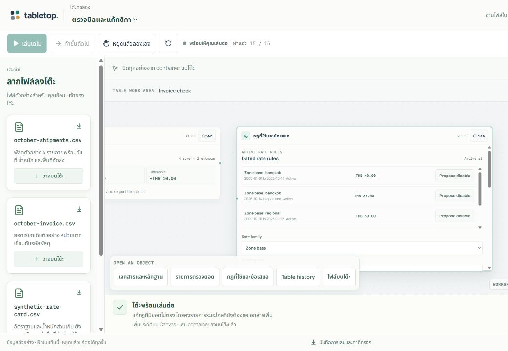

# Tabletop — Canvas demo และ container บนโต๊ะ

- เผยแพร่ 19 ตุลาคม 2569 เวลา 12:04 (Asia/Bangkok)
- Source commit: 57f8d04f7a38f9e9b48fca12d2287e224a74ecca
- Worker version: 8c4112d2-3290-4d5a-a889-bfaa618ccc07
- Repository: Thanyers/tabletop · branch feat/tabletop-r1 · main ไม่เปลี่ยน
- Environment: existing Cloudflare Workers Free + D1 + SQLite Durable Objects

[เปิด Canvas ทดลอง](https://tabletop.ptchrr.workers.dev/demo) · [บันทึกย้อนหลังเดิม](https://tabletop.ptchrr.workers.dev/demo/replay) · [Draft PR #2](https://github.com/Thanyers/tabletop/pull/2) · [CI pull_request](https://github.com/Thanyers/tabletop/actions/runs/39202025988) · [CI push](https://github.com/Thanyers/tabletop/actions/runs/39202022799)

## พฤติกรรมที่ส่งมอบ

- หน้า /demo เริ่มจาก Canvas ว่าง เดโมนำเข้าไฟล์ CSV/JSON แล้วเพิ่ม container และเดินคำสั่งทีละขั้น มีสามโจทย์: ตรวจบิล, แรงและมวล, เกมโล่ป้องกันเพื่อน
- ลากไฟล์ตัวอย่างหรือเลือกไฟล์จากเครื่องเพื่อเริ่มเอง ใช้ parser เดียวกับเดโม ข้อมูลนำเข้าเปลี่ยนผลคำนวณจริงในแท็บ ไม่ส่งไฟล์ไป server หรือ AI
- ไฟล์/หลักฐาน กฎ ตาราง ฉาก กราฟ โจทย์ การกระทำ ผู้ร่วมโต๊ะ และประวัติเปิดจากแถบ object บน Canvas การ์ดขยายอยู่บนโต๊ะและเลื่อนเนื้อหาภายในได้
- กฎบน Canvas มีการเสนอร่าง จำลอง ตรวจ อนุมัติ เปิดใช้ และคืน revision ตามสิทธิ์ ห้องจริงใช้ชุด container เดียวกัน รวม AI สำหรับบทบาทที่ได้รับสิทธิ์
- หยุดเดโมพักและเดินต่อได้; หยุดแล้วลองเองหรือแก้ค่าใน container ยกเลิกคำสั่งอัตโนมัติจนกว่าจะยืนยันเริ่มใหม่ ป้องกันสคริปต์กลับมาทับค่าที่กรอก
- ประวัติที่ดาวน์โหลดเก็บล่าสุด 200 เหตุการณ์ของทุกบทบาทจำลอง พร้อม current projection และคำสั่งที่มีขนาดจำกัด ระบุการตัดรายการเก่า ไฟล์ต้นฉบับขนาดใหญ่ไม่ได้ถูกเก็บครบใน transcript
- เดโมไม่สร้างบัญชีหรือห้อง ไม่เรียก AI ไม่เขียน localStorage/sessionStorage และเริ่มใหม่เมื่อรีเฟรช ประวัติเดิม 9 เรื่องยังอยู่ที่ /demo/replay พร้อมลิงก์กลับ Canvas

## ผลตรวจ

| ผล | ขอบเขต | หลักฐานและข้อจำกัด |
| --- | --- | --- |
| PASS | Unit / SQL | 280/280 tests ผ่านใน CI ของ source ที่เผยแพร่ รวม parser, atomic import, timer cancellation, role projection และ bounded history |
| PASS | Workers / D1 / Durable Objects | 41/41 tests ผ่านใน runtime จำลอง; ไม่มีการเขียนฐาน production |
| PASS | Browser CI | 7 กลุ่มตรวจ Node และ 10 กลุ่มตรวจ Workers ผ่าน; flows หลักเปิด container บน Canvas รวมการเชิญ ผู้เล่น และ AI ที่ใช้ provider จำลอง |
| PASS | ไฟล์และการรับช่วงต่อ | ลากไฟล์จริง, ไฟล์ผิดรูปแบบไม่แก้ข้อมูล, นำเข้า JSON 9 N / 3 kg / 2 s ได้ 6 m, แก้ระหว่างเล่นเป็น 12 N / 3 kg / 2 s ได้ 8 m, ไฟล์ที่อ่านค้างไม่ข้ามบทบาทหลังสลับคน |
| PASS | กฎและเกม | Invoice ใช้หลักฐานที่ตรวจแล้วและ lifecycle ก่อน Active; expected THB 80.00, unknown 2; เกมได้ Pip 8/10 HP และ Mira 1 AP; นาฬิกาฝึกคงที่เมื่ออ่านเกิน 30 วินาที |
| PASS | Public isolation | CI ไม่พบ API/internal/external requests, WebSocket, cookie, provider call, localStorage หรือ sessionStorage ของเดโม; users/sessions/rooms ในฐาน fixture ไม่เปลี่ยน |
| PASS | หน้าจอแคบ | CI 304 × 844 CSS px แก้ค่าและเปิดฉากบน Canvas ได้ ไม่มี page horizontal overflow; ยังไม่ใช่การทดสอบมือถือจริงทุกอุปกรณ์ |
| PASS | Hosted HTTP / assets | 40 checks ผ่าน รวม auth gate, CSP, deep links และไฟล์เว็บตรงกับ build ตาม SHA-256 |
| PASS | Hosted interaction | หน้า /demo เปิดเป็น Canvas ว่างและมีไฟล์ตัวอย่างให้เริ่มเอง; กดเล่นอัตโนมัติแล้วนำไฟล์แรกเข้าเป็น source และ file container; หยุดที่ขั้น 1/15 ได้; เดิน invoice ครบ 15 ขั้นและเปิดกฎ 5 รายการ Active r1 จาก dock บน Canvas; simulation แสดง expected THB 80.00 และ unknown 2; rule container มีตัวแก้กฎ แหล่งหลักฐาน lifecycle และการคืน revision อยู่ภายใน Canvas; จอแคบ 319 CSS px: แก้ขณะเล่นเป็น 12 N / 3 kg / 2 s แล้ว Update lesson ได้ฉาก 8 m; หลังรับช่วงเองยังคงขั้น 3/11 ระหว่างตรวจต่อ เดโมไม่กลับมาทับค่าที่แก้; จอแคบ scrollWidth เท่ากับ clientWidth 319 ไม่มี page horizontal overflow; หน้า /demo/replay แสดงคลัง 9 เรื่องและกดลิงก์กลับ Canvas ว่างได้ |
| PASS | Runtime / secrets | Bindings/settings hash ตรงก่อนและหลัง deploy; ไม่มี resource ใหม่, migration หรือ secret mutation; Cloudflare Free และ AI cap $1/day UTC, $10/month UTC เดิม |
| PASS | Independent review | Reviewer ไม่แก้ไฟล์ ตรวจ runtime, parser, shared UI, timers, projections และ test flows; แก้ local layout persistence และ stale-role file read แล้ว ไม่มี runtime/privacy finding ค้าง |
| SKIPPED | Hosted account multiplayer / AI | รอบนี้ไม่สร้าง/แก้ห้องจริง ไม่เรียก DeepSeek จริง และไม่ทดสอบคนละบัญชีจริงบน production; CI ใช้ session/provider จำลอง |
| SKIPPED | Load / recovery / rollback | ไม่มี load test, latency benchmark, cross-store recovery หรือการสลับ rollback จริง; เก็บเวอร์ชันก่อนหน้าไว้เพื่อย้อน runtime |
| SKIPPED | Offline report browser render | Browser URL policy ไม่อนุญาต file: ในรอบนี้ ตรวจโครงสร้างรายงาน ลิงก์ และภาพฝังจาก filesystem; การทดสอบ HTTPS ของแอปด้านบนเป็นคนละขอบเขตและรันแล้ว |

## ขอบเขตที่ยังจำกัด

- รับไฟล์ CSV/JSON ตามตัวอย่าง สูงสุด 128 KB, 100 แถว, 12 คอลัมน์; preview ต้นไฟล์สูงสุด 2,000 ตัวอักษร ไม่ตีความ PDF/เอกสารทั่วไปด้วย AI ใน public demo
- โต๊ะทดลองเป็นการฝึกในแท็บเดียวและสลับ persona จำลอง ผู้ที่ต้องการชวนเพื่อนหรือ resume ข้ามอุปกรณ์ใช้ห้องจริงหลังล็อกอิน Production ยังปิด uploads
- รองรับค่าขนส่ง, F=ma และ simplified shield encounter ยังไม่ใช่ตัวแก้โจทย์ข้อความอิสระหรือ D&D เต็มระบบ
- Interactive demo JavaScript 64 KiB / gzip 18 KiB ไม่รวม shared chunks; build ยังเตือน legacy chunk เกิน 500 kB แต่ไม่มี benchmark ที่ยืนยัน performance ทุกระดับ
- ระดับส่งมอบ: Local Verified และ Hosted E2E Verified เฉพาะขอบเขตที่ระบุ เหมาะสำหรับ Limited Public Testing; ยังไม่รับรอง Production Ready ทั้งระบบ

## ย้อนรุ่นและหลักฐาน

เวอร์ชันปัจจุบัน 8c4112d2-3290-4d5a-a889-bfaa618ccc07; ย้อน Worker ไป 89a4c92c-1c7a-44de-a59b-4b251f034b4f ได้เมื่อยืนยันว่า current version ยังตรงรุ่นนี้ การย้อน runtime ไม่ย้อนข้อมูล D1/Room และรอบนี้ไม่มี migration

หลักฐานในเครื่อง: test-results/canvas-demo-release-2026-10-19 และ test-results/canvas-demo-ci/57f8d04f7a38f9e9b48fca12d2287e224a74ecca; screenshot SHA-256 d979d6be35ddada14c5a62ea74e49d2f578be041477b50dc42ab46b3f70c6bde บันทึก/รายงานรุ่นก่อนคงไว้แยก ไม่รวม credential values หรือภาพห้องจริงในไฟล์เผยแพร่

