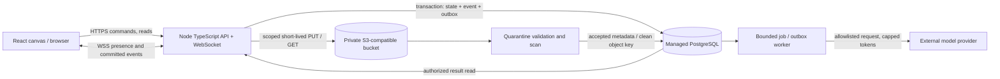

# TABLETOP R1 Deployment Blueprint

**สถานะ:** เอกสารวางแผนสำหรับตรวจและอนุมัติ ยังไม่มีการเลือกผู้ให้บริการขั้นสุดท้ายหรือการตั้งค่า infrastructure

**ตรวจเอกสารผู้ให้บริการ:** 2026-10-18

**ขอบเขต:** Hosting, runtime, persistence, collaboration, CI/CD, release, recovery และ post-deploy verification

**คู่เอกสารที่เผยแพร่รอบนี้:** [Master Plan](TABLETOP_R1_MASTER_PLAN.md), [Critical Audit](TABLETOP_R1_CRITICAL_AUDIT.md), [Open Decisions](TABLETOP_R1_OPEN_DECISIONS.md). Latest handoff/schema/examples วันที่ 18 ตุลาคม 2026 เป็น local audit inputs ไม่รวมใน Git delivery รอบนี้

> Blueprint นี้แปลง product intent ของ R1 เป็น deployment plan ที่ทำตามได้หลัง owner อนุมัติเท่านั้น การยกตัวอย่างผู้ให้บริการไม่ใช่การเลือกผู้ให้บริการ และรายการทดสอบทั้งหมดด้านล่างเป็นแผนที่ยังไม่ได้รันกับระบบ hosted

## ป้ายหลักฐาน

- **Observed** — พบใน source tree หรือเอกสารทางการ ณ วันที่ระบุ
- **Proposed** — ข้อเสนอเป้าหมายสำหรับ implementation รอบถัดไป
- **Unknown** — ต้องตรวจเพิ่มหรือให้ owner ตัดสินใจก่อนใช้จริง
- **Not run** — แผนตรวจที่ยังไม่มีผลทดสอบ; ห้ามรายงานเป็น PASS

## 1. ข้อสรุปสำหรับการตัดสินใจ

- **Observed:** แอปปัจจุบันเป็น React 19, TypeScript, Vite, Zustand และ React Flow; `npm run build` ทำ `tsc -b && vite build` และ test runner เป็น Vitest ตาม `package.json:6` (ตรวจ ณ 2026-10-18)
- **Observed:** prepared demos ใช้ authored logic และ browser-local state; README ระบุว่าไม่มี API key, connected LLM หรือ external database สำหรับ demos เหล่านั้น (`README.md:17–29` (local source), ตรวจ ณ 2026-10-18)
- **Observed:** Component Lab เรียก Codex CLI ที่เครื่องผ่าน Node `spawn`; มันขึ้นกับ CLI/identity ของ host จึงนำไปเปิดเป็น service สาธารณะตรง ๆ ไม่ได้ (`README.md:17–29` (local source), `scripts/component-lab/generator.ts:159` (local source), ตรวจ ณ 2026-10-18)
- **Observed:** README เตือนว่า iframe/CSP และ contract screening ไม่ได้แยก CPU/memory สำหรับ arbitrary hostile JavaScript (`README.md:17–29` (local source), ตรวจ ณ 2026-10-18)
- **Observed — GitHub audit 2026-10-18 (read-only API audit):** [Thanyers/tabletop](https://github.com/Thanyers/tabletop) เป็น public repository, `main`=`1de3d7adfd3955df6a8892d17f7d55f9d25e839b`, มีเพียง README, ไม่มี workflow/run/deployment, Pages ปิดอยู่ (GET 404), branch listing ระบุ protected:false และ rulesets ว่าง; การอ่านรายละเอียด protection ถูกปฏิเสธ 403 จึงยัง Unknown
- **Observed — local checkout:** project root ไม่ใช่ Git checkout; `sites/living-canvas` เป็น historical checkout ที่ `main`=`df2aac2` และไม่มี remote จึงไม่ใช่หลักฐาน source baseline ของ target repo
- **Proposed:** R1 ใช้ React canvas เดิมเป็น client และเพิ่ม shared typed capability runtime, API และ WebSocket server ที่มี authority เดียว, PostgreSQL สำหรับ revisions/events/outbox, S3-compatible private storage สำหรับ quarantine และ queue แบบมี quota สำหรับ model egress
- **Proposed:** ใช้ long-running Node/TypeScript service แบบ paid Render หรือ Railway เป็นรูปแบบ deploy เริ่มต้น; ให้ service เดียว serve Vite build + API + WebSocket บน origin เดียว พร้อม managed PostgreSQL และ private R2/S3-compatible object storage เพื่อลด CORS/cookie complexity
- **Proposed:** ใช้ PostgreSQL เป็น authoritative record สำหรับ domain state และ accepted events; WebSocket ส่ง notification หลัง transaction commit เท่านั้น; client reconnect ด้วย revision/cursor เพื่ออ่าน authorized projection ของเหตุการณ์ที่ขาด
- **Proposed:** R1 ไม่ execute arbitrary generated JavaScript บน public host; model เสนอ typed declarative changeset ที่ schema ตรวจและ trusted interpreter คำนวณได้แบบมีขอบเขต
- **Unknown:** ยังไม่มีการเลือก host/provider, region, domain, budget, allowed data, authentication provider, retention, restore objective หรือ event-specific rules; protection detail ของ GitHub ต้องตรวจด้วยสิทธิ์ที่อ่านได้ก่อนออกแบบ gate
- **Unknown:** ความจุจริง, latency, availability, model cost และ recovery time ต้องวัดจาก hosted build ที่เลือก; ตัวเลขในส่วน capacity เป็นสมมติฐานเพื่อ sizing test เท่านั้น
- **คำแนะนำในตอนนี้:** ใช้ hybrid canvas + shared typed runtime และ Node + PostgreSQL + private object storage เป็น planning baseline; Render/Railway เป็นทางเลือก deploy ที่ควรเทียบหลังตรวจบัญชี/region/cost แต่ยังไม่มี final vendor, deployment หรือ public-release approval

## 2. ความต้องการ deployment ที่ R1 มีจริง

- **Invoice:** หนึ่งผู้ใช้ทำงานกับ invoice/import, source evidence, rule draft/simulation/approval/activation, recalculation, export และ resume; server ต้องคง active/draft/revision boundary
- **Teaching:** ครูหนึ่งคนและ learner views สองคนใช้ F = ma lesson เดียวกัน; teacher ส่ง activity, learner ตอบ, teacher รับ feedback; ใช้ projection จาก state/physics model ชุดเดียว
- **D&D:** DM และผู้เล่นสองคนอยู่คนละ browser/session; action ที่อนุญาตเปลี่ยน authoritative encounter state; DM-private event ห้ามอยู่ใน player payload
- **Shared runtime:** surface manifest, component contract, typed binding, role/scope, event revision, validation และ lifecycle ต้องทำงานจริง ไม่ใช่แค่แสดง diagram
- **Continuity:** refresh/reconnect ต้องโหลด durable state ที่ประกาศไว้; reset ต้องย้อนกลับไป sample workspace โดยไม่ใช้ฐานข้อมูลรวมที่ทุกคนเขียนทับกัน
- **Bounded evolution:** rule/component changeset ต้องผ่าน schema, semantic checks และ test cases ก่อน approval; stale approval ห้าม activate revision เก่า
- **Model egress:** R1 ต้องมี live bounded model path ที่ผ่าน holdout proof ตาม Master §6; เรียกผ่าน server-side queue ที่จำกัด token, rate, timeout, provider และข้อมูลที่ส่งออก เมื่อ provider ล้มเหลว state เดิมยังใช้งานได้ แต่ manual fallback ไม่นับเป็น live proof
- **File upload:** หาก R1 รองรับ supporting docs ให้ส่งเข้า quarantine ก่อนตรวจ type/size/hash/malware; file ที่ยังไม่สะอาดห้ามอยู่ใน client-visible download path
- **ผู้ทดลอง:** เปิด URL แล้วเข้าตัวอย่างได้โดยไม่ต้องมี API key ของกรรมการ; session หนึ่งต้องไม่เห็นข้อมูลอีก session
- **R1 ไม่ต้องมี:** multi-region write, enterprise identity federation, arbitrary plugin marketplace หรือ unrestricted model-generated code execution

## 3. เป้าหมายสถาปัตยกรรมที่เสนอ

- **Command/auth path:** typed command carries `workspaceId`, `expectedRevision` and idempotency key; server derives actor/role from session and authorizes every read/write/subscribe against workspace, role, component and event visibility.
- **Commit/outbox path:** one transaction checks revision, updates projection, appends immutable event/audit and inserts durable outbox row; worker uses lease/idempotency/bounded retry/dead-letter. Publish only after commit; restart resumes pending rows.
- **Realtime/recovery path:** WSS carries presence and committed-event notifications; ephemeral cursor/typing/camera never changes domain state. Reconnect replays only newly authorized projections through an opaque projection cursor (never the raw internal event sequence); stale writes return typed `STALE_REVISION`, never silently overwrite.
- **Data path:** PostgreSQL stores workspace/session/grants, schema/capability revisions, projections, events, approvals, idempotency, jobs and file metadata; private object bucket holds binary data and scanner moves `QUARANTINED` to `ACCEPTED`/`REJECTED`.
- **Model/schema/release path:** queue worker uses allowlisted minimized payload, token/time/retry/spend caps and server-only key; versioned JSON contracts pin parser/renderer/interpreter/migration/tests. Rollback uses prior app artifact and compatible schema, never an automatic destructive down migration.
- **Scale path:** PostgreSQL event log stays authoritative; add broker/pub-sub only as post-commit fan-out/wakeup if measured multi-instance load requires it.

### Contract สำหรับ API/WebSocket ใน implementation

- `POST /api/sessions` and `/api/invites` create isolated seeded session and scoped single-use ticket; `POST /api/workspaces/{id}/commands` accepts only allowlisted typed payload, expected revision, idempotency key and size cap.
- `GET /api/workspaces/{id}` returns authorized snapshot/revision; `/events?after={cursor}` returns authorized event projection or `resync-required`; WSS handshake validates Origin/cookie/scope and authorizes every outbound projection.
- Upload intent returns a scoped signed URL; finalize verifies server-side metadata/hash/state before accept. Model job accepts only enabled capability + bounded payload/consent and returns job status, never provider credentials.
- Responses use typed outcome, stable `errorCode`, `requestId` and relevant revision; use parameterized queries and transactions. HTTP 200 alone is not business success; deterministic actions stay in trusted runtime and model cannot authorize/validate/activate.

## 4. ตัวเลือก hosting และบริการข้อมูล

ตารางนี้เปรียบเทียบความเหมาะกับ requirement ที่ตรวจพบ ไม่ใช่ benchmark, security certification หรือ final vendor selection

| ตัวเลือก | Frontend / API | Real-time | Durable data / files | Secrets / sandbox | CI, preview, limit และ fit |
|---|---|---|---|---|---|
| GitHub Pages | Static HTML/CSS/JS เท่านั้น; เหมาะ docs, landing หรือ Vite SPA หากไม่มี server authority | ไม่มี backend/WebSocket endpoint; ต้องต่อบริการอื่น | ไม่มี authoritative database หรือ private upload storage | ไม่ใช่ที่เก็บ runtime model secret; browser code เป็น public | เชื่อม GitHub Actions ได้; published site ≤1 GB, soft bandwidth 100 GB/month และ soft 10 builds/hour เป็น limits ที่ GitHub ระบุ; เหมาะ documentation/sample viewer เท่านั้น ([Pages overview](https://docs.github.com/en/pages/getting-started-with-github-pages/what-is-github-pages), [limits](https://docs.github.com/en/pages/getting-started-with-github-pages/github-pages-limits), ตรวจ 2026-10-18) |
| Vercel | Static assets/CDN และ serverless Node functions สำหรับ HTTP API; เหมาะ SPA/preview | เอกสารระบุชัดว่า Vercel Functions ไม่รองรับการเป็น WebSocket server จึงต้องมี realtime service ภายนอก | Postgres ผ่าน Marketplace provider; Blob มี private mode; ต้องเลือกและตั้ง lifecycle แยก | Environment variables ใช้กับ build/function ตาม environment; functions จำกัดเวลาและ bundle; function ไม่ใช่ hostile-code sandbox | Preview deployments และ Git integration สะดวก; Functions limit แตกต่างตาม plan; ปัจจุบันเอกสารระบุ Hobby/Pro duration cap และ WebSocket constraint ต้องทบทวนก่อนเลือก ([limits](https://vercel.com/docs/limits), [storage integrations](https://vercel.com/docs/marketplace-storage), [private Blob](https://vercel.com/docs/vercel-blob/private-storage), ตรวจ 2026-10-18) |
| Cloudflare Pages / Workers / Durable Objects | Pages/Workers serve Vite SPA assets พร้อม Worker API; มี Vite + React integration ทางการ | Durable Objects ทำ WebSocket server และ room coordination; supports hibernation | DO SQLite ต่อ object เป็น strongly consistent/transactional; D1 เป็น SQLite database; R2 มี S3 API; Hyperdrive ต่อ PostgreSQL ภายนอก | Worker secrets เป็น server binding; Worker isolation ไม่เท่ากับการอนุมัติให้ execute arbitrary application code | เหมาะเมื่อยอมรับ Workers runtime และ object-per-room design; Free Worker มี request/CPU caps, DO มีแยก request/duration/storage; R2 S3 API compatibility ไม่ครบ ต้อง verify operations ที่จะใช้ ([Vite React SPA](https://developers.cloudflare.com/workers/vite-plugin/tutorial/), [DO WebSockets](https://developers.cloudflare.com/durable-objects/best-practices/websockets/), [DO SQLite](https://developers.cloudflare.com/durable-objects/api/sqlite-storage-api/), [Workers limits](https://developers.cloudflare.com/workers/platform/limits/), [pricing](https://developers.cloudflare.com/workers/platform/pricing/), [R2 S3 API](https://developers.cloudflare.com/r2/api/s3/api/), ตรวจ 2026-10-18) |
| Netlify | Static hosting + request-based Functions, Edge Functions และ background jobs; สามารถทำ HTTP API | Official docs ครอบคลุม HTTP response streaming แต่ไม่แสดง persistent WebSocket server contract; ให้ถือว่า external WSS endpoint จำเป็นจนกว่าจะ verify ได้ | มี managed Postgres/Database และ Blobs; ต้องตรวจ current storage retention, limits และ production backup settings | function environment สามารถเก็บ server values; request functions มี runtime limits; ไม่ใช่ sandbox arbitrary code | Deploy Preview มีประโยชน์; credit model มี hard monthly limit ใน Free และ database compute/bandwidth ใช้ credits; synchronous function และ streaming limits ตรวจใหม่ก่อนเลือก ([Functions API](https://docs.netlify.com/build/functions/api/), [background functions](https://docs.netlify.com/build/functions/background-functions/), [Database](https://docs.netlify.com/build/data-and-storage/netlify-database/), [pricing](https://www.netlify.com/pricing/), ตรวจ 2026-10-18) |
| Render | Static Site แยกได้ หรือ Web Service เดียว serve Vite + Node API | Web Services รองรับ inbound WebSockets; deploy/shutdown สามารถตัด socket จึงต้อง ping, reconnect/backoff และ replay state | มี managed Postgres, Key Value, persistent disks; Web Service filesystem ปกติเป็น ephemeral | env vars/secrets สำหรับ service; host process ไม่ใช่ isolation boundary สำหรับ generated untrusted code | Operational model ชัดสำหรับ long-running Node service; Free service spin-down หลัง 15 นาทีและ Free DB 1 GB/30 วัน/no backup; Free plan ไม่เหมาะ public alpha ที่ต้องตอบทันที ([WebSockets](https://render.com/docs/websocket), [free limits](https://render.com/docs/free), [Postgres/service types](https://render.com/docs/service-types), ตรวจ 2026-10-18) |
| Railway | Long-running service สำหรับ Node/TS, static bundle, API และ queue worker | มีคู่มือ deploy WebSocket/SSE service; reconnect ต้อง implement ใน client | PostgreSQL service, persistent volume และ S3-compatible bucket มีให้เลือก; default PostgreSQL เป็น single node จนกว่าจะเพิ่ม HA/backup/PITR | service variables เก็บ server config; volume หรือ DB ไม่ได้กลายเป็น sandbox | Deploy จาก GitHub/CLI; คิดทั้ง subscription และ usage; free plan มี resource caps/credit และไม่ใช่ reliability guarantee; HA/backup/restore configuration ต้องตรวจจริง ([WebSocket guide](https://docs.railway.com/guides/sse-vs-websockets), [Postgres](https://docs.railway.com/databases/postgresql), [storage](https://docs.railway.com/data-storage), [plans](https://docs.railway.com/pricing/plans), ตรวจ 2026-10-18) |

### ข้อสังเกตสำคัญต่อการเลือก

- **GitHub Pages:** ใช้ได้กับ docs หรือ demo ที่เป็น static; ไม่ตอบ requirement shared state, secure API, event authorization, durable Postgres หรือ secret model key
- **Vercel:** ประสบการณ์ frontend/preview ดี; API functions เป็น request-oriented และ WebSocket server ไม่รองรับ จึงเพิ่ม host สำหรับ realtime และ stateful worker
- **Cloudflare:** เป็นทางเลือกที่มี primitive สำหรับ SPA, WebSocket rooms, object storage และ Postgres connection; แต่ Worker/DO data model ต่างจาก Node server และต้องยืนยัน single-source-of-truth, transaction boundaries, migration และ restore ข้าม data services
- **Netlify:** Deploy Preview, serverless Postgres และ file storage ลดงาน setup; docs ที่ตรวจยืนยัน function response streaming/background processing แต่ไม่ได้ยืนยัน long-lived WebSocket server สำหรับ collaboration; อย่าทดแทน transport โดยไม่ทดสอบ
- **Render:** ตรงกับ long-running Node+WebSocket และ managed Postgres มากที่สุดในรูปแบบการ deploy; free limits มี cold start/retention/backup ข้อจำกัดชัดเจน จึงต้องวางงบบริการ paid สำหรับ alpha ที่กรรมการเข้าได้ตลอด
- **Railway:** รวม Node service, PostgreSQL, volume และ S3-compatible bucket ในระบบเดียวได้; PostgreSQL template เริ่มแบบ single-node และ HA/backups/PITR เป็นงานตั้งค่าเพิ่ม
- **Object store:** ใช้ R2/AWS S3 หรือ provider S3-compatible ได้ แต่ให้ตรวจ API subset, bucket privacy, region, object lifecycle, signed upload semantics, CORS และ deletion receipt ก่อนเลือก
- **Database:** PostgreSQL เป็น target contract; provider convenience ไม่แทนการตรวจ backup, PITR window, connection pooling, SSL, query/connection caps, availability, region และ restore drill
- **Model API:** ใช้ external provider เฉพาะเมื่อ owner อนุมัติ data egress, model, region, budget, retention และ failure behavior; ห้ามเอา key ลงใน Vite `VITE_*` หรือ client artifact
- **Generated code:** ไม่มีบริการ frontend host ใดในตารางที่ควรถูกถือว่าเป็น hostile JavaScript sandbox เพียงเพราะมี iframe, CSP, serverless isolate หรือ deployment preview

## 5. ข้อเสนอ Tier A — Reviewable Alpha

- **Client:** ใช้ React canvas เดิมและ shared TypeScript contract; bundle จาก Vite ถูก serve บน origin เดียวกับ API ใน deployment แรกเพื่อลด cross-origin cookie และ WSS policy complexity
- **API/realtime:** หนึ่ง Node/TypeScript long-running Web Service ให้บริการ HTTPS และ WSS; รองรับ health/readiness endpoints, graceful shutdown, heartbeat, exponential reconnect และ replay cursor
- **Authority:** PostgreSQL transaction เป็นจุดตัดสิน state; ใน alpha อาจเริ่มหนึ่ง instance แล้วทดสอบ reconnect/redeploy จริงก่อนเปิดให้กรรมการ; ไม่เก็บ connection-specific state เป็น authoritative data
- **Storage:** PostgreSQL สำหรับ domain records/event log/outbox; private S3-compatible object storage สำหรับ uploads; server จัดการ scan/result status
- **Queue:** ใช้ durable Postgres queue/outbox ก่อนเพิ่ม broker; worker มี per-session/global concurrency cap, bounded retry, retry-after และ dead-letter view สำหรับ operator
- **Sample data:** เปิด demo sample สำหรับ invoice, teaching และ D&D ด้วย fixtures ที่ pin version/hash; ทุก session ได้ copy ใหม่ ไม่แชร์ mutable row
- **Anonymous isolation:** สร้าง random opaque session ID + HttpOnly, Secure cookie; เก็บ only hashed invite/session tokens where feasible; แยก workspace/session boundary และตรวจทุก read/write ที่ server
- **Role invites:** Teacher/learners และ DM/ผู้เล่นสองคนเข้าด้วย invite tickets ที่มี role, workspace, expiry, revocation; client ไม่สามารถเปลี่ยน role ด้วย payload เอง
- **Session/workspace limits (proposal):** session idle 24h, hard expiry 7d, workspace TTL 7d; หนึ่ง anonymous session มีหนึ่ง workspace ต่อ demo; เชิญร่วมแบบ single-use token อายุ 10 นาที
- **Concurrency cap (proposal):** สูงสุด 20 concurrent rooms และ 3 actors ต่อ room; Invoice ใช้ 1 actor, Teaching = 1 teacher + 2 learners, D&D = 1 DM + 2 players; เกิน cap คืน typed error
- **Upload limits (proposal):** CSV ≤5 MiB; PDF ≤10 MiB และ ≤20 pages; ปฏิเสธชนิดอื่นใน R1 จน owner อนุมัติ; จำกัดจำนวนไฟล์/ขนาดรวมต่อ workspace ก่อนเปิดรับไฟล์
- **File handling:** ไม่รับ executable/HTML/SVG/archives ใน R1; normalize filename, never use user filename as storage key; cap decompression/parser work; scan before preview/download; export CSV-escape formulas
- **Model budget (proposal):** deterministic sample path ใช้งานได้โดยไม่เรียก model; live path ปิดไว้จน owner อนุมัติ provider, data scope และ budget หลังจากนั้นต้องเปิดแบบมีขอบเขตและผ่าน holdout gate จึงเรียก hosted R1 ได้ กำหนดสูงสุด 5 generations/room/day, timeout 60s และ transient retry ได้หนึ่งครั้งภายใน reserved budget; บังคับ token ceilings และ global spend ceiling ก่อนเปิด egress
- **Data minimization:** ใช้ synthetic invoice/classroom/character data เท่านั้นใน alpha; prompt ไม่แนบไฟล์ดิบโดย default; ฟีเจอร์ส่ง content ไป model ต้องแสดงสิ่งที่จะส่งและขอ consent ต่อ action
- **Evolution:** live model เสนอเฉพาะ allowlisted Invoice patch ตาม Master §6; domain controls ของ Teaching/D&D ใช้ trusted handlers. Server ตรวจ semantic constraints + fixtures; proof และ candidate hash ครอบคลุม derived composition plan delta ด้วย เช่น surcharge column และ review binding. ก่อน activation ต้องพบ durable `Approved` record ที่ไม่ revoked/expired และตรง approvalId, candidateHash, proofHash, approvingActor, workspace/epoch และ scope; ตรวจสิทธิ์ approver ปัจจุบันและ activator พร้อม base/source revisions ใน transaction เดียว ห้ามใช้ client approval flag แทน record; missing/forged/revoked/stale approval ต้อง reject
- **No-script rule:** browser renderer ใช้ trusted compiled component registry + bounded interpreter; reject `eval`, dynamic import, arbitrary fetch, DOM/global access, filesystem/process APIs, arbitrary npm installs และ unbounded loops
- **Reset:** owner/teacher/DM command เพิ่ม workspace epoch และ seed snapshot ใหม่ใน transaction เดียว โดย remap เฉพาะผู้สั่งกับ current authenticated session; revoke peer learner/player memberships และ room sessions, close sockets, invalidate invites/jobs/cursors และ old-epoch commands. Owner ได้ full bootstrap (`RESYNC_REQUIRED` สำหรับ old cursor); peers ได้ `MEMBERSHIP_REVOKED` และต้องรับ invite ใหม่. Lost-Ack retry ใช้ reset receipt ที่ผูก stable owner + commandId + workspace/oldEpoch พร้อมตรวจ owner identity ปัจจุบัน; ไม่ยอมรับ old-epoch commands อื่น. Cleanup objects ผ่าน durable job และรายงานแยกจาก reset ตาม Master §5
- **Release data:** ไม่ใช้ข้อมูลจริงจากลูกค้า/นักเรียน; no account-based import, no external business integrations; no claim of audited financial or classroom service
- **Operational minimum:** HTTPS/TLS, logs/metrics, daily DB backup หรือ provider backup ที่ยืนยันแล้ว, pre-release restore drill, spend alert, basic rate limits, incident contact และ rollback runbook
- **Service target:** hosted alpha ให้ reviewer ใช้งานพร้อมกันตาม load gate ในส่วน capacity; ถ้า host ออกแบบให้ scale-to-zero หรือ free data expires ให้เลือก paid plan/ย้าย providerก่อนเชิญกรรมการ

### เหตุผลที่ใช้ PostgreSQL เป็น authority ใน Tier A

- Invoice workflow ต้องคง source/evidence/reference, active rules และ approval snapshot ให้สอดคล้องกันใน transaction
- D&D ต้องใช้ sequence/revision เพื่อป้องกัน concurrent player action ที่ stale และให้ reconnect เห็น order เดียวกัน
- Teaching ต้องส่ง teacher action ให้ learner projections และรับ answer เข้า state เดียวโดย role scope
- PostgreSQL transaction ให้ all-or-nothing visibility และ rollback สำหรับกลุ่ม update ที่สัมพันธ์กันตาม [PostgreSQL transaction docs](https://www.postgresql.org/docs/current/tutorial-transactions.html) (ตรวจ 2026-10-18)
- Event log/outbox อยู่ใน transaction เดียวช่วยป้องกัน “state commit แล้วแต่ message หาย” แบบ split write; fan-out notification ยัง retry ได้โดยอิง event cursor
- External file/model operations เป็น side effect; บันทึก intent ก่อน, ทำงานแยกหลัง commit, อัปเดตผลด้วย idempotency และสถานะที่ตรวจย้อนกลับได้

## 6. ทางเลือก Cloudflare Durable Objects ต่อ room

- **Observed:** Durable Objects support WebSocket hibernation and per-object private, strongly consistent/transactional SQLite storage; current docs list up to 30-day PITR ([storage](https://developers.cloudflare.com/durable-objects/api/sqlite-storage-api/), checked 2026-10-18).
- **Observed:** API upper bound is 32,768 WebSockets/DO, but workload CPU/memory can constrain earlier; Cloudflare recommends SQLite-backed DO. R2 S3 compatibility has missing/different operations ([State API](https://developers.cloudflare.com/durable-objects/api/state/), [R2 compatibility](https://developers.cloudflare.com/r2/api/s3/api/), checked 2026-10-18).
- **ข้อดี:** natural room actor, serialized per-room coordination, WebSocket hibernation, object-local transactional persistence, fast edge ingress และ high fan-out ใน topology ของ D&D
- **ข้อจำกัด:** room state กระจายเป็นหลาย object store; cross-room query, global reporting, invoice workflow, relational joins, unified event retention/export และ one transaction spanning DO + Postgres ต้องออกแบบเพิ่ม
- **A:** DO owns room events/state while Postgres owns invoice/account metadata, requiring cross-store export/reconciliation/backup/migration. **B:** Postgres authority, Worker/DO fan-out after outbox commit with idempotent delivery and PG catch-up. **C:** Node API/WS authority, stateless instances and Postgres replay; add broker after measured need.
- **Recommendation:** เริ่ม C เพื่อรักษา shared transactional model ตาม target handoff; พิจารณา B เมื่อ benchmark ชี้ว่าการกระจาย socket เป็น bottleneck; ยังไม่เลือก A เพราะเพิ่ม second authority และ operational surface ก่อนจำเป็น
- **Gate ก่อนเปลี่ยนไป Cloudflare:** prove room affinity, role filters, revision order, commit-before-broadcast, DO eviction/recreation, migration, PITR restore, expired-room deletion และ cost under idle WebSocket workload

## 7. Tier B — Production Evolution Path

- **Identity:** เลือก identity provider, verified account lifecycle, MFA สำหรับเจ้าของ workspace/teacher/DM, account recovery และ role mapping
- **Authorization:** tenant/org policy ที่ server enforced, object-level grants, invite revocation, role separation, audit exports และ admin support access controls
- **Multi-tenancy:** explicit tenant ID on every durable record, composite key/foreign key policies, row-level access test and tenant isolation test; never trust tenant ID from untrusted body alone
- **Data governance:** data classification, purpose/consent, retention/deletion schedule, export/delete requests, location/processor review และ provider terms review ก่อนรับข้อมูลจริง
- **Database operations:** managed paid Postgres tier with HA plan, PITR, connection pooling, restore runbooks, migrations gate, read replica only if measured, alerting on locks/replication lag/storage
- **Object storage:** private buckets, object versioning or retention as needed, malware scanning pipeline, metadata-only DB references, encrypted transport/at-rest and lifecycle policies
- **Background work:** separate worker fleet or managed queue with bounded retries, dead-letter queue, idempotent handlers, priority controls and model-provider outage breaker
- **Model egress:** vetted provider, per-tenant budget, content redaction, approved data region, prompt retention controls, audit of model/model revision, abuse monitoring and safe refusal path
- **Generated capability:** keep declarative DSL as default; if arbitrary code is later a product need, use a separately evaluated disposable sandbox with no credentials, denied network by default, resource quotas, one-way artifact promotion, human review, immutable build provenance and security review
- **Abuse prevention:** origin/CSRF checks, invite throttles, per-IP and per-session rate caps, upload quotas, bot mitigation, alert on token spend and unusual data-export attempts
- **Resilience:** load-balanced API, shared pub/sub or dedicated realtime gateway, graceful shutdown, client replay, maintenance/reconnect UI, backup restore exercise, queue draining and incident playbook
- **Supportability:** support role, redacted diagnostics, audit trail, request IDs, data access logs, documented escalation, scheduled security updates and accountable service owner
- **Readiness claim:** limited public testing only after supported workflows, role-negative tests, abuse tests, backup restore and hosted E2E are executed and report lists exact scope; production readiness requires separate organization/legal/operations approval

## 8. Security boundaries and operational controls

### Sessions, invites and network

- Serve HTTPS/WSS only; enforce HSTS after domain/TLS verified; redirect HTTP to HTTPS at edge/load balancer
- Session cookie: `Secure`, `HttpOnly`, `SameSite=Lax` or stricter, narrow `Path`, server-side revocation and rotation on role transition; use unpredictable hashed tokens where feasible and atomically consume 10-minute, role-scoped invite nonce.
- Validate `Origin` and CSRF policy for mutating API/WSS; use strict CORS allowlist if origins split. Derive subscription permission server-side for each stream; hidden UI or guessed room IDs are not access control.
- Require HTTPS/WSS and TLS to DB/object store; keep DB private unless explicitly reviewed. Bound request/message size, command/upload rates, WS frame size, parser time and work per session.
- Never log cookies, invite tokens, signed URLs, personal prompts, file content, DB connection strings or model keys. Treat `VITE_*` as public client data.

### Invoice and classroom privacy

- Use synthetic fixtures only; avoid real company, account, address, student or child data. Minimize model payloads and refuse file content without explicit action/consent.
- CSV export must neutralize formula-trigger cells; HTML escapes untrusted text. Teacher notes, learner answers and DM secrets stay role-scoped and never enter other projections or analytics.
- Deletion covers workspace rows, events, outbox, objects, backups and caches; report backup-retention limits. **Unknown:** event/age/privacy/data-residency requirements need owner review before upload/model features.

### Upload quarantine

- Bind upload intent to session, random object key, expected size/type, hash, expiry and destination prefix. A presigned URL is a reusable bearer credential until expiry: keep it short-lived, never log it and verify intent/state server-side.
- Keep quarantine private with client listing disabled; verify size, metadata, hash and true type (extension/MIME is not proof). Scan and parse under resource limits; reject malformed/unsupported/encrypted content and give parsers no network credentials.
- Accept only after validation; authorize every preview/download and issue short-lived read URL. If signed PUT lacks required conditional-write/version semantics, use reviewed provider API or backend proxy.
- Delete rejected/incomplete uploads within 24h; expire accepted references with workspace TTL. Test cleanup/orphans and retain only minimal upload/hash/size/scanner/result/timestamp audit metadata.

### Model egress and generated behavior

- Queue accepts an allowlisted operation name and typed payload only; model cannot select arbitrary HTTP URL, database query, MCP server, package install or local file path
- Server injects provider credentials; client never sends them and build job cannot print them
- Per request bounds: prompt bytes/tokens, output tokens, wall time, concurrency, retries, output schema, session count and daily cost ceiling
- Network egress policy allows only selected provider endpoint and required storage/database destinations; DNS/URL targets are not user-controlled
- Treat model response as untrusted data; validate exact schema, reject unknown keys/operators, normalize units, run deterministic examples and refuse unsupported requests without state mutation
- Activation requires fresh validation on exact candidate hash and base revision, explicit human approval and server-side compare-and-swap
- R1 renderer only loads trusted shipped component modules; no user-authored JS, `eval`, dynamic import or arbitrary build artifact is executed on shared host
- Browser iframe/CSP can reduce accidental access but does not supply CPU/memory/time isolation; local Component Lab remains an experimental separate host path until independently sandboxed

## 9. CI/CD and release workflow

**Proposed sequence:** Pull Request → validation → tests → artifact build → preview → hosted checks → engineering/product review → owner-approved release → report.

### Pull Request checks

1. Validate YAML/lockfile, schema JSON, manifest compatibility and fixture hashes; install the exact lockfile on supported Node without secrets in untrusted lifecycle scripts.
2. Run `tsc -b`, lint/format, unit/property/boundary tests, API contracts (permissions, stale revisions, idempotency/errors) and rule-interpreter tests with supported, unseen-valid and unsupported proposals.
3. Use disposable PostgreSQL for fresh/previous-version migrations, rollback and integration tests; use object-store emulator/isolated bucket for signed upload, quarantine, caps, reject and cleanup paths.
4. Run browser E2E for Invoice, Teaching, D&D, narrow viewport, keyboard, refresh, reconnect and reset; include role-negative and data-isolation checks.
5. Run SAST/dependency/license/secret scans; pin Actions by full SHA and produce SBOM/provenance if supported. PR jobs use read-only repo access, synthetic data and no production/model secrets; forks receive no privileged deploy access.
6. Attach redacted test artifacts with commit SHA; require named review and disposition for skipped/flaky critical authorization tests before merge.

### Preview environment

- Deploy each PR commit as a unique preview with its digest, isolated DB/schema, synthetic fixtures, preview-only bucket and distinct secrets; restrict invites and automatically expire preview data with auditable cleanup.
- Check deep links/refresh, HTTPS/cookies/WSS, console/network errors, source-map policy, deployed asset hash parity and secret absence from artifacts, responses, logs and preview metadata.
- Run hosted smoke and core E2E; attach exact pass/fail/skipped counts and evidence. A preview proves only that commit/environment.
- A preview deployment proves only that exact commit/environment; it is not production release evidence

### Production release gate

- Merge only after protected checks/review; tag the source commit and lockfile, build one immutable artifact, then promote that exact digest through staging to production.
- Release notes identify scope, migration, known limitations, model/storage changes, checks, digest and rollback. Use protected deployment environment/owner approval for production secrets only after confirming the actual GitHub plan supports required rules ([GitHub environment rules](https://docs.github.com/en/actions/reference/workflows-and-actions/deployments-and-environments), checked 2026-10-18).
- Prefer short-lived OIDC/deploy identity; otherwise use narrowly scoped, rotatable environment credentials excluded from PR checks. Production job can deploy only approved app/environment and reviewer cannot self-approve where supported.
- Run migration as one explicit locked job, not concurrently at every app replica startup; save migration log/result and applied schema revision
- Deploy, wait for readiness, then run hosted smoke/E2E against synthetic accounts; for canary, watch errors, DB pressure, queue depth and WSS reconnects before promotion.
- Owner reviews test report, limitations and cost/security gates; R1 has no ownerless auto-promotion.

### Required CI identities and permissions

- `pull_request`: no production secrets, minimal check/artifact write scopes and no untrusted `pull_request_target`; `preview` and `staging` use isolated synthetic DB/storage and separate limited credentials.
- `production`: protected environment, required human review, deploy-only short-lived identity and exact approved digest. **Observed:** target currently has zero workflows/deployments, branches unprotected and rulesets empty; protection detail read returned 403, so plan-level capabilities remain Unknown.

## 10. Database migration and rollback procedure

- Give every migration an ordered ID/owner, forward SQL, lock/statement timeout, expected impact, compatibility window and verification query. Expand additively first; keep old/new app versions compatible and use provider-supported online index methods.
- Run backfills as separately bounded, resumable, deterministic, rate-limited/idempotent jobs with a stop switch. Cut over only after count/hash/semantic checks; contract obsolete fields in a later release after proving no consumer remains; destructive schema change requires owner approval.
- Test fresh/prior schema, interrupted transaction, concurrent app versions and backup restore. Before migration failure, rollback artifact; after additive migration, rollback only if compatibility is proven.
- On corruption/destructive failure, freeze writes, preserve snapshot/logs and use tested PITR/backup or forward repair; never guess a down migration. After rollback verify read/write/isolation/WSS/replay/outbox/files and record snapshot, migration/deploy versions, recovered point and data loss.

## 11. Capacity and cost model (assumptions, not measurements)

All quantities below are **planning assumptions** to make a first load test and cost estimate concrete. They are not observed user demand or a hosting quote.

### Traffic and realtime assumptions

- Base planning scenario: 100 new sessions/day, average 15 minutes, up to 3 actors per room, peak-to-average factor 8
- Average rooms = `sessions/day × minutes/session ÷ 1440`; peak rooms = `ceil(average × 8)`. Base `100×15÷1440≈1.04`, peak `9 rooms` and `9×3=27` sockets.
- Stress `200×15÷1440×8` = 17 rooms/51 sockets; proposed hard cap is 20 rooms/60 sockets. Test 20 rooms, 10 committed commands/sec for 5m and 40/sec burst for 30s; verify room 21 is safely rejected/queued and replay is complete.
- Proposed targets: p95 commit-to-authorized-broadcast ≤750ms, simple read ≤800ms, zero duplicate commit/cross-role leak. Report measured p50/p95/p99, errors, DB pool, reconnects, queue delay and load shape; owner may revise after region test.

### Persistence and file assumptions

- Assumption: 60 events/room at 1.5 KB each gives `100×60×1.5KB≈9MB/day`; 7 days is 63MB raw or ~158MB with 2.5× index/WAL/growth reserve (Tier A TTL); a hypothetical Tier B 90-day retention would be 810MB raw / ~2.0GB and is not selected. Replace assumptions with measured schema/provider data.
- Assumption: 20% of 100 daily sessions attach one average 1 MiB file = 20 MiB/day; 24-hour quarantine hold ≈20 MiB; seven-day accepted-object retention ≈140 MiB before derivatives/replication. Size cap is CSV 5 MiB or PDF 10 MiB/20 pages; owner must set per-workspace count/aggregate cap.
- Track DB rows/events/backups separately from binary object storage; purge capacity = `expired_sessions/day × rows/session × mean_row_size`; upload GB = `uploads/day × avg_MB × retention_days × replication/derivative factor` with bounded cleanup before object deletion.

### Model cost assumptions

- Assumption: 20% of 100 sessions use one generation = 20/day, within 5/room/day; per-request token caps and rates await provider selection. Monthly model cost = `daily_generations × 30 × (mean_input_tokens/1M × input_rate + mean_output_tokens/1M × output_rate) + tools/storage`; use a per-request sum instead when token counts vary.
- Enforce `min(daily_rooms×5, global_generations/day_cap)` before egress; owner approves global spend and token caps. Bound timeout/retry/cancel; never blindly retry a billable timeout; log counters/approved metadata, not sensitive prompt bodies.

### Monthly cost worksheet

| Cost area | Estimate formula | Owner inputs |
|---|---|---|
| Static + Node API/WS | plan/build/bandwidth + instance-hours/rate/egress/scale | provider/region, preview count, always-on/replicas/traffic |
| PostgreSQL + objects | DB compute/storage/HA/PITR + object GB-month/requests/scan/transfer | growth, retention, file caps, connections, RPO/RTO |
| Queue + observability | worker-hours/operations/retries + logs/metrics/traces/alerts | model concurrency, event rate, retention/sampling |
| Model + CI/security | token/tool rates + build/test/scanning/attestation | model/rate card/caps, GitHub plan/concurrency/artifacts |
| Recovery | backup, staging DB, restore drills, object versioning | recovery policy and cadence |

- Do not call this a quote without dated price source, chosen region/plan, quota/overage and traffic worksheet; free quotas are not reliability guarantees and hard caps can reject/suspend work. Recheck docs before purchase/release (sources viewed 2026-10-18).
- Set owner monthly budget, provider alerts at 50/75/90%, model daily cap, upload/DB limits, preview count and automatic preview cleanup.

### Budget envelope สำหรับตัดสินใจ (Proposed; ยังไม่ใช่ราคาเสนอหรือสิทธิ์ใช้เงิน)

เสนอเพดานวางแผน **USD 100/month ก่อนภาษีและ FX** สำหรับ bounded review alpha หนึ่ง environment โดยจัดสรร app + PostgreSQL USD 40, model USD 20, objects/scan/logs/backup USD 10, preview/restore drill USD 15 และ reserve USD 15. ตัวเลขนี้เป็น allocation ที่ owner เลือกปรับได้ ไม่ใช่ผล sizing หรือราคาที่รับประกันว่าซื้อบริการครบได้. หากราคาจริงหรือ load test เกิน allocation ต้องกลับมาตัดสินใจ scope/provider/budget ก่อน provisioning.

เพื่อให้เห็นสเกลราคา: Render ยกตัวอย่าง Starter + Basic-256mb ราว USD 13/month ใน **July 2026 snapshot** ซึ่งยังไม่รวม bandwidth/storage และไม่ใช่ sizing ที่ผ่านการพิสูจน์สำหรับ Tabletop ([official cost article](https://render.com/articles/how-much-does-cloud-application-hosting-cost-for-small-businesses), อ่าน 2026-10-18). R2 Standard ระบุ USD 0.015/GB-month, Class A USD 4.50/million และ Class B USD 0.36/million ก่อนหัก free allowance; scanner, backup และ DB คิดแยก ([official R2 pricing](https://developers.cloudflare.com/r2/pricing/), ตรวจ 2026-10-18).

**Provisioning blocker:** current provider/region quote, paid backup/restore terms, scanner sizing, model/rate card, token reservations และ owner-approved total/daily cap ยัง Unknown. แทน allocation ด้วย dated worksheet ตาม plan จริงและให้ owner อนุมัติก่อนซื้อหรือเปิด egress; ห้ามรายงานว่า budget เพียงพอจากตัวอย่างข้างต้น. Live proof เป็น R1 release gate เสมอ ถ้า budget ยังไม่อนุมัติให้เรียก milestone นั้นว่า pre-R1.

## 12. Reliability and scale gates

- PostgreSQL transaction/revision is the only write authority; API instances are stateless and revalidate socket membership/grants after restart.
- Shutdown drains short transactions and prompts cursor replay; client reconnect uses jittered backoff, same idempotency key and WSS heartbeat; ephemeral presence is not durable.
- Queue jobs require lease/attempt/dead-letter/idempotent completion; model outage cannot block deterministic workflows. Size total DB pool across replicas/migrations/tools and alert before provider cap.
- Imports/scans run asynchronously with progress/cancel; do not hold DB transactions across model/storage network calls.
- Periodically restore into isolated environment and verify rows, event order, file hashes and app/schema compatibility.
- Start single-region; defer multi-region writes until measured need. **Unknown:** judge locations, available regions, residency rules and budget.

## 13. Hosted post-deployment verification — required, not yet run

Run these only after implementation and an owner-approved deployment. Keep synthetic fixtures and separate browser sessions; record commit, artifact digest, environment, timestamp, evidence and exact pass/fail/skipped count. A local build or successful deployment event is not hosted acceptance evidence.

### Checklist 1 — Global smoke and release state

- [ ] From clean profile, verify exact URL/DNS/TLS/HTTPS redirect/no mixed content; load app/assets/fixtures and compare hashes with artifact manifest.
- [ ] Check console/network/server errors; readiness SHA/schema/flags; API errors, origin/CORS, cookie flags, session/reset and invite expiry.
- [ ] Use two anonymous sessions to prove workspace isolation; refresh/deep-link to prove durable state and navigation recovery.
- [ ] Exercise WSS origin, heartbeat, drop/reconnect, cursor replay and dedupe; inspect assets/maps/headers/responses/logs for secrets or sensitive data.
- [ ] Check desktop/narrow keyboard/focus/loading/error/recovery; verify reset and previous-session cleanup follow TTL; capture URL, build, region, browser, timestamp and evidence.

### Checklist 2 — Invoice end-to-end

- [ ] Open isolated seeded workspace; import sample and modified-valid CSV, checking row counts, units, duplicate/unsupported handling and a result that changes with input.
- [ ] Verify match/unmatched/duplicate/ambiguous evidence links and explicit Unknown suggestions; attach allowed file and test quarantine/hash/type/scan plus rejected-file denial.
- [ ] Propose scoped/effective-date rule candidate bound to base revision/hash; compare old/new results, boundaries, conflict and unseen edge case.
- [ ] Test invalid/unsupported rule and missing evidence: typed refusal, no mutation/export drift; validate/approve authorized candidate and reject stale approval.
- [ ] Activate transactionally; verify revision/event/audit/outbox readback and forced-failure atomicity; independently recompute totals/details from fixture.
- [ ] Export CSV/HTML against active revision with formula escaping; refresh/reconnect to resume state, then reset and verify sample plus TTL cleanup.

### Checklist 3 — Teaching end-to-end

- [ ] Teacher creates isolated F=ma session; two separate learner contexts join with distinct 10-minute single-use tickets.
- [ ] Beginner/advanced views derive from same force/mass/acceleration revision; legal changes keep equation, animation and graph aligned; invalid/zero/negative/out-of-range input leaves state unchanged.
- [ ] Teacher activity reaches authorized learners once; learner answer returns feedback; private teacher note stays hidden from learner B; expired/wrong-role invite is denied without score change.
- [ ] Save scoped teaching note; refresh/reconnect all three contexts and verify one state, event order, accepted answer and no duplicate submission/view drift.
- [ ] Reset to seed and verify expired session is inaccessible.

### Checklist 4 — D&D many-to-many end-to-end

- [ ] DM creates isolated encounter; two players join separately with role tickets; verify owner, public/private scope and initial revision.
- [ ] Inspect player bootstrap/API/WSS/logs for DM-private leakage; DM/players receive consistent committed public outcomes through authorized projection cursors.
- [ ] Submit legal action and read back authoritative HP/turn/revision; repeat idempotency key (one event), stale revision (typed conflict), and Player B action/identity spoof attempt.
- [ ] Propose bounded shield rule; simulate independent examples, reject unsupported case, approve exact hash/base as DM, and deny stale/unauthorized approval.
- [ ] Activate approved revision; actually use ally shield in the ongoing encounter, then activate cost1AP/once-per-own-turn revision and test repeat denial/reset. Verify HP6 vs8 from the same pre-hit state/seed. Deny forbidden cursor/extra role; interrupt/redeploy and verify no lost/duplicate effect or private leak.
- [ ] Reload DM/players and reset; public state agrees, DM-private data stays private, seed restores and TTL policy holds.

### Failure and recovery matrix

| Failure injection | Expected behavior | Evidence required |
|---|---|---|
| Schema/binding/rule failure | typed refusal; no mutation; active version remains usable | payload/result, validator status, revision before/after |
| Stale/concurrent write or approval | CAS conflict; exactly one valid commit; no stale activation | two-client trace, event/idempotency record, DB revision |
| Model timeout/5xx/backlog/cost cap | bounded retry or failed job; stop new model work at budget; deterministic paths continue | attempts/usage/quota, queue age and recovery result |
| Network/redeploy/rollback | reconnect/replay without loss/duplication; health gates promotion; prior compatible artifact restores | event cursor, deploy SHA, migration/schema version and hosted E2E |
| Unauthorized API/WSS/cursor | deny with zero role-scoped data disclosure | negative request/frame and audit record |
| Failed generated declaration/unknown renderer | keep prior active component, show retry/reject; never run arbitrary code | candidate diagnostics, unchanged state hash, other components remain usable |
| Malformed/oversized file or object outage | quarantine/reject; no preview/model/parser side effect; retry stays idempotent | object hash/scan or upload intent state, API result |
| DB unavailable/full | readiness/write fail closed; never report client-only success; recover consistently | service logs/metrics and post-recovery readback |

## 14. Post-deployment report contract

After implementation/deployment, create both `TABLETOP_R1_POST_DEPLOY_TEST_REPORT.md` and `TABLETOP_R1_POST_DEPLOY_TEST_REPORT.html`. They should contain the same conclusions and evidence IDs; HTML must not imply tests that are absent from Markdown.

- Identify date/timezone, repository URL/branch/tag/commit, artifact digest, hosted URLs, environment/region/provider plan and deployed version; attach build log/evidence.
- Include a test matrix with scope, browser/client count, fixture version, result/time, evidence pointer and failure/skip reason; list flaky tests, unresolved findings and owner disposition.
- Use explicit coverage labels (`Local Verified`, `Preview Deployed`, `Hosted E2E Verified`, `Ready for Limited Public Testing`, `Production Ready`); report only the highest level whose criteria all passed.
- State limitations/caps/TTL/files/AI/data scope and security evidence (secret scan, role-negative, file scan, model egress/cost, residual risks).
- Report load/region/peak sockets/rate/p50-p95-p99/errors/reconnects/DB/queue/storage metrics; include backup/restore RPO/RTO, migration version and rollback steps plus whether rollback was exercised.
- Give recommendation (hold, limited review, revise, or separate approval). State conclusions apply only to the dated commit/environment and prove neither future code, different data, legal compliance nor higher load.

## 15. Owner decisions before implementation/release

| Decision | Proposed default | Must be decided by |
|---|---|---|
| GitHub target/branch gates | target `Thanyers/tabletop` is public, default branch `main`; add protected release branch, required checks/review after repo-owner approval | repository owner; current branches are unprotected and rulesets empty; protection details returned 403 |
| Hosting provider/runtime | long-running Node/TypeScript service serving SPA + API/WSS | product/platform owner after plan, region and account audit |
| DB/object provider and location | managed PostgreSQL + private S3-compatible quarantine storage in one approved region | data/platform owner |
| Public alpha data | synthetic data only | product owner; event rules may add constraints |
| Anonymous/session/invite caps | 24h idle, 7d hard session, 7d workspace TTL, one workspace/session; 10-minute single-use invite | product owner and privacy/security reviewer |
| Room/actor cap | 20 concurrent rooms, 3 actors/room (Invoice 1; Teaching 1+2; D&D 1+2) | product/engineering owner after audience estimate |
| Upload policy | CSV ≤5 MiB, PDF ≤10 MiB/20 pages; workspace file-count/aggregate cap set before enabling | product/security owner after scan and cost review |
| Model egress/limits | off until approved provisioning; required live holdout proof before R1; ≤5 generations/room/day, timeout 60s, one transient retry within reserved budget; token ceilings/global spend cap | product/security/finance owner after provider and rate-card review |
| Recovery objectives | initial proposal RPO ≤24h and RTO ≤4h for alpha; adjust to importance and provider feature | service owner; verify restore drill |
| Load gate | hard cap 20 rooms/60 actors; test 10 commands/sec sustained + 40/sec burst and rejection of room 21 | engineering owner; tune only after expected audience is known |
| Hackathon constraints | pre-built code, AI/model use, libraries, external hosting, data and deadline allowed | event organizer/owner; currently Unknown |
| Production access | separate approval and environment after alpha report | system owner; not inferred from planning approval |

### Explicit hold points

- Do not deploy or publish application from this planning blueprint
- Do not create/change `.github/workflows`, provider resources, DB schema, domain, secrets or billing settings during planning
- Do not use real invoice data, learner profiles or private campaign/session data for hosted tests
- Do not mark branch protection, credentials, deploy previews, backups, database integration or security scans as present until directly verified
- Do not open anonymous public upload/model use until quotas, session isolation, deletion, scanner and egress controls pass hosted tests
- Do not treat a Preview URL, successful build, HTTP 200, green deployment indicator or screenshot as hosted E2E acceptance

## 16. Outstanding uncertainties and next review

- **GitHub:** audit observed public `Thanyers/tabletop`, default branch `main`, SHA and no workflows/runs/deployments, Pages disabled, unprotected branches and empty rulesets; protection detail read returned 403, so plan capabilities and any additional server-side protection are Unknown
- **Code baseline:** root is not a Git checkout; `sites/living-canvas` is historical `main` at `df2aac2` with no remote. Do not treat its source or local baseline checks as content of public `main`; clone/audit target SHA before planning PR changes.
- **Backend gap:** no production backend or external DB is described in current README; implementation must audit source tree for any unlisted local server behavior and choose migration seam
- **Region:** target judge locations and account/provider location eligibility are Unknown; stateful connection latency and data processing location need review
- **Data:** allowable use of real invoices, student/child data, or personal information is Unknown; public alpha recommendation remains synthetic-only
- **Cost:** account plan, organization billing, taxes, spend budget, model rate card, DB tier, backups and object retention are Unknown; formulas support dated estimate after owner inputs
- **Availability:** SLA, maintenance terms, support route, incident contact and recovery guarantee vary by chosen plan; vendor marketing pages are not evidence of app availability
- **Capacity:** sizing formulas are assumptions; run load, failover, reconnect, DB saturation and queue saturation tests against the actual deployment
- **Schema:** draft JSON contract and examples are review inputs; validate permission expressiveness, migration rules, canonical state, per-role projection and event replay before adopting
- **MCP/integrations:** none are required to serve R1 core workflows; any external tool access adds a separate permission/secret/data-egress review
- **File security:** antivirus/inspection provider, max decompression/parser CPU, file retention, signed URL lifetime and object deletion semantics remain to select
- **Model behavior:** provider may retain requests, change models or return malformed output; provider contract/region/retention and safe fallback remain Unknown
- **Competition:** pre-built code, internet access, hosted services, tool use and deadline rules are not supplied; confirm before finalizing submission package

## 17. Source register

Official provider or protocol documentation reviewed for this blueprint. Access date is 2026-10-18; provider limits/prices can change and must be rechecked before procurement.

- GitHub: [Pages model](https://docs.github.com/en/pages/getting-started-with-github-pages/what-is-github-pages), [Pages limits](https://docs.github.com/en/pages/getting-started-with-github-pages/github-pages-limits), [deployment environments](https://docs.github.com/en/actions/reference/workflows-and-actions/deployments-and-environments), [Actions security](https://docs.github.com/en/actions/reference/security/secure-use).
- Vercel: [runtime limits/WebSocket constraint](https://vercel.com/docs/limits), [environment variables](https://vercel.com/docs/environment-variables), [database integrations](https://vercel.com/docs/marketplace-storage), [private Blob](https://vercel.com/docs/vercel-blob/private-storage).
- Cloudflare: [React/Vite Workers](https://developers.cloudflare.com/workers/vite-plugin/tutorial/), [DO WebSockets](https://developers.cloudflare.com/durable-objects/best-practices/websockets/), [DO SQLite storage](https://developers.cloudflare.com/durable-objects/api/sqlite-storage-api/), [DO State API](https://developers.cloudflare.com/durable-objects/api/state/), [Workers limits](https://developers.cloudflare.com/workers/platform/limits/) and [pricing](https://developers.cloudflare.com/workers/platform/pricing/), [R2 S3 compatibility](https://developers.cloudflare.com/r2/api/s3/api/) and [presigned URLs](https://developers.cloudflare.com/r2/api/s3/presigned-urls/).
- Netlify: [Functions API](https://docs.netlify.com/build/functions/api/), [background functions](https://docs.netlify.com/build/functions/background-functions/), [Database](https://docs.netlify.com/build/data-and-storage/netlify-database/), [pricing](https://www.netlify.com/pricing/).
- Render: [WebSockets](https://render.com/docs/websocket), [Free limits](https://render.com/docs/free), [service/datastore types](https://render.com/docs/service-types), [persistent disks](https://render.com/docs/disks).
- Railway: [WebSockets/SSE](https://docs.railway.com/guides/sse-vs-websockets), [PostgreSQL topology](https://docs.railway.com/databases/postgresql), [storage](https://docs.railway.com/data-storage), [plan/usage](https://docs.railway.com/pricing/plans).
- Persistence/security: [PostgreSQL transactions](https://www.postgresql.org/docs/current/tutorial-transactions.html), AWS [S3 access control](https://docs.aws.amazon.com/AmazonS3/latest/userguide/granting-public-access.html) and [Block Public Access](https://docs.aws.amazon.com/AmazonS3/latest/userguide/access-control-block-public-access.html).
