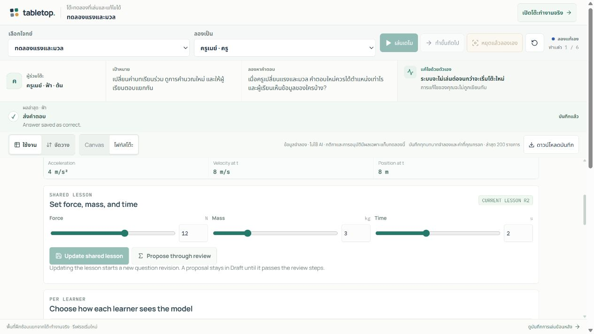

# Tabletop — Interactive Auto demo release

- เผยแพร่ 19 ตุลาคม 2569 เวลา 10:29 (Asia/Bangkok)
- Source commit: 34bd07e868c0de636be6c405a0e9e9c25337c633
- Worker version: 89a4c92c-1c7a-44de-a59b-4b251f034b4f
- Repository: https://github.com/Thanyers/tabletop · branch feat/tabletop-r1 · main ไม่เปลี่ยน
- Environment: existing Cloudflare Workers Free + D1 + SQLite Durable Objects; Google auth และ server-side AI secrets เดิม

[เปิดโต๊ะทดลอง](https://tabletop.ptchrr.workers.dev/demo) · [บันทึกย้อนหลัง](https://tabletop.ptchrr.workers.dev/demo/replay) · [Draft PR #2](https://github.com/Thanyers/tabletop/pull/2) · [CI pull_request](https://github.com/Thanyers/tabletop/actions/runs/39194316436) · [CI push](https://github.com/Thanyers/tabletop/actions/runs/39194312042)

## พฤติกรรมที่ส่งมอบ

- หน้า /demo ใช้ Canvas และ workbench ชุดเดียวกับโต๊ะจริง พร้อม domain engine จริงในแต่ละแท็บ มี 3 โจทย์: ตรวจบิลและแก้กติกา, แรงและมวล, และช่วยเพื่อนด้วยโล่
- เล่นเดโมและทำขั้นถัดไปส่งคำสั่งแล้วคำนวณสถานะใหม่; หยุดเดโมพักและเดินต่อได้ ส่วนหยุดแล้วลองเองหรือเริ่มใช้ช่องกรอก/ปุ่มบนโต๊ะรับช่วงต่อทันที
- หลังรับช่วงต่อ สคริปต์ไม่กลับมาทับการแก้ไข ต้องยืนยันเริ่มใหม่เพื่อเดินสคริปต์อีกครั้ง; สลับบทบาทจำลองเพื่อลองมุมมองครู/ผู้เรียน หรือ DM/Mira/Pip ได้
- ดาวน์โหลดประวัติล่าสุด 200 รายการพร้อมคำสั่งและค่าที่กรอกของทุกบทบาทจำลอง รวมข้อความที่กรอกเป็นครูหรือ DM; ไฟล์ระบุจำนวนรายการเก่าที่ไม่ได้รวมไว้
- เดโมใช้ข้อมูลจำลอง ไม่เรียก AI และไม่บันทึกห้องบนเซิร์ฟเวอร์; รีเฟรชหรือปิดแท็บเริ่มใหม่ ผู้ที่ต้องการบันทึกห้องและชวนเพื่อนใช้หน้าหลักหลังล็อกอิน
- บันทึกเล่นย้อนหลังเดิมทั้ง 9 เรื่องยังอยู่ที่ /demo/replay; การเปิดกติกาในพื้นที่ฝึกมีผลเฉพาะแท็บ ไม่ใช่ server approval หรือการทดสอบ identity security

## ผลตรวจ

| ผล | ขอบเขต | หลักฐานและข้อจำกัด |
| --- | --- | --- |
| PASS | Unit / SQL | 276/276 tests ผ่าน; รวมการหยุด timer, คำสั่งจากผู้เล่น, แยกแท็บ/บทบาท และขอบเขตประวัติ 200 รายการ |
| PASS | Workers / D1 / Durable Objects | 41/41 tests ผ่านบน runtime จำลองใน CI |
| PASS | Browser CI | 7 กลุ่มตรวจ Node และ 10 กลุ่มตรวจ Workers ผ่าน; ใช้บัญชีและ model จำลอง ไม่ใช่ acceptance ของบัญชีจริงบน production |
| PASS | รับช่วงต่อโดยตรง | เล่น → พัก → เล่นต่อ → กรอก 12 N / 3 kg / 2 s → ผล 8 m; ค่าช่องแรกคงอยู่ และ timer ไม่กลับมาทับหลังรับช่วงต่อ |
| PASS | เกมฝึก | เล่นกติกาใหม่และรับช่วงเอง: Mira ยกโล่ให้ Pip, DM ตัดสินผล, Pip เหลือ 8/10 HP; นาฬิกาฝึกไม่หมดเวลาเมื่ออ่านเกิน 30 วินาที |
| PASS | ขอบเขตเดโม | CI ไม่พบ API/internal/external requests, WebSocket, cookie หรือ provider call จากเดโม; จำนวน users, sessions และ rooms ในฐาน disposable ไม่เปลี่ยน |
| PASS | หน้าจอแคบ | CI viewport 304 × 844 CSS px แก้ค่าบนโต๊ะได้และไม่มี horizontal overflow; ไม่ใช่การรับรองอุปกรณ์มือถือจริงทุกแบบ |
| PASS | Hosted HTTP / assets | 40 ข้อตรวจผ่าน รวม deep links, CSP, auth gate และ hash ของไฟล์เว็บที่เผยแพร่ตรงกับ build |
| PASS | Hosted interaction | เดสก์ท็อป 1280 × 720 เปิดโต๊ะทดลองโดยไม่ล็อกอิน; ตรวจบิลเดินครบ 6 ขั้น: Active r1, expected THB 80.00, difference THB 10.00, unknown 2; เล่นอัตโนมัติ พัก และเริ่มใหม่ได้; กรอกตรงระหว่างเล่นรับช่วงต่อเป็น manual โดยคง 12 N / 3 kg / 2 s และผล 8 m; สลับเป็นผู้เรียนไม่เห็นช่องหมายเหตุครู และส่งคำตอบ 8 ได้ Correct; กลับเป็นครูยังเห็นผลเดิม; หน้าจอแคบ 304 px แก้ค่า 12/3/2 ได้ 8 m และ scrollWidth เท่ากับ clientWidth 304; เกม: หยุดขั้น 6/8, สลับ Mira ยกโล่ให้ Pip, กลับ DM ตัดสินผล ได้ Pip 8/10 HP และ Mira 1 AP; แท็บฟิสิกส์กับแท็บเกมคงสถานะเป็นอิสระระหว่างเล่น; ลิงก์ /demo/replay เปิดประวัติเดิม 9 เรื่องและปุ่มไปจังหวะถัดไปทำงาน; รีเฟรช /demo กลับ ready และ 0/6 โดยไม่เปิด session ห้องจริง; ไม่พบ console error ในแท็บ desktop และ narrow ที่ตรวจ; กราฟ workbench มี SVG และขนาด 1041.7 × 205 px |
| PASS | Runtime และ secrets | readback ของ bindings/settings ตรงก่อนเผยแพร่; ไม่มี migration, resource ใหม่ หรือ secret mutation; คงแผน Free และเพดาน AI เดิม $1/day UTC, $10/month UTC |
| PASS | Independent review | ตรวจ runtime, UI ร่วม, timer, projection, history export และการรับค่าครั้งแรกโดย reviewer ที่ไม่แก้ไฟล์; ไม่มี finding ค้าง |
| SKIPPED | Hosted multiplayer / AI รอบนี้ | ไม่ได้สร้างหรือแก้ห้องจริง ไม่เรียก DeepSeek และไม่ได้ทดสอบสองบัญชีจริงบน production ในรอบ frontend นี้ |
| SKIPPED | Rollback / recovery | เก็บ version ก่อนหน้าเพื่อย้อน runtime แต่ไม่ได้สลับกลับจริงหรือทดสอบกู้ข้อมูลข้าม D1 และ Room |
| SKIPPED | Offline report browser render | Browser URL policy ไม่อนุญาตให้ CUA เปิด file: ในรอบนี้ จึงตรวจโครงสร้าง เนื้อหา และภาพฝังจากไฟล์โดยตรง การตรวจหน้าแอป HTTPS ด้านบนเป็นคนละขอบเขตและรันแล้ว |

## ข้อจำกัดและสิ่งที่ยังไม่ได้ทดสอบ

- หน้าโต๊ะเล่นได้ในขอบเขต Invoice ตัวอย่าง, ฟิสิกส์ F=ma และ encounter แบบเทิร์น/โล่ที่รองรับ ยังไม่ใช่ตัวแก้โจทย์ข้อความอิสระหรือ D&D เต็มระบบ
- Production ยังคงปิดการอัปโหลดไฟล์; ปุ่มรายงานจริงในพื้นที่ฝึกให้ใช้การดาวน์โหลดประวัติการลองแทน
- CI รอบก่อนยังไม่ผ่าน: พบการกรอกค่าแรกหายขณะรับช่วงต่อ จังหวะรอ autofocus ของ dialog และการเทียบข้อความนาฬิกาคนละรูปแบบในตัวทดสอบ แก้แล้วและตรวจกรณีเดิมใน CI ของ source ที่เผยแพร่
- Build ผ่าน แต่ยังมีคำเตือนขนาด bundle ของหน้า legacy ที่เกิน 500 kB; รอบนี้ไม่มี load test หรือ latency benchmark จึงไม่รับรอง capacity/performance ทุกระดับ
- บนเว็บจริงพบ Recharts warning ขนาดกราฟเป็นศูนย์ระหว่างสลับมุมมอง/บทบาท แต่กราฟใน workbench ที่เปิดมี SVG และขนาด 1041.7 × 205 px; ไม่พบ console error ที่หยุดการเล่น การเก็บ warning นี้ให้หมดเป็นงานค้าง
- ระดับส่งมอบ: Local Verified และ Hosted E2E Verified เฉพาะ public practice ที่ระบุ เหมาะสำหรับ Limited Public Testing; ยังไม่มีหลักฐานครบสำหรับ Production Ready ทั้งระบบ

## ย้อนรุ่นและหลักฐาน

ย้อน Worker กลับ version b0108b5d-8b3a-4ab2-a3c4-e100a97e2217 หากจำเป็น โดยตรวจว่า version ปัจจุบันยังเป็น 89a4c92c-1c7a-44de-a59b-4b251f034b4f ก่อนดำเนินการ การย้อน runtime ไม่ย้อนข้อมูล D1/Room ไม่มี migration ในรุ่นนี้ และยังไม่ได้ทดลอง rollback จริง

หลักฐานรายรอบอยู่ใน ignored test-results/interactive-demo-release-2026-10-19 และ test-results/interactive-demo-ci/<commit> ในเครื่องนี้; ไม่เผยแพร่ credential values หรือภาพห้องจริง บันทึก/รายงานรุ่นก่อนคงไว้แยกต่างหาก
