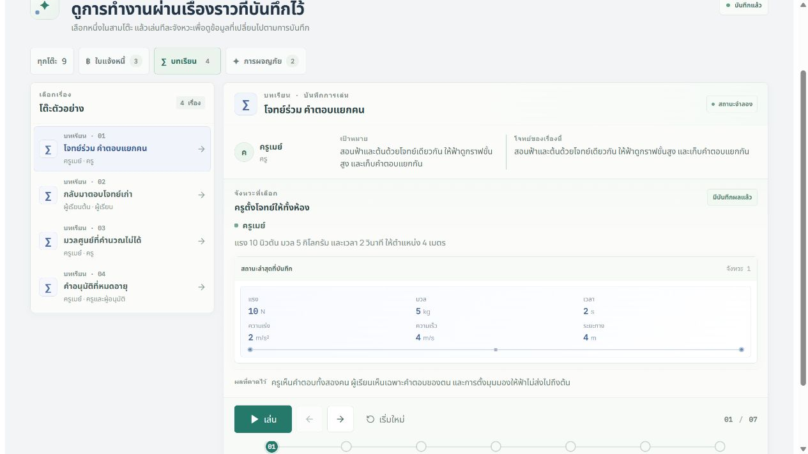

# Tabletop — Public Auto demo release

เผยแพร่ 19 ตุลาคม 2569 เวลา 09:21 (Asia/Bangkok)

เปิด [Auto demo](https://tabletop.ptchrr.workers.dev/demo) ได้โดยไม่ล็อกอิน ปุ่มอยู่ที่หน้าล็อกอิน หน้ารวมโต๊ะ และโต๊ะที่เปิดอยู่ บนหน้าจอแคบ ปุ่มของโต๊ะอยู่ในเมนูเลือกโต๊ะ ลิงก์เปิดแท็บใหม่เพื่อเก็บงานที่ทำค้างไว้

## พฤติกรรมที่ส่งมอบ

เลือกเรื่องจากสามกลุ่ม: ตรวจบิล ห้องเรียน และเกมร่วมมือ มี 9 persona/โจทย์ ไม่จำกัดอยู่ที่ DnD ใช้ปุ่มเล่น/หยุด ย้อน/ไปต่อ เริ่มใหม่ และ timeline เพื่อดูค่าจาก checkpoint ที่บันทึกไว้ ขั้นที่ไม่มีภาพสถานะใหม่จะแสดง checkpoint ล่าสุดพร้อมเลขจังหวะต้นทาง การ reload เริ่มที่เรื่องแรก

นี่คือข้อมูลจำลองจากรอบทดสอบที่เลือก ไม่ใช่ live AI หรือห้องที่แก้ข้อมูลได้ จึงไม่ใช้โควตา AI เมื่อกดเล่น ผู้ที่ต้องการสร้างโต๊ะ ชวนคน หรือเปลี่ยนกติกาจริงให้กลับหน้าหลักและล็อกอิน

## รุ่นและหลักฐาน

- Source ที่ deploy: `86bd297cd6c86ff0fa46c310e5b0c1ba90c05f76`
- Cloudflare Worker version: `b0108b5d-8b3a-4ab2-a3c4-e100a97e2217`
- Previous version สำหรับ rollback: `dfdc8c72-2fc2-4344-92c1-44fbc48d80d0`
- [Draft PR #2](https://github.com/Thanyers/tabletop/pull/2); main ไม่เปลี่ยน และ CI ไม่ deploy อัตโนมัติ
- [CI pull_request](https://github.com/Thanyers/tabletop/actions/runs/39189028362): success
- [CI push](https://github.com/Thanyers/tabletop/actions/runs/39189024980): success
- [คู่มือ Auto demo](../../../docs/AUTO_DEMO.md)
- [JSON archive ต้นทาง](../auto-demo/0926de9d-b570-4229-a6a9-3e10f5e2d7d8/run.json): 9 scenarios / 166 checks; เป็นบันทึก local synthetic ที่ระบุ sourceDirty ไม่ใช่ hosted acceptance
- SHA-256 ของ JSON archive: `1137b7b657c058bfd40c34dd56fe9686ab0cf6d50d53dfeba4f25008536bc864`

## ผลตรวจ

| ผล | ขอบเขต | หลักฐานและข้อจำกัด |
| --- | --- | --- |
| PASS | CI ของ source ที่ deploy | PR และ push ผ่านครบ: unit/SQL, typecheck/build, Worker/D1/DO, persona runner และ browser acceptance ทั้ง Node/Workers ใช้ identity และ model จำลอง |
| PASS | หน้า Auto demo สาธารณะ | เปิด /demo ก่อนโหลดระบบบัญชี มี 9 เรื่องจาก 3 กลุ่ม รวม 55 จังหวะ; กรอง เลือกเรื่อง เล่น หยุด ย้อน ไปต่อ เริ่มใหม่ และเลือกจังหวะได้ |
| PASS | ไม่มีผลข้างเคียงจากการเล่นเดโม | การทดสอบ anonymous browser ไม่พบ API/internal/external requests, WebSocket, cookies หรือ provider calls; จำนวน users, sessions และ rooms ในฐาน disposable ไม่เปลี่ยน |
| PASS | หน้าจอแคบ | CI ใช้ viewport 304 × 844 CSS px เปิดใหม่ เล่น และย้อน โดยไม่มี horizontal overflow; เป็น browser viewport ไม่ใช่อุปกรณ์มือถือจริง |
| PASS | เว็บที่เผยแพร่ | 30 รายการตรวจ HTTP/security/deep-link/asset ผ่าน; /demo และ /demo/ เปิดได้, /demo?legacy-demo=1 ยังเลือกหน้าเดโม; API ที่ต้องมีบัญชียังปฏิเสธผู้ไม่ล็อกอิน |
| PASS | ปุ่มและการเล่นบนเว็บจริง | กด Auto demo จากหน้าก่อนล็อกอิน เปิดแท็บใหม่สำเร็จ; เล่นอัตโนมัติและหยุดเมื่อจบ หยุดชั่วคราว ย้อน/ไปต่อ เริ่มใหม่ กรองกลุ่มและเลือกจังหวะได้; เลือกครบ 9 เรื่องและตรวจจังหวะสุดท้าย; reload กลับเรื่องแรก; IAB 304 CSS px ไม่ล้นหน้า และไม่พบ console error/warning หลัง interaction |
| PASS | คง runtime เดิม | Worker ใช้ D1 และ Room/Billing bindings เดิม; readback ของ bindings และ settings ตรงก่อนอัปเดต ไม่มี secret mutation หรือ database migration; แผนที่เลือกยังเป็น Free, AI cap $1/day UTC และ $10/month UTC |
| PASS | แหล่งข้อมูลและคีย์ | Build ตรวจ SHA-256 ของ archive จำลองที่เลือกและ projection ที่สร้าง; known-credential scan ผ่าน source/build/Git; ไฟล์เผยแพร่ไม่มีประวัติห้องจริงหรือ credential values |
| SKIPPED | AI และ multiplayer จริงในรอบนี้ | รอบนี้ไม่เรียก AI, ไม่สร้าง/แก้ห้องจริง และไม่รันเกมสองบัญชีบน production; การเล่นเดโมเป็น recorded playback |
| SKIPPED | Rollback/recovery จริง | เก็บ previous version ไว้สำหรับ rollback แต่ไม่ได้สลับกลับจริงหรือทดสอบกู้ข้อมูล D1/Room ข้าม store |

## เก็บประวัติและย้อนรุ่น

Archive JSON/HTML เดิมยังอยู่ครบ หน้า public ใช้เฉพาะ projection ที่เลือกไว้และตรวจ hash ระหว่าง build ไม่อ่าน latest run หรือประวัติห้องจริง การอัปเดตนี้ไม่มีคำสั่ง Reset ห้อง และไม่มี migration ฐานข้อมูล

การ rollback หมายถึงเปิด Worker version ก่อนหน้าอีกครั้ง ไม่ได้ย้อนสถานะข้อมูลของ D1/Room ตาม [Cloudflare rollback documentation](https://developers.cloudflare.com/workers/versions-and-deployments/rollbacks/) จึงเก็บ rollback pin และการตรวจ settings แยกจากการกู้ข้อมูล รายงานนี้ไม่ได้รับรอง cross-store recovery หรือ all-case production acceptance

รายงานรอบ 18 ตุลาคมและประวัติเปิดกติกาเดิมคงไว้เป็นคนละหลักฐาน ภาพของบัญชีจริงอยู่เฉพาะ ignored local evidence; หน้าเดโมและภาพ public demo ใช้ข้อมูลจำลองเท่านั้น
